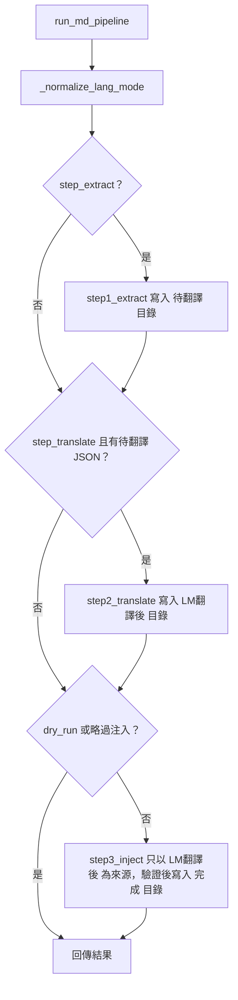

# Markdown 三步驟核心流程（`run_md_pipeline`）

`translation_tool/core/md_translation_assembly.py` 的 `run_md_pipeline` 把 Markdown 抽取（Step 1）、LM 翻譯（Step 2）、寫回（Step 3）組成一個三步驟流程，
以檔案（`待翻譯`、`LM翻譯後`、`完成` 三個資料夾）傳遞中間結果。任務翻譯頁的 Markdown 分頁使用 ModDB 流水線
（見 [md-moddb-pipeline.md](md-moddb-pipeline.md)），頁面不呼叫這個流程；本流程供續跑框架測試（`tests/test_plugin_resume_e2e.py`）與命令列使用。
無語言資料夾指南的辨識（`neutral_guide_index`、`iter_md_files`）與段落切分兩邊共用。

## 流程（`run_md_pipeline`）

Markdown 抽取階段已把色碼與物品 ID 換成佔位符並記在待翻譯 JSON 的 `_shields`；翻譯輸出的逐檔 JSON 必須原樣帶回 `_shields`（`PendingItem.shields`），注入階段才能還原。`translation_map_md.json` 是翻譯記錄，注入不會把它當成待注入檔。

Markdown 只有 `DONE` 才能把翻譯結果寫入完成目錄；`PARTIAL`、`FAILED`、`CANCELLED` 不使用 pending JSON 當作完成輸出，也不執行最終注入。

Step 1 與 Step 3 之間靠檔案內容保持一致，所以單獨續跑任一步都安全：

- 同一個輸出（`完成/…/zh_tw/…`）只能有一個來源：`en_us` 與 `zh_tw` 同名檔（資料夾名稱不分大小寫，底線前綴要一致）視為一對，以 `zh_tw` 為底稿、`en_us` 檔不產生 pending，所以已翻譯的段落不會退回英文。`non_cjk_only` 只把 `zh_tw` 裡 `content_hash` 與英文原文相同的區塊送翻，不靠 CJK 字元、也不做位置對齊；英文與繁中區塊數不同時只警告（`structure_mismatch`），英文新增的段落不會自動補進繁中。同語系出現多份（例如大小寫不同的兩個 `zh_tw` 資料夾）會寫到同一個輸出，全部略過並記入 `output_conflicts`。想從英文整份重翻，要把 `zh_tw` 檔移出輸入資料夾。Step 3 同一輪內若第二份譯後 JSON 對應到已寫過的輸出，略過並計入 `skipped_output_conflict`。被 `zh_tw`／`zh_cn` 底稿取代的舊英文譯後檔是預期的略過，計入 `skipped_superseded`，不會觸發「有 N 個檔案沒有更新」警告。
- 完成檔的人工修改保護（`md_output_guard.py`）：Step 3 每寫一個完成檔就把內容雜湊記在 `完成/.md_output_hashes.json`；下次要覆寫時，若檔案內容與上次寫入的不同（使用者手動改過），不覆蓋、計入 `skipped_manual_edit` 並警告，刪除或移走該檔即可重新產生。沒有紀錄的既有完成檔（舊版產生）照常覆寫並開始記錄。
- 無語言資料夾的指南（例如 `assets/advanced_ae/ae2guide/aae_intro/x.md`）視為英文來源（`neutral_guide_index`，`translation_tool/plugins/md/md_extract_qa.py`）：位置只看資源包結構，不靠資料夾名稱清單——路徑要是 `assets|data/<模組>/<資料夾>/…`，內容根目錄是模組底下第一層資料夾；叫 `guides` 時（GuideME 預設的 `guides/<模組>/<指南 id>/`）是往下兩層（`guides/powah/book/_zh_tw/…`）。是不是指南敘述文字靠內容判斷（`iter_md_files`）：先過 `sniff_text_file`（README、CHANGELOG、LICENSE 等專案文件名稱、`textures` 等原版規格資料夾、JSON 內容、沒有敘述段落的檔案不收），再確認是英文原文——非拉丁字母（中日韓、俄文等）佔字母 1% 以上就不收，內文英文停用字比例（`english_stopword_ratio`）低於 0.12 也不收，所以西、德、法文不會被當英文；內文英文單字少於 8 個（只有標題、連結、元件）時無從用停用字判斷，只要出現帶重音的拉丁字母（é、ç、ã、ş）就不收，否則不擋；希臘字母（μ、Ω）不算非拉丁。已知限制：英文夾雜外語段落的混合檔會通過；整頁都是物品清單、沒有停用字的英文頁會被略過。沒有語言標記的 `lang/` 資料夾不算指南。內容判斷不處理授權全文與設定檔：它們若檔名不是專案文件名稱，仍會被當成英文敘述送翻。繁中輸出放在內容根目錄下的 `_zh_tw/`；其他語言的底線資料夾（`_es_es/`）不處理；同層已有 `_zh_tw` 檔時照 `zh_tw` 為底稿的規則配對，與 `_en_us` 並存則輸出身分相同、視為同語系衝突而兩份都略過。只看相對於輸入資料夾的路徑，所以輸入資料夾本身就是 `ae2guide` 時抽不到，請改選含 `assets` 的上一層；輸入資料夾底下是多個解壓後的 jar 資料夾（`jar1/assets/…`）時同樣抽不到，要逐個選到含 `assets` 的那一層。內容根目錄之下任何一層資料夾或檔名若長得像語言碼（de、de_de、es-es，或底線開頭的 _fil_ph、_lzh；檔名主幹就是語言碼，或以「底線加兩段語言碼」結尾），無法確定是不是其他語言，一律略過，寧可漏掉也不當英文送翻。已知限制：不帶底線的三字母語言碼資料夾（如 lzh）無法辨識，兩字母的章節資料夾名稱（如 ui、me）會被略過；GuideME 的其他語言資料夾都帶底線，所以前者風險低。
- 路徑語言資料夾是 `zh_cn` 的檔案（`is_zh_cn_source`）不產生 pending：Step 3 只寫 `en_us`／`zh_tw` 來源，`zh_cn` 檔送翻只是白花 API。沒被採用為底稿的 `zh_cn` 檔，不論 `lang_mode`，Step 1 都略過並計入 `zh_cn_skipped`；舊版留下的 `zh_cn` pending 由過期清理移除。
- 只有 `en_us` 與 `zh_cn`、沒有 `zh_tw`，且 `lang_mode` 為 `non_cjk_only` 時，`zh_cn` 可當底稿（`md_pipeline_zh_cn.py`）：先用文件骨架（區塊數與種類、連結網址、行內程式碼、`§` 代碼、標籤名稱、圍欄程式碼、圖片網址、frontmatter key）檢查兩份是否對齊。對齊才採用：只把仍與英文相同的殘留區塊送 LM，Step 3 再整檔簡轉繁（OpenCC s2twp 加替換規則，圍欄程式碼不動、行數不變）後填入 LM 譯文，輸出寫到 `zh_tw`。不對齊就退回英文整份送翻，並記入 `zh_cn_unaligned`。`zh_tw` 優先於 `zh_cn`；同語系的 `zh_cn` 重複視為衝突。pending 頂層的 `base` 記錄底稿語言與兩份來源的 sha1，Step 3 驗證兩份來源的 sha1，與現行來源不同就以 `skipped_stale_source` 略過；譯後檔與 pending 的 `base` 不同則以 `skipped_pending_mismatch` 略過。Step 2 沒有要翻的區塊時仍會寫出狀態為 DONE 的譯後檔（`_write_passthrough_docs`），Step 3 才有東西可寫。成功寫入的計入 `written_from_zh_cn`；已採用的 `zh_cn` 檔列在 `zh_cn_based_docs`。
- 已知限制：對齊檢查只比結構，不比段落內容；英文新增句子、元件屬性（例如物品 id）改變、段落順序對調，都不會被判為不對齊，輸出沿用 `zh_cn` 的舊內容。簡轉繁的結果沒有經過 LM 校對；整份已翻好的 `zh_cn` 仍要跑 Step 2 才會寫出 DONE 譯後檔，但沒有區塊要送 API（零區塊直通）或 dry-run 時不檢查 API 金鑰，只有真的要呼叫 API 時才需要有效金鑰。
- Step 1 以原子寫入產生 pending JSON，全部寫完後才清掉「本輪沒重寫」的 `md_pending_blocks_v1` 檔案（來源已刪除、改為零區塊、換了輸入資料夾）；只動 schema 符合的檔案，其他 JSON 不碰，結果記在 `stale_removed`。換輸入資料夾時會警告。
- Step 2 的 `translate_md_pending` 把 `out_dir` 當作譯後資料夾本身：譯後 JSON 與 `translation_map_md.*` 直接寫在 `LM翻譯後/<相同子路徑>.json`。舊版會多建一層同名資料夾（`LM翻譯後/LM翻譯後/`），Step 2 開始時由 `remove_legacy_nested_translated` 清掉那層的 `md_pending_blocks_v1` 與對照表（其他檔案不動）；尚未重跑 Step 2 時，Step 3 仍能讀到舊層的譯後檔。
- Step 2 寫出的譯後 JSON 帶 `step2_status`；失敗、額度用完、取消時仍會寫出保留原文的半成品供檢視，但狀態不是 `DONE`。
- Step 3 只讀 `LM翻譯後` 的譯後 JSON，沒有時回報 `no_translated_json` 並略過（不再退回注入 pending 的英文原文）。每個譯後 JSON 注入前由 `verify_translated_doc` 驗證，不符就略過該檔並保留 `完成` 內上一次的結果：`skipped_incomplete`（Step 2 沒有 `DONE`）、`skipped_pending_mismatch`（找不到對應 pending，或區塊身分與現行 pending 不同，例如來源刪除、`lang_mode` 改變、`zh_tw` 對照檔後來已翻好）、`skipped_stale_source`（原始檔對應行範圍重算的 `content_hash` 與抽取時不同）。沒有 `step2_status` 的舊檔視為可用，來源驗證仍會把關。
- `source_md` 與輸出路徑都要通過 `is_safe_relative_path` 與 `is_inside`（不得是絕對路徑、含 `..` 或越出根目錄），否則計入 `skipped_unsafe_path`。
- 掃描譯後資料夾時排除 `translation_map_md*` 與 `_md_dry_run*`（翻譯記錄與 dry-run 預覽）。
- 注入由後往前套用所有區塊（`apply_items_to_md_lines`）：譯文行數比原文多時插入在區塊最後一個文字行之後，比原文少時刪除多餘的原文行（不留空白行）；譯文沒有內容時保留原文。注入端判斷文字行與抽取器共用 `is_translatable_text_line`。

## 各步驟細節（`translation_tool/core/md_translation_steps.py`，由 `md_translation_assembly.py` 的 `run_md_pipeline` 組裝）
- **Step1 Extract**（`step1_extract_impl`）：掃描 MD 檔，依 `lang_mode` 過濾後抽取區塊，寫入 `pending_dir/<rel_md>.json` + `_manifest.json`（schema `md_pending_manifest_blocks_v1`）
  - 無語言資料夾的指南（`assets|data/<模組>/<資料夾>/…/x.md`）由 `neutral_guide_index` 以資源包結構認定位置、`iter_md_files` 以 `sniff_text_file` 的內容判斷認定是指南，`map_rel_lang_path`／`map_lang_in_rel_path_allow_zh` 把輸出放到內容根目錄下的 `_zh_tw/`；不使用資料夾名稱清單；
  - 有對應的 `zh_tw` 檔時（`plan_sources`，`translation_tool/core/md_pipeline_pairing.py`）以 `zh_tw` 為底稿：`en_us` 檔不產生 pending；`non_cjk_only` 只挑 `content_hash` 與英文檔區塊相同的 `zh_tw` 區塊（`select_untranslated_blocks`），不靠 CJK 判斷；區塊數不同記入 `structure_mismatch`、無法確定的舊英文記入 `ambiguous_kept`；同語系重複（輸出會互相覆蓋）記入 `output_conflicts` 並全部略過；沒有 `zh_tw` 時 `zh_cn` 若與英文骨架對齊（`check_zh_cn_alignment`，`translation_tool/core/md_pipeline_zh_cn.py`）在 `non_cjk_only` 下當底稿（`build_base`，pending 頂層 `base`），Step 3 以 `convert_markdown_lines` 整檔簡轉繁後再填 LM 譯文（成功寫入計入 `written_from_zh_cn`）；Step 2 沒有區塊要翻時由 `_write_passthrough_docs` 直接寫出 DONE 譯後檔；不對齊記入 `zh_cn_unaligned` 並退回英文；其餘 `zh_cn` 檔（`is_zh_cn_source`）不產生 pending，計入 `zh_cn_skipped`
  - **去重複**：相同 `content_hash` 只留一份（`seen_hashes`，重複計入 `duplicate_blocks`）
  - **原子寫入與清理**：`write_json_atomic` 寫 pending；全部寫完後 `remove_stale_pending`（`translation_tool/core/md_pipeline_files.py`）清掉本輪沒重寫的 `md_pending_blocks_v1` 檔案，不動其他 JSON（`stale_removed`）
- **Step2 Translate**（`step2_translate_impl`）：`translate_md_pending_fn` 批次翻譯 pending JSON → translated_dir（dry_run / write_new_cache 透傳）
- **Step3 Inject**（`step3_inject_impl`）：讀原始 MD + 翻譯 JSON，逐區塊套用（`apply_item_to_md_lines_fn`）→ 寫入 final_dir
  - `map_lang_in_rel_path_allow_zh_fn` 回傳 `status` 只認 `SRC_EN` / `SRC_ZH`，其他狀態跳過（`skipped_lang_status`）
  - 來源 MD 不存在 → `skipped_missing_source`；保留原始結尾換行（`ends_with_nl`）
  - 只讀譯後 JSON；給了 `pending_dir` 時每檔先過 `verify_translated_doc`（`step2_status`、與現行 pending 的區塊身分、原始檔區塊 `content_hash`），不符則略過並計入 `skipped_incomplete`／`skipped_pending_mismatch`／`skipped_stale_source`，`完成` 內舊檔保留；寫入前用 `OutputGuard` 檢查完成檔是否被手動修改（`skipped_manual_edit`），被底稿取代的舊英文譯後檔計入 `skipped_superseded`
  - 路徑不安全（`is_safe_relative_path`／`is_inside`）→ `skipped_unsafe_path`
  - 區塊由後往前套用（`apply_items_to_md_lines`），多／少行時插入／刪除，不留空白行
- Markdown 只有 `DONE` 才可執行 Step3；`PARTIAL`、`FAILED`、`CANCELLED` 不使用 pending JSON 產生完成目錄，避免未完成翻譯被當成最終輸出。
