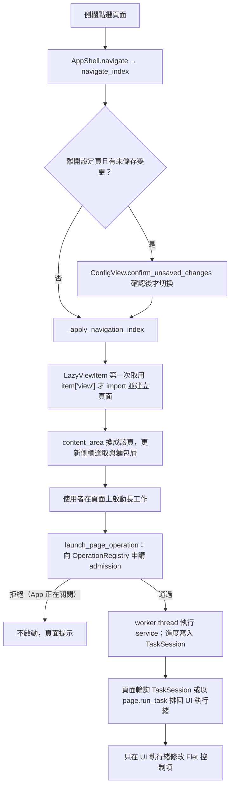

# 頁面處理流程

每個側欄頁面一份流程文件，描述「使用者操作 → 背景工作 → 結果回到畫面」的實際程式路徑。
元件與版面細節見 [`View 架構文件`](../developer-guide/views/) 下各頁的 `*_VIEW_ARCHITECTURE.md`；跨頁面的長任務規則見
[`../developer-guide/operation-lifecycle.md`](../developer-guide/operation-lifecycle.md)。

| 側欄 | key | 流程文件 | 入口 |
|---|---|---|---|
| 工作台 | `dashboard` | [dashboard.md](dashboard.md) | `app/views/dashboard_view.py` |
| 一鍵流水線 | `pipeline` | [pipeline.md](pipeline.md) | `app/views/pipeline/pipeline_view.py` |
| JAR 提取 | `extractor` | [extractor.md](extractor.md) | `app/views/extractor_view.py` |
| 語系合併 | `merge` | [merge.md](merge.md) | `app/views/merge_view.py` |
| 機器翻譯 | `lm` | [lm.md](lm.md) | `app/views/lm_view.py` |
| 任務翻譯 | `translation` | [translation.md](translation.md) | `app/views/translation_view.py` |
| KubeJS / FTB 流水線 | `kubejs_ftb_pipeline` | [kubejs_ftb_pipeline.md](kubejs_ftb_pipeline.md) | `app/views/kubejs_ftb_pipeline_view.py` |
| QC 檢驗 | `qc` | [qc.md](qc.md) | `app/views/qc_view.py` |
| 翻譯校對 | `icon_preview` | [icon_preview.md](icon_preview.md) | `app/views/icon_preview_view.py` |
| Mod 資料庫 | `moddb` | [moddb.md](moddb.md) | `app/views/moddb_view.py` |
| 快取管理 | `cache` | [cache.md](cache.md) | `app/views/cache_view.py` |
| 替換規則 | `rules` | [rules.md](rules.md) | `app/views/rules_view.py` |
| 學名查詢 | `lookup` | [lookup.md](lookup.md) | `app/views/lookup_view.py` |
| 資源包打包 | `bundler` | [bundler.md](bundler.md) | `app/views/bundler_view.py` |
| 設定 | `config` | [config.md](config.md) | `app/views/config_view.py` |

頁面清單與順序以 `app/view_registry.py` 的 `VIEW_SPECS` 為準；新增頁面時一併補上流程文件與本表。

## 共通流程

共通規則：

- 頁面只在第一次切換到該頁時建立（`build_view_registry` 回傳 `LazyViewItem`）。
- worker thread 不直接修改控制項或呼叫 `page.update()`；結果經 `page.run_task`、`UiBatcher` 或輪詢 `TaskSession` 回到 UI 執行緒（見 [`worker thread 稽核`](../developer-guide/worker-thread-audit.md)）。
- 背景結果套回畫面前，要比對啟動時擷取的識別（例如 generation、資料庫物件、清單批次）；不一致就丟棄，避免晚到的結果覆蓋目前狀態。
- 沒有組 `AppShell` 的測試頁面（缺 `operation_registry`）由 `launch_page_operation` 改走 fallback launcher。
