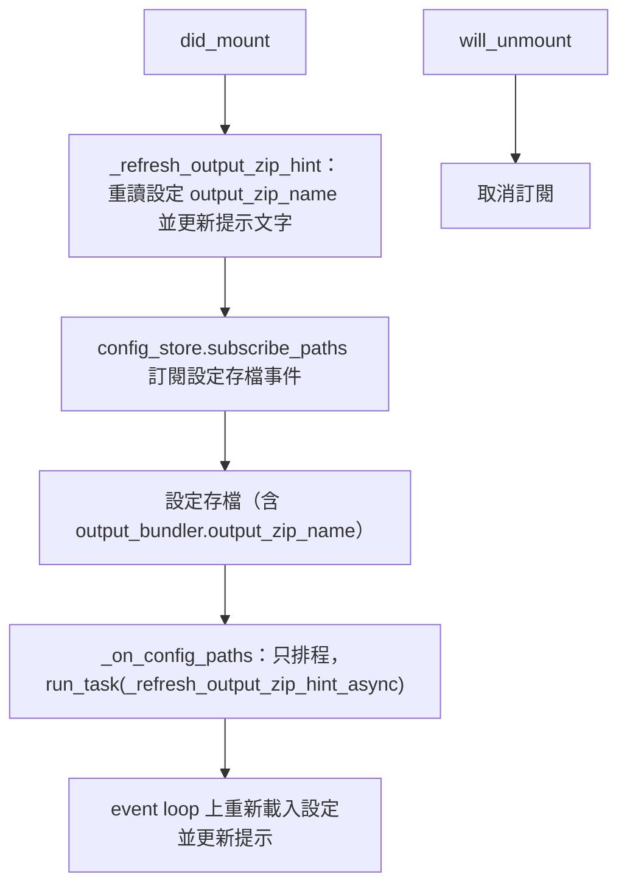
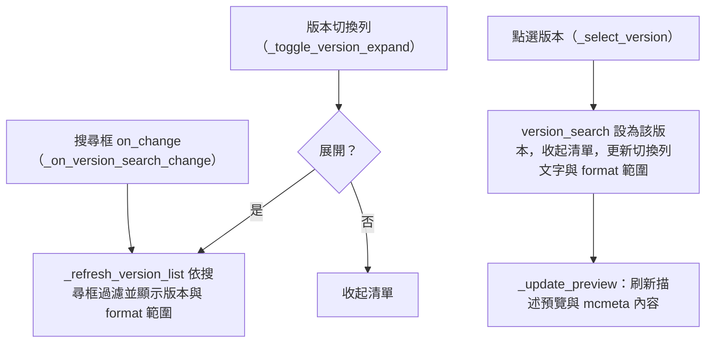
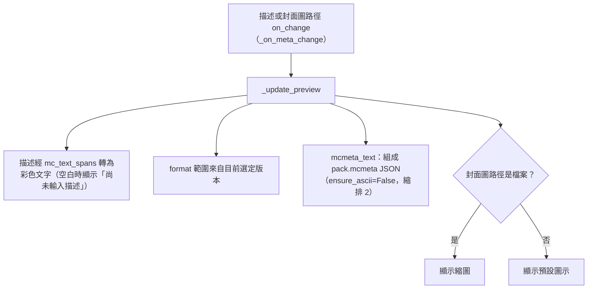
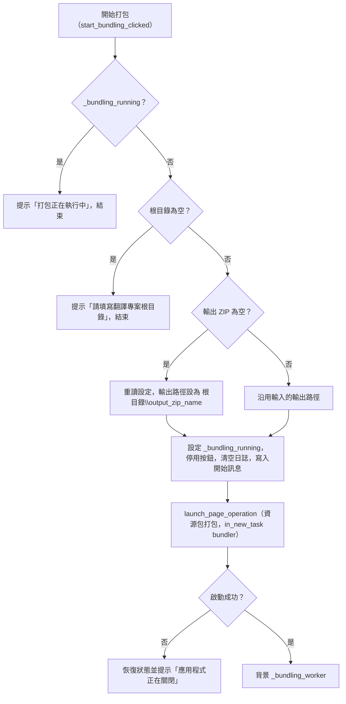
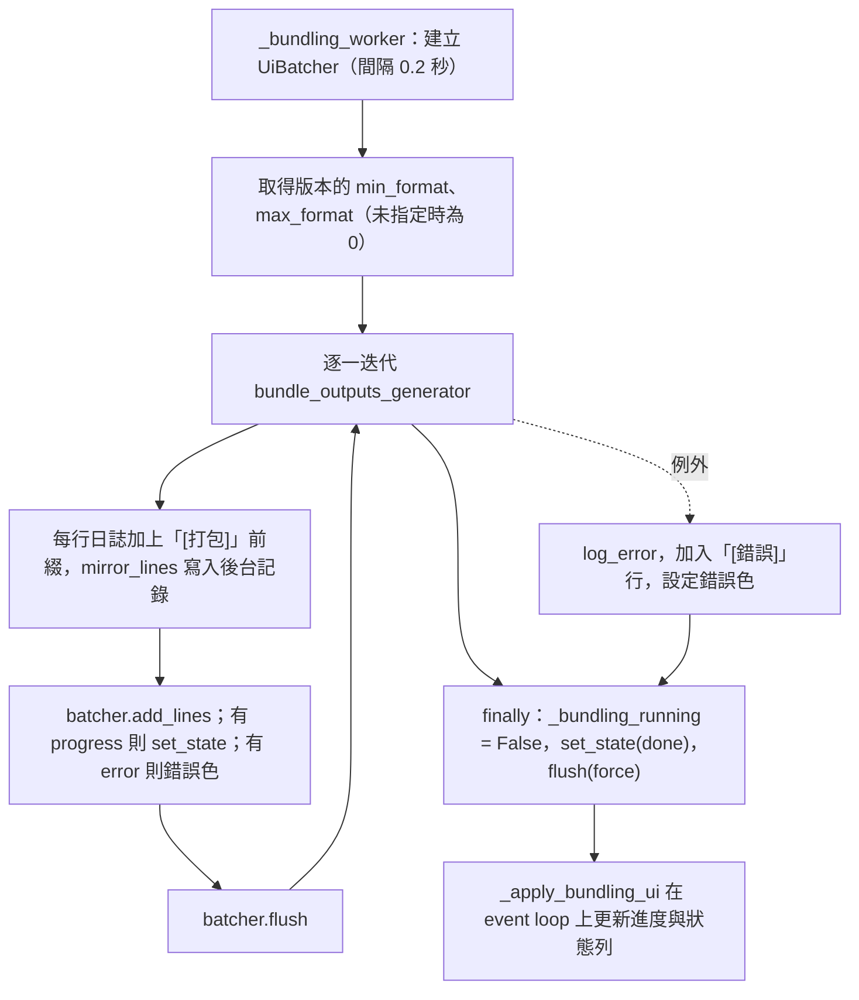
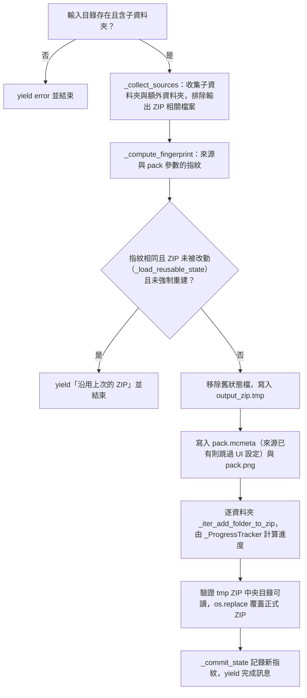

# 資源包打包頁（`bundler`）處理流程

> 入口：`app/views/bundler_view.py` 的 `BundlerView`。詳細元件說明見 [`BUNDLER_VIEW_ARCHITECTURE.md`](../BUNDLER_VIEW_ARCHITECTURE.md)。

## 職責

資源包打包頁把翻譯專案根目錄下各子資料夾的產出，連同額外資料夾與 `pack.mcmeta`、`pack.png`，打包成一個可直接放入遊戲的 ZIP。頁面負責：

- 選擇翻譯專案根目錄、輸出 ZIP 路徑（留空時自動帶入 `根目錄\<output_zip_name>`）、封面圖。
- 從 `resource_pack_version.json` 選擇 Minecraft 版本，決定寫入 `pack.mcmeta` 的 `min_format`、`max_format`。
- 新增、移除額外資料夾或檔案。
- 即時預覽描述（含 § 顏色碼）、版本格式與即將寫入的 `pack.mcmeta` 內容。
- 顯示打包日誌與進度。

打包本身由 `translation_tool/core/output_bundler.py` 的 `bundle_outputs_generator` 完成。`BundlerView` 直接呼叫它（經由 `app/services_impl/pipelines/bundle_service.py` 的 re-export），沒有使用 `run_bundling_service`，因此這一頁不經過 `GLOBAL_LOG_LIMITER` 節流。

控制項的版面由 `app/views/bundler/bundler_widgets.py` 的 `BundlerWidgetsMixin` 建構。

## 主要流程

### 頁面掛載與輸出檔名提示

`_on_config_paths` 可能在任何執行緒被呼叫，因此只排程，不直接改控制項。

### 版本選擇

`version_search` 同時作為搜尋框與「目前選定版本」的儲存位置，清單中被選中的版本會以勾號標示。

### 預覽與 pack.mcmeta

### 開始打包

### 背景打包與日誌

`bundle_outputs_generator` 內部的主要步驟如下：

## 背景任務與 UI 更新

- **背景任務**：`launch_page_operation`（owner `bundler`，`CancellationPolicy.NON_CANCELLABLE`，`CommitPolicy.PARTIAL_ALLOWED`，`DurabilityPolicy.USER_ACTION`，`ShutdownPolicy.DRAIN_ONLY`）。`in_new_task("bundler", …)` 為這次執行建立獨立的任務上下文，讓日誌能對應到此任務。
- **節流**：背景執行緒只把日誌與進度累積到 `UiBatcher`；`UiBatcher` 依 0.2 秒間隔（`_UI_FLUSH_INTERVAL_SEC`）把一批資料交給 `_apply_bundling_ui` 在 event loop 上套用，避免每一行都刷新畫面。
- **日誌顯示**：`LogView`（`app/views/_log/log_view.py`，`tail` 模式，保留最後 250 行）。`add_many` 批次寫入，`dedupe=False`。
- **旗標與按鈕**：`_bundling_running` 由 worker 的 `finally` 清除；`_apply_bundling_ui` 依此旗標設定開始按鈕的停用狀態。
- **檔案選擇器**：各選擇器的回呼（`_async_pick_*`）在 `run_task` 中執行，選取結果寫入對應欄位後只呼叫 `page.update()`。

## 狀態與資料

- **`version_data`**：從 `translation_tool/core/resource_pack_version.json` 讀入，格式為版本字串 → `{min_format, max_format}`。檔案不存在或讀取失敗時使用空字典，讀取失敗會記錄 `log_warning`。
- **`extra_folders`**：使用者新增的額外資料夾或檔案路徑清單，只存在記憶體中，打包時以副本傳入。
- **版本選擇**：`version_search.value` 即目前選定的版本；`version_expanded` 記錄清單是否展開。
- **輸出檔名**：`_config_output_zip_name` 來自設定 `output_bundler.output_zip_name`，預設 `可使用翻譯.zip`（`OUTPUT_ZIP_NAME_PATH` 為訂閱的設定路徑）。
- **打包狀態檔**：`_state_path(output_zip_path)` 記錄上次成功打包的指紋，供下次判斷是否可沿用既有 ZIP。
- **暫存檔**：打包期間寫入 `<輸出路徑>.tmp`，成功後以 `os.replace` 替換正式檔案，未完成則在 `finally` 中刪除。
- **pack.mcmeta**：內容來自 UI 的描述與版本 format；若來源資料夾或額外路徑中已有 `pack.mcmeta`，會跳過 UI 設定並在日誌中說明。`pack.png` 的處理方式相同。

## 錯誤處理

- **輸入驗證**：根目錄為空時提示並不啟動；輸出路徑為空時自動帶入。
- **重複執行**：`_bundling_running` 為真時，再次點擊只會提示「打包正在執行中」。
- **輸入目錄錯誤**：不存在或沒有子資料夾時，核心 generator 以 `error` 更新回報，worker 將進度條改為錯誤色，狀態列顯示「打包失敗，請查看日誌」。
- **打包中途失敗**：核心 generator 保留既有的有效 ZIP（尚未 `os.replace`），移除狀態檔使下次必定重建，並刪除暫存檔。worker 另外捕捉未預期例外，寫入「[錯誤]」行。
- **狀態檔寫入失敗**：不影響已成功的 ZIP，只在日誌中記錄「無法保存打包狀態」，下次會重新打包。
- **版本資料讀取失敗**：改用空版本資料。之後若未選定版本，或選定的版本不在資料中，`min_format` 與 `max_format` 都以 0 寫入。
- **應用程式關閉中**：啟動失敗時恢復開始按鈕、狀態列顯示「應用程式正在關閉，未啟動打包」並提示 snack。
- **注意（目前行為）**：`_async_pick_root_dir` 與 `_async_pick_pack_image` 設定欄位值後只呼叫 `page.update()`，不會重新計算輸出檔名提示或封面預覽，要等使用者再次輸入才會更新。
