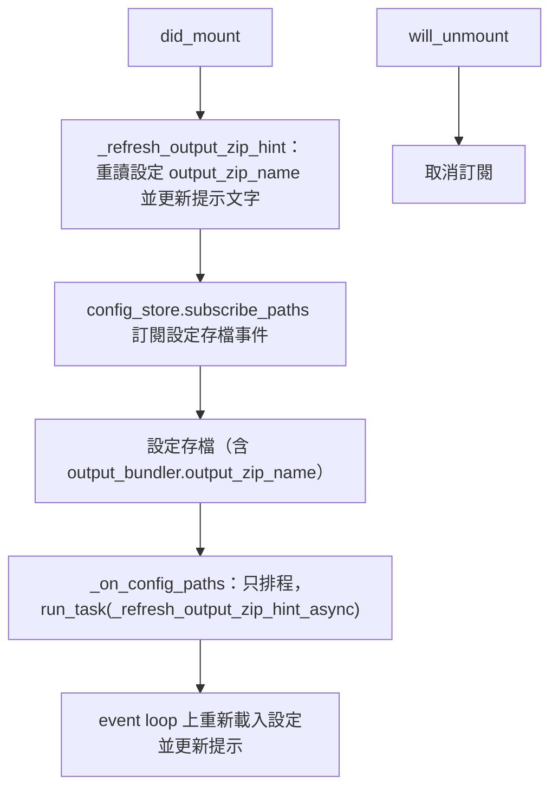
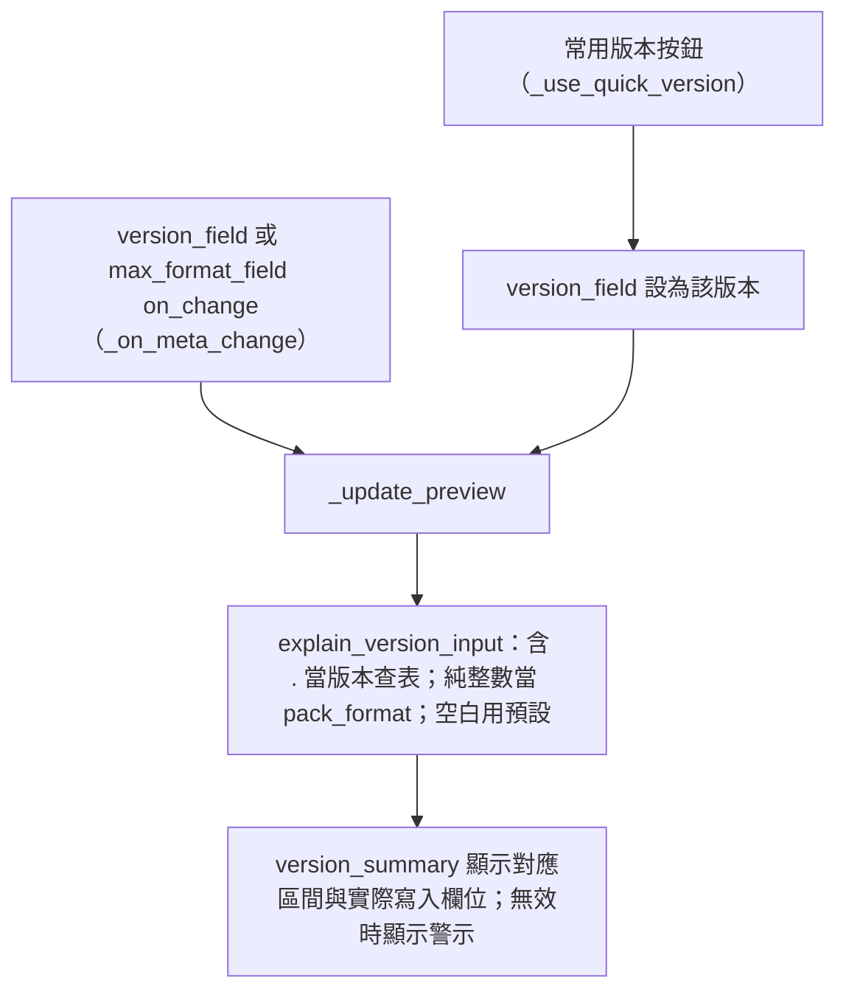
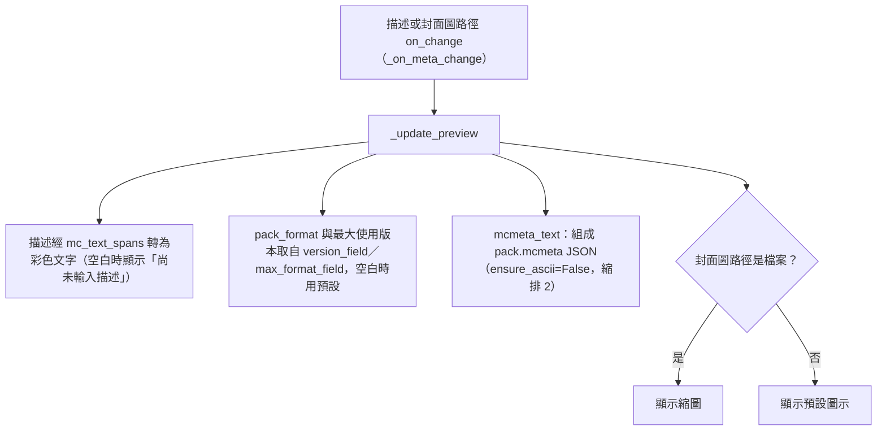
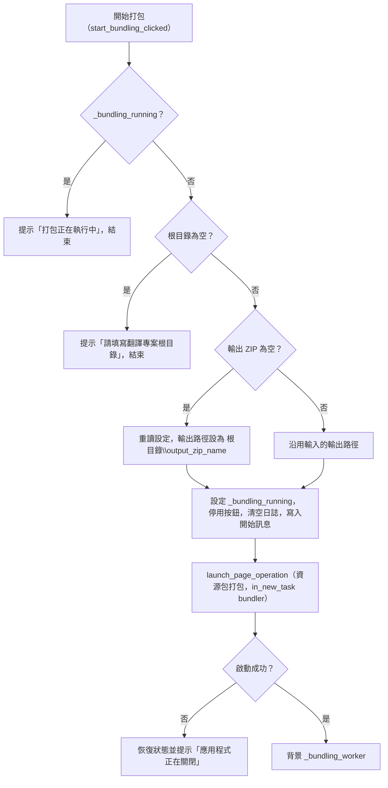
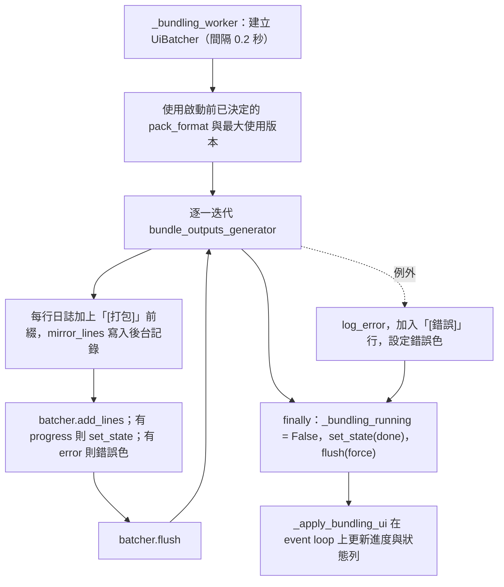
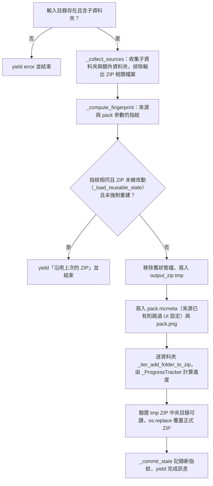

# 資源包打包頁（`bundler`）處理流程

> 入口：`app/views/bundler_view.py` 的 `BundlerView`。詳細元件說明見 [`View 架構文件`](../developer-guide/views/BUNDLER_VIEW_ARCHITECTURE.md)。

## 職責

資源包打包頁把翻譯專案根目錄下各子資料夾的產出，連同額外資料夾與 `pack.mcmeta`、`pack.png`，打包成一個可直接放入遊戲的 ZIP。頁面負責：

- 選擇翻譯專案根目錄、輸出 ZIP 路徑（留空時自動帶入 `根目錄\<output_zip_name>`）、封面圖。
- 在單一輸入框填 Minecraft 版本（如 `1.20.4`）或 `pack_format` 整數，換算出寫入 `pack.mcmeta` 的 `pack_format`（18～64 另寫 `supported_formats`；65 以上改寫 `min_format`／`max_format`）；選填「最大使用版本」取代預設上限。
- 新增、移除額外資料夾或檔案。
- 即時預覽描述（含 § 顏色碼）、版本格式與即將寫入的 `pack.mcmeta` 內容。
- 顯示打包日誌與進度。

打包本身由 `translation_tool/core/output_bundler.py` 的 `bundle_outputs_generator` 完成。`BundlerView` 直接呼叫它（經由 `app/services_impl/pipelines/bundle_service.py` 的 re-export），沒有使用 `run_bundling_service`，因此這一頁不經過 `GLOBAL_LOG_LIMITER` 節流。

控制項的版面由 `app/views/bundler/bundler_widgets.py` 的 `BundlerWidgetsMixin` 建構。

## 主要流程

### 頁面掛載與輸出檔名提示

`_on_config_paths` 可能在任何執行緒被呼叫，因此只排程，不直接改控制項。

### 版本輸入

`version_field` 是「目前選定版本」的唯一儲存位置；最大使用版本放在 `max_format_field`，空白代表使用預設上限。

### 預覽與 pack.mcmeta

### 開始打包

### 背景打包與日誌

`bundle_outputs_generator` 內部的主要步驟如下：

## 背景任務與 UI 更新

- **背景任務**：`launch_page_operation`（owner `bundler`，`CancellationPolicy.NON_CANCELLABLE`，`CommitPolicy.PARTIAL_ALLOWED`，`DurabilityPolicy.USER_ACTION`，`ShutdownPolicy.DRAIN_ONLY`）。`in_new_task("bundler", …)` 為這次執行建立獨立的任務上下文，讓日誌能對應到此任務。
- **節流**：背景執行緒只把日誌與進度累積到 `UiBatcher`；`UiBatcher` 依 0.2 秒間隔（`_UI_FLUSH_INTERVAL_SEC`）把一批資料交給 `_apply_bundling_ui` 在 event loop 上套用，避免每一行都刷新畫面。
- **日誌顯示**：`LogView`（`app/views/_log/log_view.py`，`tail` 模式，保留最後 250 行）。`add_many` 批次寫入，`dedupe=False`。
- **旗標與按鈕**：`_bundling_running` 由 worker 的 `finally` 清除；`_apply_bundling_ui` 依此旗標設定開始按鈕的停用狀態。
- **檔案選擇器**：各選擇器的回呼（`_async_pick_*`）在 `run_task` 中執行，選取結果寫入對應欄位後只呼叫 `page.update()`。

## 狀態與資料

- **版本對照表**：`translation_tool/core/pack_format_table.json`，由 `pack_format_lookup.load_table()` 讀入並快取。檔案不存在或損毀時使用空表並記錄 `log_warning`，此時輸入版本會提示改填 `pack_format` 整數。
- **`extra_folders`**：使用者新增的額外資料夾或檔案路徑清單，只存在記憶體中，打包時以副本傳入。
- **版本輸入**：`version_field.value` 為版本或 `pack_format`；`max_format_field.value` 為選填的最大使用版本。
- **輸出檔名**：`_config_output_zip_name` 來自設定 `output_bundler.output_zip_name`，預設 `可使用翻譯.zip`（`OUTPUT_ZIP_NAME_PATH` 為訂閱的設定路徑）。
- **打包狀態檔**：`_state_path(output_zip_path)` 記錄上次成功打包的指紋，供下次判斷是否可沿用既有 ZIP。
- **暫存檔**：打包期間寫入 `<輸出路徑>.tmp`，成功後以 `os.replace` 替換正式檔案，未完成則在 `finally` 中刪除。
- **pack.mcmeta**：內容來自 UI 的描述、`pack_format` 與選填的最大使用版本（整數；18～64 另有 `supported_formats`，最大使用版本 ≥ 65 時再加 `min_format`／`max_format`；`pack_format` 65 以上改用 `min_format`／`max_format`）；若來源資料夾或額外路徑中已有可用的 `pack.mcmeta`，會跳過 UI 設定並在日誌中說明，format 欄位寫成字串或無法使用時會修正（數字字串改成整數、無效欄位丟掉並用 UI 設定補上，其他自訂欄位保留）並在日誌列出；來源檔讀不出來或不是有效 JSON 時改用 UI 設定產生。`pack.png` 的處理方式相同。

## 錯誤處理

- **輸入驗證**：根目錄為空時提示並不啟動；輸出路徑為空時自動帶入。
- **重複執行**：`_bundling_running` 為真時，再次點擊只會提示「打包正在執行中」。
- **輸入目錄錯誤**：不存在或沒有子資料夾時，核心 generator 以 `error` 更新回報，worker 將進度條改為錯誤色，狀態列顯示「打包失敗，請查看日誌」。
- **輸出路徑不是檔案**：輸出 ZIP 路徑空白、以 `/` 或 `\\` 結尾、或指到既有資料夾時，核心 generator 一開始就回報「錯誤：輸出 ZIP 路徑是資料夾而不是檔案…（請指定檔名）」並結束，不建立任何檔案。設定 `output_bundler.output_zip_name` 為空白、含路徑分隔字元時改用預設檔名，缺少 `.zip` 時補上。
- **最終替換被暫時拒絕**：暫存檔換成正式 ZIP 時遇到 `PermissionError`（OneDrive 或防毒掃描剛寫完的檔案）會短暫退避重試，仍失敗才視為打包失敗。
- **打包中途失敗**：核心 generator 保留既有的有效 ZIP（尚未替換），移除狀態檔使下次必定重建，並刪除暫存檔。worker 另外捕捉未預期例外，寫入「[錯誤]」行。
- **狀態檔寫入失敗**：不影響已成功的 ZIP，只在日誌中記錄「無法保存打包狀態」，下次會重新打包。
- **版本無法換算**：輸入格式不合、比表內最新還新、落在表的空隙，或最大使用版本小於 `pack_format` 時，說明列顯示原因，按「開始打包」以 snack 擋下、不啟動；改填 `pack_format` 整數即可繞過對照表。版本與最大版本皆空白時使用預設 `pack_format` 34。
- **應用程式關閉中**：啟動失敗時恢復開始按鈕、狀態列顯示「應用程式正在關閉，未啟動打包」並提示 snack。
- **注意（目前行為）**：`_async_pick_root_dir` 與 `_async_pick_pack_image` 設定欄位值後只呼叫 `page.update()`，不會重新計算輸出檔名提示或封面預覽，要等使用者再次輸入才會更新。
