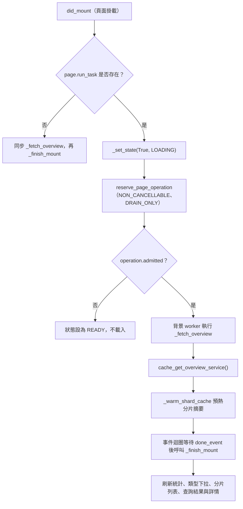
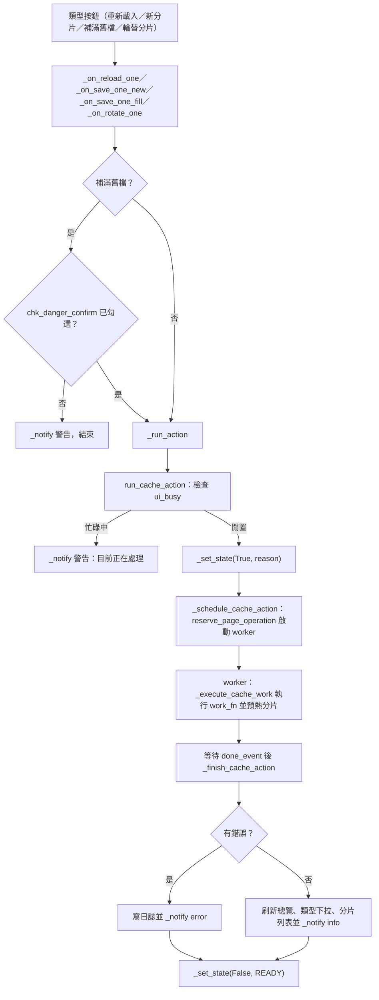
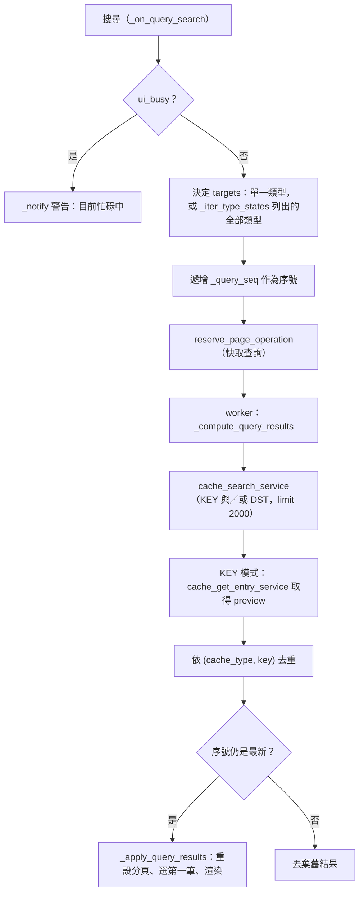
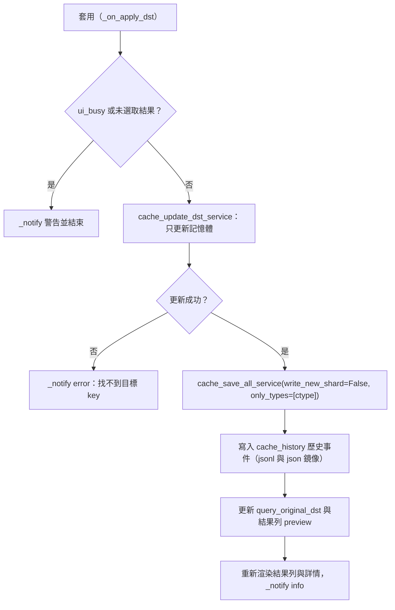
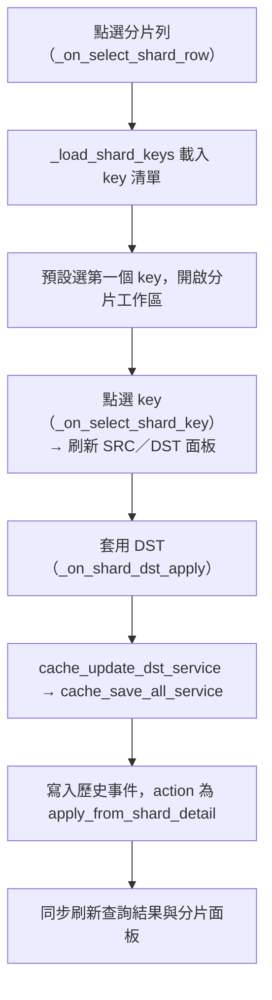

# 快取管理頁（`cache`）處理流程

> 入口：`app/views/cache_view.py` 的 `CacheView`。詳細元件說明見 [`CACHE_VIEW_ARCHITECTURE.md`](../CACHE_VIEW_ARCHITECTURE.md)。

## 職責

快取管理頁分為三個主分頁（`main_tabs`）：

- **總覽**：顯示各 `cache_type` 的統計卡與類型列表，提供重新載入、新分片、補滿舊檔、輪替分片、分析、切換查詢等按鈕。
- **查詢**：依 KEY／DST／ALL 模式搜尋記憶體中的快取條目，檢視、套用或還原單筆 DST。
- **分片詳情**：瀏覽分片檔的 key 清單與 SRC／DST 內容，可套用 DST 或套用歷史舊值。
- **歷史**：每次套用 DST 都寫入 `cache_history` 目錄；查詢區與分片區共用一組可拖曳的浮動歷史視窗。

`CacheView` 本身不直接讀寫快取檔。讀取與寫回透過 `app/services_impl/cache/cache_services.py` 的 service 函式進入 `translation_tool/utils/cache_manager.py`；歷史記錄由 `app/views/cache_manager/cache_history_store.py` 處理。

`CacheView` 由下列 mixin 組成：`CacheOverviewMixin`、`CacheQueryMixin`、`CacheQueryWidgetsMixin`、`CacheShardMixin`、`CacheShardDetailMixin`、`CacheShardWidgetsMixin`、`CacheHistoryMixin`。

## 主要流程

### 頁面掛載與初始載入

`_finish_mount` 在讀取失敗時只寫入 `[WARN]` 日誌並照常渲染空白畫面，不會中斷頁面。

### 總覽的類型操作

類型列的按鈕（`_type_actions_row`）統一透過 `_run_action` 進入 `run_cache_action`（`app/views/cache_manager/cache_actions.py`）。

各按鈕對應的工作：

| 按鈕 | 呼叫的 service | reason |
| --- | --- | --- |
| 重新載入 | `cache_reload_type_service(ctype)` | `RELOADING` |
| 新分片 | `cache_save_all_service(write_new_shard=True, only_types=[ctype])` | `SAVING` |
| 補滿舊檔 | `cache_save_all_service(write_new_shard=False, only_types=[ctype])` | `SAVING` |
| 輪替分片 | `cache_rotate_service(ctype)`，失敗時拋出 `RuntimeError` | `ROTATING` |
| 分析 | 不呼叫 service，只讀 `_last_overview_data` 並寫入日誌與提示 | 無 |
| 切換查詢 | 不呼叫 service，切到查詢分頁並設定 `dd_query_mode` 為 `KEY` | 無 |

總覽頂端的「重新載入全部」走 `cache_reload_service`（`RELOADING`，顯示進度）。「刷新統計」`_on_refresh_stats` 例外：它在 UI 執行緒上同步呼叫 `_load_overview`，不經背景 worker。

「重建搜尋索引」`_on_rebuild_index` 也不經 `run_cache_action`，而是自行 `reserve_page_operation`，worker 呼叫 `cache_rebuild_index_service`，完成後把 `_set_state` 設回 `READY`。

### 查詢與搜尋

`cache_search_service` 先走 FTS 搜尋引擎（`cache_manager.search_cache`），沒有結果或失敗時降級為 `_search_linear` 線性掃描。

### 套用與還原 DST（查詢區）

此流程在 UI 執行緒上同步執行，沒有經過背景 worker。「還原」（`_on_revert_dst`）只把輸入框改回 `query_original_dst`，不寫入快取。「還原最新歷史」（`_on_restore_latest_query`）讀取最新一筆歷史的 `old_dst` 填入輸入框，同樣不寫入快取，需再按「套用」。

### 分片詳情與套用

分片區的「套用舊值」（`_on_shard_apply_selected_history`）以所選歷史事件的 `old_dst` 作為新值，依序執行記憶體更新、寫檔、寫入歷史（action 為 `revert_from_shard_history`），再刷新查詢區與分片區。查詢區的「套用歷史」（`_on_apply_selected_history`）同樣以所選事件的 `old_dst` 為新值，並先讀取目前的 DST 作為記錄用的舊值。

### 歷史視窗

`_on_open_history_window(e, source)` 依 `source`（`query` 或 `shard`）開啟對應的浮動視窗並渲染紀錄（`_render_query_history`／`_render_shard_history`）。切換主分頁時（`_on_tab_change`）會自動關閉兩個視窗。視窗標題列的拖曳與右下角縮放只調整 `top`、`left`、`width`、`height`。

## 背景任務與 UI 更新

- **走背景 worker 的操作**：總覽的類型操作（`run_cache_action`）、重建索引、快取查詢、頁面掛載時的總覽讀取。這些都透過 `reserve_page_operation` 或 `launch_page_operation` 取得 operation，worker 結束後以 `done_event` 通知事件迴圈，UI 更新一律在事件迴圈執行。
- **同步在 UI 執行緒的操作**：套用 DST、套用歷史、還原、刷新統計、分頁切換、分片詳情的選取。這些操作會呼叫磁碟寫入，因此操作期間頁面會阻塞。
- **忙碌狀態**：`_set_state(busy, reason, trace)` 更新 `ui_busy`、`busy_reason` 與狀態列文字，並呼叫 `_refresh_disabled_state` 依忙碌狀態切換所有按鈕與分頁控制項。
- **日誌與提示**：`_append_log` 依前綴 `[ERROR`、`[WARN` 分別寫入 `log_error`、`log_warning`，其餘寫入 `log_info`，並同步加入記憶體日誌（上限 1500 筆）。`_notify` 同時寫日誌並顯示 `show_snack`。日誌面板可切換「只看警告以上」。
- **換頁清理**：`will_unmount` 會取消 `Debouncer`；`_on_page_resized` 會重算分片鍵清單寬度並重新渲染分片區。

## 狀態與資料

- **Flet 控制項狀態**：`ui_busy`、`busy_reason`、`_all_logs`、`_only_error`、`_last_overview_data`（最近一次總覽資料，多數歷史與分析功能依賴其中的 `cache_root`）。
- **查詢狀態**：`CacheQueryState`（`app/views/cache_manager/cache_state.py`）提供初始值，實際使用的是 `query_results`、`query_selected_result`、`query_original_dst`、`query_page`、`query_page_size`、`query_total_pages` 等 view 屬性。`_query_seq` 用於丟棄過期的搜尋結果。
- **分片狀態**：`CacheShardState` 提供初始值，實際使用 `shard_detail_selected_type`、`shard_detail_selected_file`、`shard_detail_selected_key`、`shard_detail_keys`、`shard_detail_page`、`shard_detail_src_mode`，以及 `shard_dst_original`、`shard_dst_loaded_sig`。
- **歷史狀態**：`CacheHistoryState` 提供初始值，`history_window_source` 記錄目前開啟的來源。
- **分片讀取**：`app/views/cache_manager/shard_reader.py` 以檔案簽章為 key 快取分片摘要與 raw 內容；`warm_shard_summaries` 在背景預熱，渲染時不必再解析 JSON。
- **磁碟資料**：快取分片位於 `cache_root/<cache_type>/`；歷史位於 `cache_root/cache_history/<cache_type>/`，包含 `jsonl/`（含 `.history.active` 指標檔）與 `json/`（鏡像，最多保留 `max_per_file` 筆，預設 10000）。
- **記憶體快取**：`cache_update_dst_service` 透過 `add_to_cache` 修改 `cache_manager` 的記憶體字典；寫回磁碟由 `save_translation_cache` 負責，只寫入 session 中待寫入的條目。

## 錯誤處理

- **service 拋出例外**：背景 worker 內以 `_execute_cache_work` 或 `_compute_query_results` 捕捉，錯誤回傳給事件迴圈後寫入日誌（含 traceback）並顯示 `error` 提示，最後仍會呼叫 `_set_state(False, READY)`。
- **找不到 key**：`cache_update_dst_service` 回傳 `False` 時顯示「找不到目標 key」。
- **忙碌中被觸發**：`run_cache_action`、查詢、套用、還原都會先檢查 `ui_busy`，直接以警告拒絕，不排入任務。
- **應用程式關閉中**：`reserve_page_operation` 回傳 `admitted=False` 時，類型操作與索引重建都會以錯誤回呼，顯示「應用程式正在關閉」。
- **歷史寫入失敗**：`_append_mirror` 寫入 json 鏡像失敗時只記錄 `log_warning`，不影響 jsonl 主記錄。
- **套用失敗**：UI 層的 `try/except` 捕捉例外並 `_notify` 錯誤；記憶體可能已被更新而檔案未寫入，這種情況需要使用者以重新載入復原。
