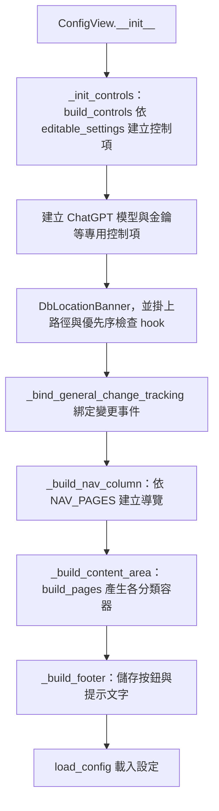
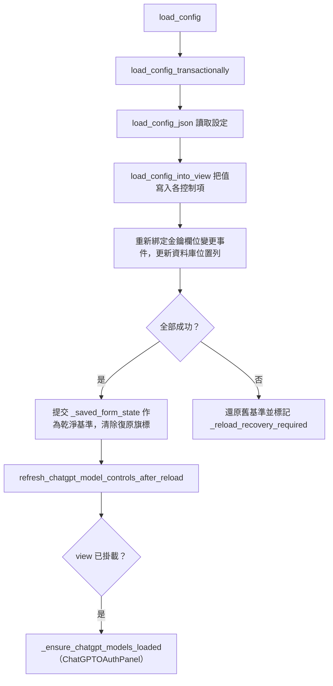
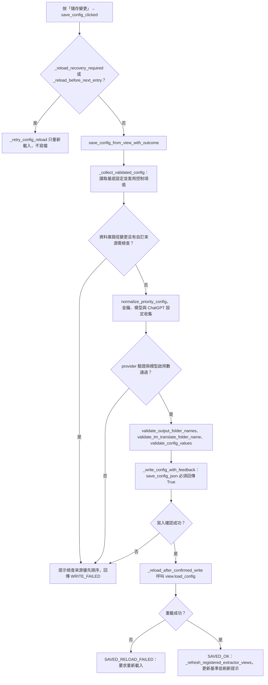
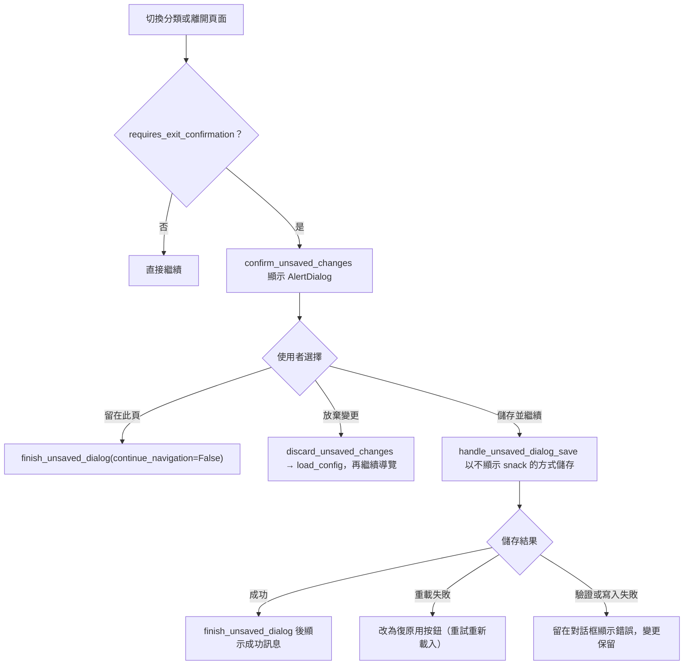

# 設定頁（`config`）處理流程

> 入口：`app/views/config_view.py` 的 `ConfigView`。詳細說明見 [`CONFIG_VIEW_ARCHITECTURE.md`](../CONFIG_VIEW_ARCHITECTURE.md)。

## 職責

- `ConfigView`（`app/views/config_view.py`）是設定頁的外殼：建立左側導覽與右側分類內容、頂部資料庫位置列、底部儲存列，並協調載入、儲存、未儲存變更確認與重新載入。
- 一般設定的控制項與版面由 `app/views/config/settings_schema.py` 宣告，`app/views/config/settings_form.py` 負責把宣告轉成 Flet 控制項。
- 專用元件：模型清單與金鑰列（`ConfigView` 內的 `_models_panel`、`_keys_panel`）、ChatGPT 模型設定（`_build_chatgpt_model_settings_panel`）、ChatGPT 登入面板 `ChatGPTOAuthPanel`（`app/views/config/chatgpt_oauth_panel.py`）。
- 載入、收集、驗證、寫入與重載的流程集中在 `app/views/config/config_actions.py`，磁碟讀寫由 `app/services_impl/config_service.py` 的 `load_config_json` 與 `save_config_json` 提供。

## 主要流程

### 建構與版面

導覽點擊由 `_on_nav_click` 處理。若目前有未儲存變更，先呼叫 `confirm_unsaved_changes`；否則直接 `_apply_nav` 切換分類。

### 載入設定

`did_mount` 在切回設定頁時再次確認資料庫位置（`db_location.safe_refresh`）並嘗試載入 ChatGPT 模型清單。

### 儲存設定

`save_config_clicked` 會依結果設定 `_last_save_outcome`，供未儲存確認框判斷下一步。

### 未儲存變更確認

關閉對話框時 `finish_unsaved_dialog` 會檢查 `page.pop_dialog()` 回傳的物件是否就是本對話框，不符合就不繼續導覽。外部關閉（dismiss）一律視為留在此頁。

### 變更偵測

- `_bind_change_tracking` 為控制項的 `on_change`、`on_select`、`on_blur` 串接 `_on_form_changed`。
- `_capture_form_state` 收集所有控制項值、金鑰、模型列與 ChatGPT 模型設定，`has_unsaved_changes` 以此與 `_saved_form_state` 比較。
- `_refresh_dirty_state` 依狀態更新底部提示文字與儲存按鈕文字（「儲存變更」、「儲存所有設定」或「重新載入設定」）。

## 背景任務與 UI 更新

設定頁本身沒有背景工作，設定的讀寫都在 UI 執行緒同步完成。例外是 `ChatGPTOAuthPanel.ensure_models_loaded`：在帳號已連結但模型清單未驗證時，若頁面提供 `page.run_task`，會排程一次非同步的模型清單載入。

## 狀態與資料

- 持久化資料：`config.json`，由 `save_config_json` 寫入；寫入後以 `load_config_json` 重新讀取作為畫面來源。
- 基準狀態：`_saved_form_state`（最近一次成功載入或儲存的表單快照）。
- 復原旗標：`_reload_recovery_required`（寫入成功但畫面重載失敗）、`_reload_before_next_entry`（先前確認過的過期畫面需在進入前重載）、`_reload_exit_acknowledged`（單次允許離開）。
- 對話框狀態：`_unsaved_dialog_open`、`_unsaved_dialog_resolved`、`_unsaved_dialog_continue`。
- 控制項映射：`controls_map` 以設定路徑（例如 `translation_db.path`）為鍵。金鑰與模型列不在此映射中，另有 `key_fields` 與 `models_column`。
- 資料庫位置列 `DbLocationBanner`（`app/views/config/db_location.py`）顯示實際路徑與檔案狀態，路徑與優先序欄位變更時重新檢查。

## 錯誤處理

- 輸出資料夾名稱無效（提取輸出後綴，或「LM 翻譯輸出資料夾」不是單一資料夾名稱，例如路徑、`..`、Windows 保留名稱）：`validate_output_folder_names`／`validate_lm_translate_folder_name` 拋出 `ConfigValidationError`，記錄警告並以錯誤原因提示，不寫入。「LM 翻譯輸出資料夾」留空表示使用預設值 `LM翻譯後`。
- 其他收集或驗證失敗（例如 `validate_config_values` 拋出錯誤）：`_collect_validated_config` 記錄含堆疊的 log（經 `redact_text` 遮蔽），顯示「設定驗證失敗」提示，不寫入。
- 寫入回傳值不是 `True`，或例外發生：視為無法確認寫入，變更保留在頁面上，提示使用者檢查 `config.json`。
- 寫入成功但重載失敗：結果為 `SAVED_RELOAD_FAILED`，頁面進入復原模式，儲存按鈕改為「重新載入設定」，離開前會再次確認。
- 載入失敗：`load_config_transactionally` 還原舊基準後重新拋出例外，由呼叫端處理。
- 提供者為 `gemini` 時，金鑰會先經 `validate_api_keys_from_ui` 檢查；提供者為 `chatgpt` 且未選擇模型時拒絕儲存，並提示先登入。
- 提供者為 `gemini` 時若沒有任何啟用中的模型，且先前有啟用模型或本次模型設定有變更，拒絕儲存。
