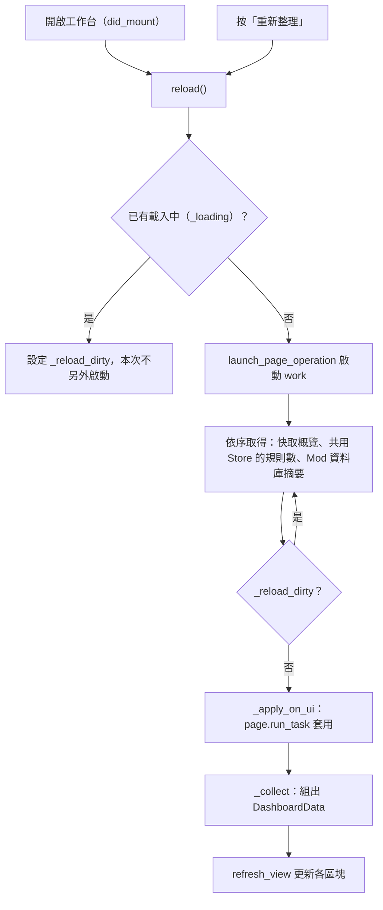
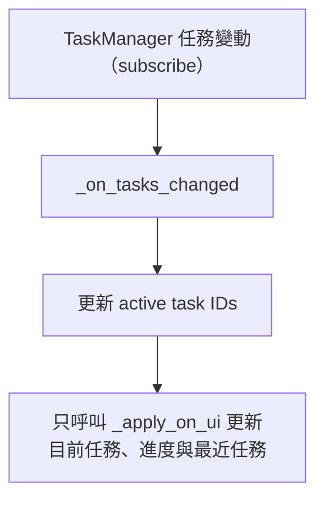
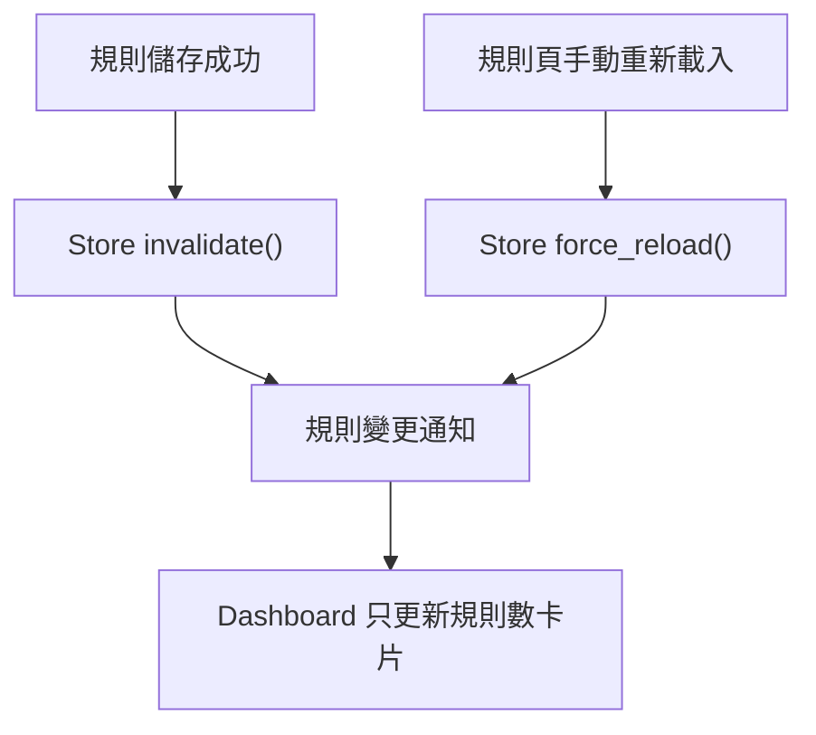
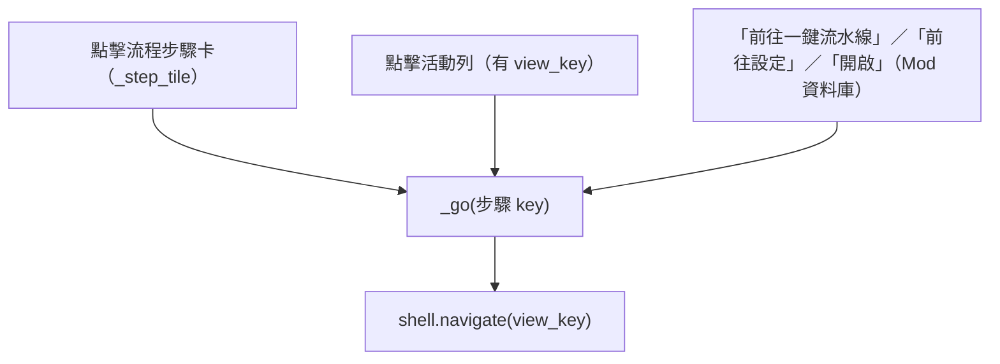

# 工作台（`dashboard`）處理流程

> 入口：`app/views/dashboard_view.py` 的 `DashboardView`。資料組裝（不依賴 Flet）在 `app/views/dashboard/dashboard_data.py`。

## 職責

- 彙整四張統計卡（快取條目、替換規則、可用 API Key、本次任務）、翻譯流程五步的狀態、快取分佈、最近活動、API Key 與模型配額狀態，以及 Mod 資料庫摘要。
- 資料來源：`cache_get_overview_service`（`app/services_impl/cache/cache_services.py`）、`get_replace_rules_count` 與共用 `ReplaceRulesStore`（`app/services_impl/config_service.py`／`translation_tool/utils/text_processor.py`）、`get_key_health_snapshot`／`get_model_quota_snapshot`（`app/services_impl/key_health_service.py`）、`summarize_database`（`app/services_impl/moddb_service.py`），以及 `TaskManager` 的 `active()`／`recent()`（`app/shell/task_manager.py`）。
- 頁面本身不啟動翻譯或提取任務，只做重新載入與導覽；導覽函式由外殼透過 `set_shell` 注入。

## 主要流程

### 載入與重新整理

### 任務狀態變化

### 規則變更

### 導覽

## 背景任務與 UI 更新

- `reload()` 以 `launch_page_operation` 啟動，名稱為「工作台資料重新載入」，owner 為 `dashboard`，使用 `CancellationPolicy.NON_CANCELLABLE`、`ShutdownPolicy.DRAIN_ONLY` 與 `OperationPresentation.MAINTENANCE`。若啟動被拒（應用程式關閉中），會清除 `_loading` 與 `_reload_dirty`。
- `reload(sync=True)` 會在呼叫執行緒直接執行 `work`，不經過 operation registry。
- `work()` 內以 `while True` 合併重新載入請求：讀取期間又有人呼叫 `reload()`，會設定 `_reload_dirty`，由同一個 worker 再跑一輪，不另開執行緒。
- 背景執行緒只寫入 `_cache_overview`、`_rules_count`、`_moddb` 三個欄位，完成後以 `_apply_on_ui` 透過 `page.run_task` 排回 event loop 呼叫 `refresh_view`；沒有 event loop 時（測試）直接套用。
- `ReplaceRulesStore` 以 resolved path 與 `(mtime_ns, size)` 判斷版本，快取唯讀 snapshot；相同規則檔的併發讀取由同一把鎖序列化。快取命中不輸出 INFO，只有實際讀取或強制重載才記錄來源、版本、數量與讀取耗時。
- TaskManager 事件不再呼叫 `reload()`，只更新任務資料的畫面；規則儲存成功的 `invalidate()` 與規則頁手動 `force_reload()` 才會通知 Dashboard 更新規則數。
- `_collect()` 在 UI 執行緒同步呼叫 Key 與模型配額的 loader，內部例外會被吞掉並以空清單顯示。
- 本頁重新載入被標記為不可取消；換頁時會解除 TaskManager 與規則 Store 的訂閱。
- 鎖：`_reload_state_lock` 保護 `_loading` 與 `_reload_dirty`；`_task_state_lock` 保護 `_active_task_ids`。

## 狀態與資料

- 頁面狀態：`_cache_overview`、`_rules_count`、`_moddb`（`None` 表示尚未讀取或尚未建立資料庫）、`data`（最近一次的 `DashboardData`）、`_active_task_ids`、`_loading`、`_reload_dirty`。
- 本頁只讀取，不寫入任何設定或檔案。規則數的卡片標示來源為 `replace_rules.json`，實際數字由共用 Store 的 `get_replace_rules_count()` 取得；初始化或手動工作台重新整理會使用既有快取，規則檔版本變更時才重新讀取。
- 翻譯流程步驟（`PIPELINE_STEPS`）：提取（extractor）、語系合併（merge）、機器翻譯（lm）、QC 檢驗（qc）、打包輸出（bundler）。`build_step_statuses` 只依 active 任務的 `view_key` 把步驟設為「進行中」（附進度百分比），其餘為「待執行」。
- 注意：`build_step_statuses` 目前不會產生 `STEP_DONE` 或 `STEP_FAILED`，因此步驟卡的「完成」樣式與「本次完成 N / 5」徽章在現行程式碼中不會出現非零值，完成與失敗只在「最近活動」區呈現。
- 任務計數：`tasks_running` 為 active 任務數；`tasks_done`（只算 `STATUS_DONE`）、`tasks_failed`（`STATUS_ERROR`）、`tasks_cancelled`（`STATUS_CANCELLED` 與 `STATUS_ABORTED`）由 `recent(20)` 分類，三者互斥，取消或中止的任務不會被算成完成。`TaskManager` 以 `OperationRegistry` 的 `terminal_reason`（無 owner 的舊 session 則用 summary 的 `CANCELLED`／`ABORTED` 與取消旗標）決定終態；最近活動以 `task_status_style` 顯示「完成／失敗／已取消／已中止」。
- 活動區最多 6 筆（`activity_limit=6`），由 active 與 recent 合併後依 `started_at` 由新到舊排序。
- Key 狀態以 `summarize_keys`（`app/shell/topbar.py`）整理成「可用／總數」與冷卻數；模型配額列出今日額度用盡的模型，重置時間由 `format_quota_reset` 顯示。

## 錯誤處理

- 快取概覽或規則數讀取失敗：以 `logger.warning(..., exc_info=True)` 寫入後台 log，該值以 `None` 套用，卡片顯示「—」。
- Mod 資料庫摘要讀取失敗：寫入 warning，並以 `{"problem": ...}` 呈現於「Mod 資料庫」卡片（「資料庫無法使用」）。`summarize_database()` 回傳 `None` 時則顯示「尚未建立資料庫」。
- Key 或模型配額快照失敗：以 `logger.debug` 記錄，畫面以空清單顯示，不跳出警告。
- 畫面尚未加入頁面時，`_safe_update` 會忽略 `AssertionError` 與 `RuntimeError`。
- `_apply_on_ui` 若 `page.run_task` 拋出例外，會退回同步套用畫面。
- 規則變更通知若讀取失敗，會寫入 `logger.warning`，規則數卡片顯示「—」；通知失敗不會阻斷規則檔儲存。
