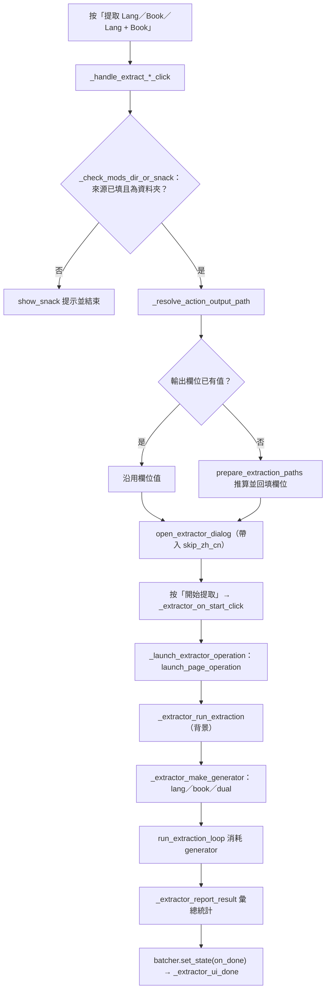
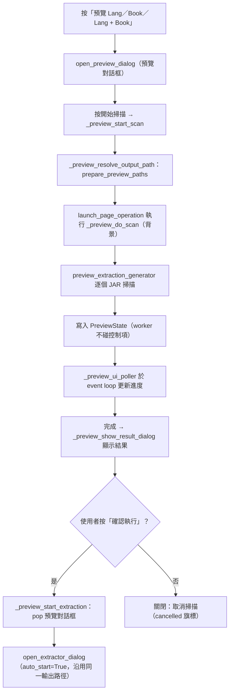

# JAR 提取（`extractor`）處理流程

> 入口：`app/views/extractor_view.py` 的 `ExtractorView`。詳細元件說明見 [`EXTRACTOR_VIEW_ARCHITECTURE.md`](../EXTRACTOR_VIEW_ARCHITECTURE.md)。

## 職責

- 頁面提供 Mod 資料夾、輸出資料夾與「跳過 zh_cn 抽取」開關，以及 Lang、Book、Lang + Book 三種提取按鈕與對應的預覽按鈕。
- 路徑推算與設定讀取交給 `app/services_impl/pipelines/extract_service.py`：`prepare_extraction_paths`、`prepare_preview_paths`、`get_output_folder_names`、`get_skip_zh_cn_extract`、`get_lang_codes`。
- 實際讀取 JAR 的 generator（`extract_lang_files_generator`、`extract_book_files_generator`、`extract_dual_files_generator`、`preview_extraction_generator`）定義在 `translation_tool/core/jar_processor.py`，由 `extract_service` 轉出；`run_extraction_loop` 負責消耗提取 generator。
- 提取與預覽各自由獨立對話框執行：`app/views/extractor/extractor_dialog.py`（提取）與 `extractor_preview_dialog.py`（預覽）。頁面本身不啟動背景任務。

## 主要流程

### 提取

### 預覽

## 背景任務與 UI 更新

- 提取：按下對話框的「開始提取」後，`launch_page_operation`（名稱「JAR 提取」，owner `extractor`）登記並執行 `in_new_task("extractor", run_extraction)`。
- 此流程不直接建立 `TaskSession`。進度、日誌與統計由對話框的 `add_log`、`update_progress`、`update_stats` 更新。背景執行緒送出的更新先進入 `UiBatcher`（`app/ui/ui_batcher.py`，節流間隔 0.2 秒），再以 `page.run_task` 在 event loop 執行 `_extractor_apply_batch`。
- 按鈕與 modal 狀態（隱藏開始、顯示取消、`dialog.modal=True`）在 UI 執行緒切換；背景執行緒的 `finally` 只設定 `state["running"]=False` 並排入 `on_done`。
- 取消：對話框的取消按鈕與 operation 的 `on_cancel` 都會設定 `extraction_cancel_flag[0]=True` 與 `state["cancelled"]=True`。generator 在下一個 JAR 檢查點停止，`run_extraction_loop` 依 `cancelled_flag` 結束。
- 執行中若對話框被外側關閉（`_extractor_on_dialog_dismiss`），會設定取消旗標讓背景提早結束。
- 預覽：`launch_page_operation`（名稱「JAR 提取預覽」，owner `extractor-preview`）執行 `in_new_task("extract-preview", _preview_do_scan)`。`_preview_ui_poller` 以 `page.run_task` 啟動，每 0.2 秒讀取 `PreviewState` 並更新畫面。掃描期間對話框 `modal=True`，結束後才解除。
- `_preview_do_scan` 的 `finally` 一定設定 `preview_state.done=True`，確保輪詢不會永遠等待。取消預覽時，poller 會等 worker 真正結束後才收尾。

## 狀態與資料

- 頁面狀態：`mods_dir_textfield`、`output_dir_textfield`、`skip_zh_cn_switch`。`output_dir_textfield.helper` 顯示目前的資料夾命名規則，由 `get_output_folder_names()` 組成。
- 提取對話框的 `ctx.state`（dict）：`running`、`done`、`cancelled`、`stats`（success／warnings／failures）、`progress`、`current_file`。`extraction_cancel_flag` 是單元素 list，與 service 共用同一個參照。
- 預覽狀態 `PreviewState`（`app/views/extractor/extractor_state.py`）：`progress`、`current`、`total`、`done`、`result`、`error`、`log`。
- 輸出路徑：未填寫時由 `prepare_extraction_paths`（提取）或 `prepare_preview_paths`（預覽）推算，結果為 Mod 資料夾同層的「來源資料夾名稱 + 設定後綴」。提取按鈕會把推算值回填到輸出欄位並顯示 SnackBar；預覽只在顯示時使用，不回填。
- 設定讀取：資料夾後綴與語系代碼來自設定（`get_output_folder_names`、`get_lang_codes`），`skip_zh_cn` 來自頁面開關。`refresh_config_defaults()` 會在設定頁儲存後被呼叫，重新讀取開關與說明文字。
- 本頁不寫入設定檔。產出的 JAR 內容寫入 `final_output`。

## 錯誤處理

- 來源未填或不是資料夾：在按鈕層以 SnackBar 提示，不開啟對話框。
- 輸出資料夾名稱設定無效（`prepare_extraction_paths` 或 `prepare_preview_paths` 拋出 `ValueError`）：以 `log_warning` 記錄，並提示到「設定 → Jar 提取設定」修正。
- 開始按鈕處的二次驗證：來源為空或不存在時，同時顯示對話框內的 `status_text` 與 SnackBar。
- 提取執行中發生例外：`_extractor_run_extraction` 的 `except` 會把訊息與 `traceback.format_exc()` 寫入對話框日誌，統計的 `failures` 設為 1，`finally` 仍會恢復 UI 狀態。
- generator yield 的 `error` 更新只寫入錯誤等級的日誌，不中止整體流程。
- 取消：日誌出現「[系統] 任務已取消」與「[取消] 已處理部分」，不標記為完成，進度不會拉到 100%。
- 預覽失敗：`_preview_do_scan` 以 `log_error(..., exc_info=True)` 記錄，錯誤寫入 `preview_state.error`；UI 顯示「預覽失敗」並解除 modal。
- 應用程式關閉中無法啟動 operation：`launch_page_operation` 回傳 `False`，恢復按鈕並顯示 SnackBar。
