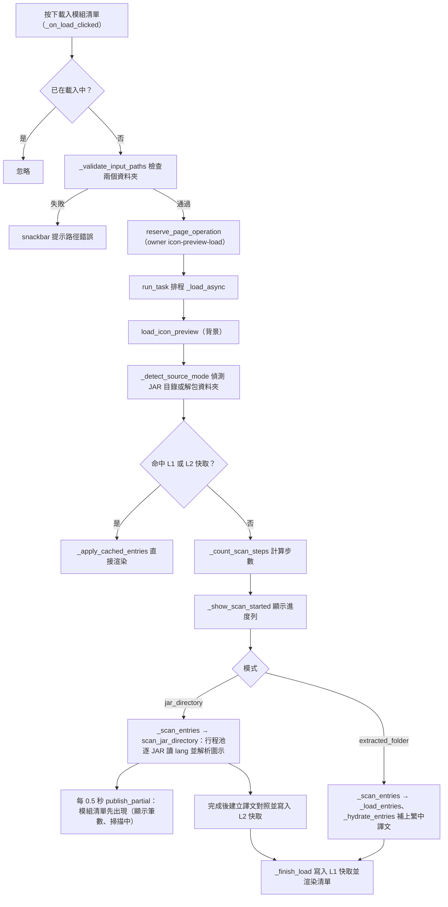
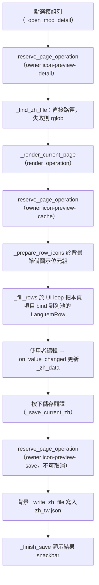

# 翻譯校對（`icon_preview`）處理流程

> 入口：`app/views/icon_preview_view.py` 的 `IconPreviewView`。詳細元件說明見 [`View 架構文件`](../developer-guide/views/ICON_VIEW_ARCHITECTURE.md)。

## 職責

- 讓使用者指定模組資料夾（`mods` 或已解包的資料夾）與資源包／`lang_output` 路徑，載入所有模組的語言條目與對應的繁中譯文。
- 以兩層介面呈現：第一層為模組清單（可分頁、可搜尋），第二層為單一模組的翻譯校對列（含 mod icon 預覽、可分頁、可搜尋）。
- 載入由 `app/views/icon_preview/load_operation.py` 協調；JAR 目錄的冷載入由 `app/views/icon_preview/scan_operation.py` 驅動 `app/icon_scan_pool.py`（行程池）與 `app/icon_jar_scan.py`（單一 JAR：讀 lang 並解析圖示）；解包資料夾與詳情頁的圖示備援用 `translation_tool/core/icon_resolver.py`（`resolve_icon_with_reason`）。
- 儲存時把使用者編輯的譯文寫回 `{modid}/lang/zh_tw.json`。
- 圖示解析由 `app/icon_resolve.py`、渲染由 `app/icon_render.py`／`app/icon_preview_image.py` 負責；磁碟快取由 `app/views/icon_preview/entries_cache.py` 管理。
- 圖示在背景執行緒渲染為 128×128 的像素銳利 PNG（動畫取首格、整數倍最近鄰放大、方塊為等角預覽）；懸停可看貼圖／模型／來源 JAR；內容類 key 找不到圖示時顯示共用佔位圖。

## 主要流程

### 載入模組清單

### 開啟模組詳情、渲染與儲存

## 背景任務與 UI 更新

- 三類背景工作都以 `reserve_page_operation`（`app/tasks/operation_registry.py`）登錄，並在 `run_task` 排程的協程中等待結果：
  - 載入：owner `icon-preview-load`，`CancellationPolicy.BOUNDARY_ONLY`，`CommitPolicy.EPHEMERAL`，`ShutdownPolicy.CANCEL_AND_DRAIN`。
  - 詳情與圖示準備：owner `icon-preview-detail` 與 `icon-preview-cache`，同樣為 `BOUNDARY_ONLY`。
  - 儲存：owner `icon-preview-save`，`CancellationPolicy.NON_CANCELLABLE`，`CommitPolicy.PARTIAL_ALLOWED`，`DurabilityPolicy.USER_ACTION`，`ShutdownPolicy.DRAIN_ONLY`。
- JAR 目錄冷載入（`scan_operation.scan_jar_directory`，背景執行緒）每個 JAR 只開一次：`app/icon_jar_scan.py` 的 `scan_jar` 在同一個 ZIP 內讀出 `assets/<modid>/lang/en_us.json` 並以 `ModpackAssetCatalog` 解析每個內容類 key 的圖示。解析是純 Python（受 GIL 限制），所以 JAR 數達 `PROCESS_MIN_JARS` 且 worker 數大於 1 時由 `icon_scan_pool` 啟動 `spawn` 行程池（worker 數取 config `translator.parallel_execution_workers` 的 `icon_cache` 用途，不超過 CPU 核心數）；每個 worker 行程第一次工作時各自建立一份 catalog。行程池無法啟動、或掃描中途整個壞掉時，其餘 JAR 改用執行緒完成；JAR 少於門檻時直接用執行緒。取消時監看執行緒設定共用的 `Event`，worker 在下一個讀取區塊中止；worker 內的日誌隨結果送回，由呼叫端重新送出。
- 逐步顯示：掃描執行緒最多每 `PARTIAL_INTERVAL_SEC`（0.5 秒）把目前累積的 `ScannedSource` 快照經 `publish_partial` 交給 event loop，`apply_partial` 以 `ModEntryStore` 顯示模組清單（`_scan_partial` 為真時，`ModRow` 只顯示筆數與「掃描中」，不顯示未翻譯數）。使用者已開啟詳情或正在搜尋模組時不套用；載入結束時 `_finish_load` 以完整結果取代，使用者仍在詳情頁就不拉回清單。掃描途中沒有任何解析或檔案 I/O 發生在 event loop。
- 阻塞步驟以 `_run_blocking`（`load_operation.py`）包成 `asyncio.to_thread`。取消時 `_run_blocking` 會等待執行緒結束後才重新拋出，確保 owner 不提早釋放。
- 世代檢查：
  - `_load_generation` 與 `_render_generation` 在 `will_unmount` 時遞增。每個 `await` 之後，協程檢查世代是否仍相同，不相同就丟棄結果，不再碰已卸載的控制項。
  - 詳情與渲染也會比對 `current_modid` 與 `_render_generation`，避免換頁後覆蓋畫面。
- 載入 owner：`_load_operation` 只允許目前世代的載入作業清除 `_loading`；舊作業即使晚到完成，也不能把新作業的忙碌狀態誤清掉。
- 進度：`_set_progress` 只記錄最新值，並攜帶載入世代；`_refresh_progress` 以 0.2 秒節流，透過 `run_task` 在 UI loop 上套用（`progress.py`、`_apply_pending_progress`）。舊世代排入 event loop 的進度會被丟棄。
- 刷新範圍：換頁、搜尋與改每頁筆數只刷新清單、分頁列與搜尋狀態文字（`_update_list_area`）；模組清單與詳情各有自己的 ListView（`mod_list_view`、`detail_list_view`），進出詳情只切換 `visible`。模組清單換頁會在背景預載前後頁（`_prefetch_mod_pages`），詳情換頁會預先渲染下一頁圖示。
- 列控制項重用：模組清單與詳情頁各有一個列池（`_mod_row_pool`、`_detail_row_pool`）。換頁、搜尋、改每頁筆數只對池中的 `ModRow`／`LangItemRow` 呼叫 `bind` 更新值，Flet 只送出變動的欄位。連續快速換頁時，`_render_generation` 讓較舊的圖示準備結果被丟棄，只套用最後一次。
- 搜尋：模組與詳情的搜尋框都使用 `app/ui/debounce.py` 的 `Debouncer`，延遲 150 毫秒後在 UI 執行緒執行 `_do_mod_search` 或 `_do_detail_search`。
- `will_unmount` 會取消兩個 debouncer；`did_mount` 只同步載入按鈕狀態。

## 狀態與資料

- 路徑狀態：`source_root`（模組資料夾）、`review_root`（資源包路徑）。路徑欄位失焦時會正規化（`normalize_path_text`），並視需要呼叫 `_migrate_old_icon_cache`。
- 資料狀態：
  - `mods`：`modid → [entry]`。JAR 目錄冷載入與快取命中時都是 `ModEntryStore`（`mod_store.py`，冷載入的來源為 `ScannedSource`）；解包資料夾由 `_finish_load` 建成 dict，第一次存取某模組才讀該模組分片並補上譯文，模組清單因此只讀當頁模組。
  - `current_modid`、`_zh_data`（目前模組的譯文字典，儲存時整份寫出）、`_current_zh_file`。
  - 分頁：模組清單 `mod_page_size`（預設 50，可選 25、50、100），詳情 `page_size`（預設 50）。
- L1 快取：`_source_cache`（`MemorySource`、`ScannedSource` 或 `ShardSource`）與 `_cache_meta["source_identity"]`，僅保存來源資料（modid、key、en、source_jar、icon_path），不含譯文。命中時依目前的 `review_root` 建立譯文對照（`_build_zh_tw_lookup`），由 `ModEntryStore` 逐模組補上。
- L2 快取：`get_data_root()/.icon_cache/<key>/`（`entries_cache._get_cache_dir`），只在 `jar_directory` 模式下讀寫：`index.json`（身分、模組與筆數）加每個模組一個欄位式分片。寫入於掃描完成後、仍在背景執行緒（`save_source_cache_l2`），讀取（`open_entries_cache_l2`）命中時只讀 index；目前快取版本為 7，舊版本會 miss 並在下一次掃描後重建。延遲讀取分片失敗會使來源失效並排程一次完整重掃，恢復狀態維持到載入作業結束。身分由 `_compute_source_identity` 計算。
- 圖示快取：`get_data_root()/.icon_cache/jar_icons/`（`_get_icon_cache_dir`）。
- 寫出檔案：`{review_root}/{modid}/lang/zh_tw.json`，UTF-8、`indent=2`、`ensure_ascii=False`。若找不到既有檔案，`_find_zh_file` 回傳 `None`，儲存會被拒絕。

## 錯誤處理

- 路徑檢查失敗（空白、不存在、不是資料夾）：`_validate_input_paths` 以 snackbar 提示並中止載入。
- 載入例外：`load_icon_preview` 記錄 `log_error`，顯示「掃描失敗」snackbar，然後以空清單進入 `_finish_load`，後者再提示「掃描結果為空」或「無法識別模式」，並丟棄掃描途中顯示的部分清單。
- 單一 JAR 無法讀取（壞 ZIP、累計讀取超過安全上限）：該 JAR 視為沒有項目並寫 `[IconPreview]` 警告，其他 JAR 照常；圖示解析累計讀取超限時保留該 JAR 的 lang 項目，其餘 key 不再解析。
- 取消：`TaskCancelled` 或 owner 被取消時，`load_icon_preview` 不顯示錯誤。若世代已變（已卸載），結果一律丟棄。
- 詳情載入失敗：`_open_mod_detail` 的 `find_file` 把例外放入 `result["error"]`，協程以 `log_error` 與「載入詳情失敗」snackbar 呈現。
- 圖示準備失敗：`render_current_page` 的 `prepare_icons` 把例外放入結果，協程只記錄 `log_error`，不重繪該頁。
- 儲存失敗：寫入例外由 `_write_zh_file` 回傳，`_finish_save` 以 `log_error` 與「儲存失敗」snackbar 呈現。找不到 `zh_tw.json` 時直接提示「找不到 zh_tw.json」，不寫檔。
- 找不到單一模組的 `zh_tw.json`：`_find_zh_file` 以 `log_warning` 記錄，該模組譯文視為空字典，仍可開啟列表。
- 路徑與掃描相關的日誌統一以 `[IconPreview]` 為前綴，寫入 `translation_tool/utils/log_unit.py` 的後台 log。
