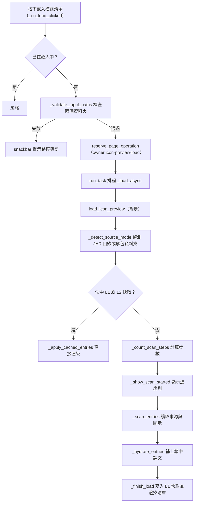
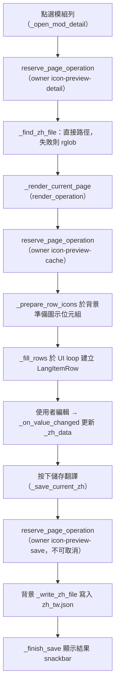

# 翻譯校對（`icon_preview`）處理流程

> 入口：`app/views/icon_preview_view.py` 的 `IconPreviewView`。詳細元件說明見 [`View 架構文件`](../developer-guide/views/ICON_VIEW_ARCHITECTURE.md)。

## 職責

- 讓使用者指定模組資料夾（`mods` 或已解包的資料夾）與資源包／`lang_output` 路徑，載入所有模組的語言條目與對應的繁中譯文。
- 以兩層介面呈現：第一層為模組清單（可分頁、可搜尋），第二層為單一模組的翻譯校對列（含 mod icon 預覽、可分頁、可搜尋）。
- 掃描與讀取由 `app/views/icon_preview/load_operation.py` 協調，核心讀取位於 `translation_tool/utils/jar_browser.py`（`scan_jars`）與 `translation_tool/core/icon_resolver.py`（`resolve_icon_with_reason`）。
- 儲存時把使用者編輯的譯文寫回 `{modid}/lang/zh_tw.json`。
- 圖示快取與磁碟快取由 `app/views/icon_preview/icon_cache.py` 與 `entries_cache.py` 管理。

## 主要流程

### 載入模組清單

### 開啟模組詳情、渲染與儲存

## 背景任務與 UI 更新

- 三類背景工作都以 `reserve_page_operation`（`app/tasks/operation_registry.py`）登錄，並在 `run_task` 排程的協程中等待結果：
  - 載入：owner `icon-preview-load`，`CancellationPolicy.BOUNDARY_ONLY`，`CommitPolicy.EPHEMERAL`，`ShutdownPolicy.CANCEL_AND_DRAIN`。
  - 詳情與圖示準備：owner `icon-preview-detail` 與 `icon-preview-cache`，同樣為 `BOUNDARY_ONLY`。
  - 儲存：owner `icon-preview-save`，`CancellationPolicy.NON_CANCELLABLE`，`CommitPolicy.PARTIAL_ALLOWED`，`DurabilityPolicy.USER_ACTION`，`ShutdownPolicy.DRAIN_ONLY`。
- 阻塞步驟以 `_run_blocking`（`load_operation.py`）包成 `asyncio.to_thread`。取消時 `_run_blocking` 會等待執行緒結束後才重新拋出，確保 owner 不提早釋放。
- 世代檢查：
  - `_load_generation` 與 `_render_generation` 在 `will_unmount` 時遞增。每個 `await` 之後，協程檢查世代是否仍相同，不相同就丟棄結果，不再碰已卸載的控制項。
  - 詳情與渲染也會比對 `current_modid` 與 `_render_generation`，避免換頁後覆蓋畫面。
- 進度：`_set_progress` 只記錄最新值，`_refresh_progress` 以 0.2 秒節流，透過 `run_task` 在 UI loop 上套用（`progress.py`、`_apply_pending_progress`）。
- 搜尋：模組與詳情的搜尋框都使用 `app/ui/debounce.py` 的 `Debouncer`，延遲 150 毫秒後在 UI 執行緒執行 `_do_mod_search` 或 `_do_detail_search`。
- `will_unmount` 會取消兩個 debouncer；`did_mount` 只同步載入按鈕狀態。

## 狀態與資料

- 路徑狀態：`source_root`（模組資料夾）、`review_root`（資源包路徑）。路徑欄位失焦時會正規化（`normalize_path_text`），並視需要呼叫 `_migrate_old_icon_cache`。
- 資料狀態：
  - `mods`：`modid → [entry]`，由 `_rebuild_mods` 或 `_finish_load` 建立。
  - `current_modid`、`_zh_data`（目前模組的譯文字典，儲存時整份寫出）、`_current_zh_file`。
  - 分頁：模組清單 `mod_page_size`（預設 50，可選 25、50、100），詳情 `page_size`（預設 50）。
- L1 快取：`_entries_cache` 與 `_cache_meta["source_identity"]`，僅保存來源資料（modid、key、en、source_jar、icon_path），不含譯文。命中時仍會依目前的 `review_root` 重新補上譯文（`_hydrate_entries`）。
- L2 快取：`get_data_root()/.icon_cache/`（`entries_cache._get_cache_dir`），只在 `jar_directory` 模式下讀寫，寫入於掃描完成後（`_save_entries_cache_l2`）。快取版本為 `_CACHE_VERSION`，身分由 `_compute_source_identity` 計算。
- 圖示快取：`get_data_root()/.icon_cache/jar_icons/`（`_get_icon_cache_dir`）。
- 寫出檔案：`{review_root}/{modid}/lang/zh_tw.json`，UTF-8、`indent=2`、`ensure_ascii=False`。若找不到既有檔案，`_find_zh_file` 回傳 `None`，儲存會被拒絕。

## 錯誤處理

- 路徑檢查失敗（空白、不存在、不是資料夾）：`_validate_input_paths` 以 snackbar 提示並中止載入。
- 載入例外：`load_icon_preview` 記錄 `log_error`，顯示「掃描失敗」snackbar，然後以空清單進入 `_finish_load`，後者再提示「掃描結果為空」或「無法識別模式」。
- 取消：`TaskCancelled` 或 owner 被取消時，`load_icon_preview` 不顯示錯誤。若世代已變（已卸載），結果一律丟棄。
- 詳情載入失敗：`_open_mod_detail` 的 `find_file` 把例外放入 `result["error"]`，協程以 `log_error` 與「載入詳情失敗」snackbar 呈現。
- 圖示準備失敗：`render_current_page` 的 `prepare_icons` 把例外放入結果，協程只記錄 `log_error`，不重繪該頁。
- 儲存失敗：寫入例外由 `_write_zh_file` 回傳，`_finish_save` 以 `log_error` 與「儲存失敗」snackbar 呈現。找不到 `zh_tw.json` 時直接提示「找不到 zh_tw.json」，不寫檔。
- 找不到單一模組的 `zh_tw.json`：`_find_zh_file` 以 `log_warning` 記錄，該模組譯文視為空字典，仍可開啟列表。
- 路徑與掃描相關的日誌統一以 `[IconPreview]` 為前綴，寫入 `translation_tool/utils/log_unit.py` 的後台 log。
