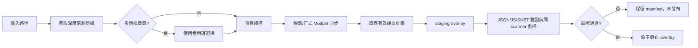

# KubeJS／FTB Quests 流水線（`kubejs_ftb_pipeline`）

入口：`app/views/kubejs_ftb_pipeline_view.py`。

側欄的「KubeJS / FTB 流水線」頁與任務翻譯頁的 FTB Quests、KubeJS Tooltips 分頁使用同一個元件與同一套流程。

這一頁是模組包根目錄 overlay 工作流，不是 Resource Pack 打包器。它沿用
`pack_sources.scan_pack_sources`、ModDB `TranslationDB` 與
`pack_output.export_pack_overlay`，因此不另建資料庫、也不執行來源內的 JavaScript。

## 使用流程



## 根目錄與輸出契約

來源可直接選模組包根、`kubejs`、`config` 或解壓後的 wrapper。探索最多四層，
拒絕 symlink、junction 與其他 reparse point；多個候選不會取第一個，也不會合併。
輸出固定相對模組包根目錄：

```text
<overlay>/kubejs/assets/<namespace>/lang/zh_tw.json
<overlay>/kubejs/client_scripts/<relative>.js
<overlay>/config/ftbquests/quests/<relative>.snbt
<overlay>/config/ftbquests/quests/lang/<target-locale>.snbt
```

`config/ftbquests` 與原始 `kubejs/*.js` 不會放入 Resource Pack ZIP。每次執行
會建立 `run_id`、`pack_scope`、kind 統計、問題明細、輸出計畫與驗證結果的
`manifest.json`，並分開寫入 `metadata/source_mapping.json`、
`metadata/translation_plan.json`、`reports/scan_report.json`、
`reports/coverage.json`、`reports/execution.json`、`reports/format_issues.json`、
`reports/writeback_diff.json`。每筆來源 mapping 都包含 selector、source hash 與
overlay target path。預覽使用 SQLite 唯讀連線；正式執行先 staging，通過來源 hash、
selector、檔案格式與重掃驗證後才發布。

執行可選「完整掃描（非破壞同步）」或「增量同步（只處理來源 hash 變更）」。
兩者都使用同一套 scanner／ingest；完整模式不刪除有效翻譯，增量模式只略過已存在
且來源身份與 hash 完全相同的條目，仍會保留完整掃描 coverage。

## 介面與步驟

頁面版面與「一鍵製作」相同：左欄為「專案路徑」與「流水線步驟」，右欄為「執行狀態」與日誌。

- 專案路徑：讀取來源（模組包根目錄）。分析來源後，候選根目錄與 overlay 輸出目錄在一鍵執行的精靈中設定。
- 流水線步驟：每一步有獨立的「執行」按鈕。
  1. 分析來源：只做候選探索，不寫入。
  2. 預覽同步計畫：dry-run，唯讀開啟 ModDB，不寫入資料庫。
  3. 同步 ModDB：寫入來源條目與 manifest；不輸出 overlay 檔案。
  4. 輸出 overlay：正式發布，需先通過同一 scanner 的驗證。
- 一鍵執行（標頭金色按鈕）：開啟四步設定精靈（1/4 → 4/4，與模組包一鍵製作相同的操作方式）。
  1. 來源與版本：有效來源根目錄（多個候選時必須選擇）、遊戲版本、同步模式（完整／增量）、
     KubeJS／FTB Quests 來源類型。遊戲版本在分析來源時自動帶入：從來源資料夾或 zip 內的
     `manifest.json`、`modrinth.index.json`、`mmc-pack.json`、`minecraftinstance.json`、`instance.cfg` 讀取。
     偵測不到時請手動選擇或輸入；輸入時會依前綴過濾選項（例如輸入 1.21）。手動輸入的版本不會被之後的分析覆蓋。
     未分析來源、版本未填或來源類型都未選時不能前進。
  2. 翻譯設定：「LM 翻譯待處理」開關。預覽不會翻譯，發布時才會生效。
  3. 輸出目的地：overlay 輸出目錄（正式發布必填），未填時不能前進。
  4. 確認並預覽：列出以上設定，按「開始預覽」才開始唯讀預覽（同步步驟 2）。
  預覽成功後彈出「確認發布 overlay」對話框，列出來源檔案與候選數、待同步與略過數、LM 翻譯是否啟用、
  overlay 輸出目錄、將套用與衝突數。按「確認執行並發布」後依序執行同步、LM 翻譯（若啟用）與 overlay 發布；
  按「取消」不寫入任何檔案。預覽有衝突時確認按鈕停用，需先處理衝突。預覽失敗或取消時不會開啟確認對話框。

## 翻譯與責任邊界

本頁負責來源覆蓋率、DB 同步、既有有效譯文回寫與輸出證據。啟用 LM 翻譯時，
同一個流水線 session 會呼叫共用 ModDB 翻譯入口（與模組包一鍵製作使用同一套批次、
快取與格式診斷），不在此頁複製第二套翻譯引擎。Smart Review 仍在既有校對頁處理。

合法跳過、unsupported、parse failure 與 selector conflict 都留在 manifest／DB
問題紀錄，不計入已完成回寫，也不以成功檔案數冒充逐條驗證成功。
