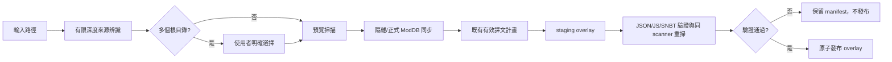

# KubeJS／FTB Quests 流水線（`kubejs_ftb_pipeline`）

入口：`app/views/kubejs_ftb_pipeline_view.py`。

這一頁是模組包根目錄 overlay 工作流，不是 Resource Pack 打包器。它沿用
`pack_sources.scan_pack_sources`、ModDB `TranslationDB` 與
`pack_output.export_pack_overlay`，因此不另建資料庫、也不執行來源內的 JavaScript。

## 使用流程



## 根目錄與輸出契約

來源可直接選模組包根、`kubejs`、`config` 或解壓後的 wrapper。探索最多四層，
拒絕 symlink、junction 與其他 reparse point；多個候選不會取第一個，也不會合併。
輸出固定相對模組包根目錄：

```text
<overlay>/kubejs/assets/<namespace>/lang/zh_tw.json
<overlay>/kubejs/client_scripts/<relative>.js
<overlay>/config/ftbquests/quests/<relative>.snbt
<overlay>/config/ftbquests/quests/lang/<target-locale>.snbt
```

`config/ftbquests` 與原始 `kubejs/*.js` 不會放入 Resource Pack ZIP。每次執行
會建立 `run_id`、`pack_scope`、kind 統計、問題明細、輸出計畫與驗證結果的
`manifest.json`，並分開寫入 `metadata/source_mapping.json`、
`metadata/translation_plan.json`、`reports/scan_report.json`、
`reports/coverage.json`、`reports/execution.json`、`reports/format_issues.json`、
`reports/writeback_diff.json`。每筆來源 mapping 都包含 selector、source hash 與
overlay target path。預覽使用 SQLite 唯讀連線；正式執行先 staging，通過來源 hash、
selector、檔案格式與重掃驗證後才發布。

執行可選「完整掃描（非破壞同步）」或「增量同步（只處理來源 hash 變更）」。
兩者都使用同一套 scanner／ingest；完整模式不刪除有效翻譯，增量模式只略過已存在
且來源身份與 hash 完全相同的條目，仍會保留完整掃描 coverage。

## 翻譯與責任邊界

本頁負責來源覆蓋率、DB 同步、既有有效譯文回寫與輸出證據。LM 翻譯與 Smart Review
仍使用「任務翻譯」既有入口與共用快取／格式診斷，不在此複製第二套翻譯引擎；
完成後可重新執行本頁取得相同 `pack_scope` 的輸出計畫。

合法跳過、unsupported、parse failure 與 selector conflict 都留在 manifest／DB
問題紀錄，不計入已完成回寫，也不以成功檔案數冒充逐條驗證成功。
