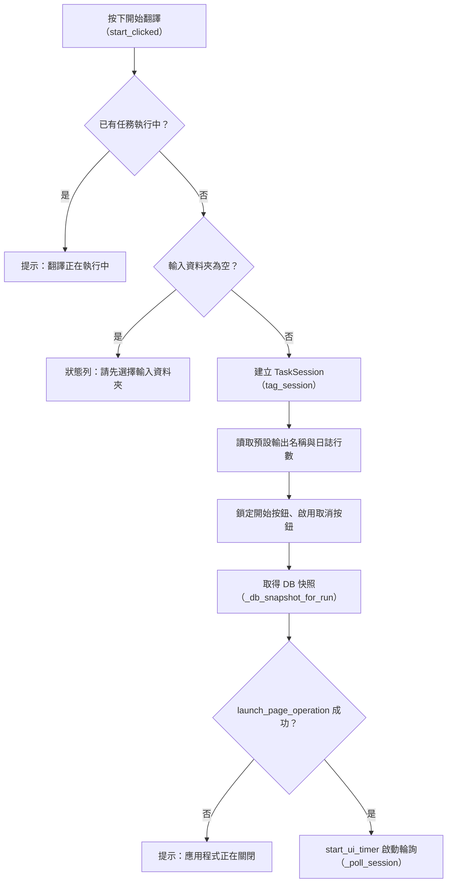
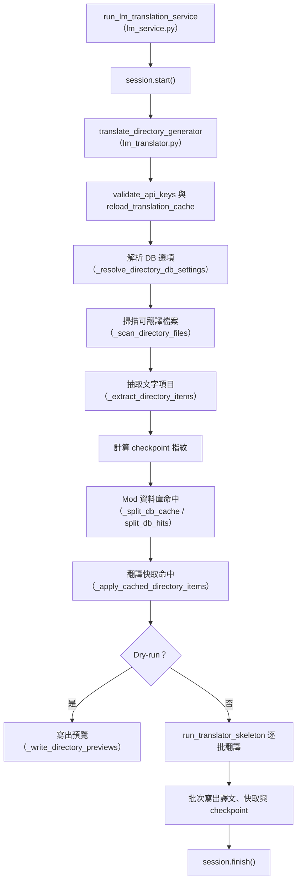
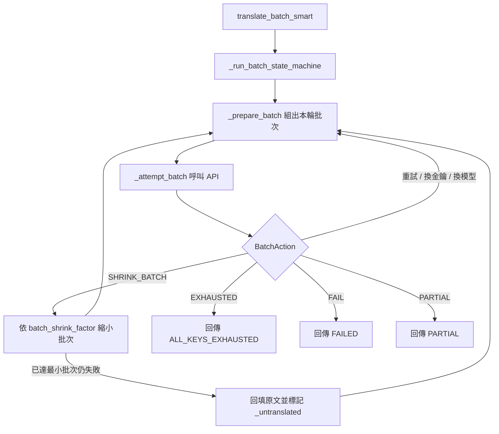

# 機器翻譯（`lm`）處理流程

> 入口：`app/views/lm_view.py` 的 `LMView`。詳細元件說明見 [`View 架構文件`](../developer-guide/views/LM_VIEW_ARCHITECTURE.md)。

## 職責

- 讓使用者選擇輸入／輸出資料夾，並設定本次任務選項（Dry-run、輸出 `.lang`、每次寫入新快取分片（預設關閉，寫入編號分片）、Mod 資料庫）。
- 按下開始後，透過 `launch_page_operation` 把 `run_lm_translation_service`（`app/services_impl/pipelines/lm_service.py`）放到背景執行緒執行。
- 服務層呼叫 `translation_tool/core/lm_translator.py` 的 `translate_directory_generator`，負責掃描、Mod 資料庫／翻譯快取分流、批次 AI 翻譯與輸出。
- 以 `TaskSession` 的 `snapshot()` 輪詢進度與日誌，右側統計卡顯示進度、已用時間、AI 認證狀態（金鑰健康或 ChatGPT 連線）與快取寫入頻率。
- 支援續跑：啟動時偵測到中斷任務後，由 `resume_interrupted(task)` 還原上次的輸入與選項。

## 主要流程

### 開始翻譯（UI 執行緒）

### 服務與核心翻譯（背景執行緒）

### 單批翻譯狀態機（`lm_translator_main.py`）

- 每批提示詞會依輸入項目加入官方 Minecraft 術語；Mod DB 的已審核 `lang` 翻譯參考會限制在同一模組、目前 Minecraft 版本與本批原文，提供給 `lang`、Patchouli、Guide、Advancement 與 `md`／`.txt` 路線參考。同一英文有互相衝突的已審核譯文時不注入任何一筆。提示詞與同模組的 session 歷史會計入輸入 token 預算，但不計入翻譯輸出 KPI。
- Mod DB 翻譯以 `(cache_type, batch_group)` 分組，避免把不同模組或不同種類混在同一個 payload；同一模組的不同 kind 批次沿用同一個 client-side session。預覽與實際執行共用同一個批次 planner 與固定 prompt token 估算；開始前的批次數是依當下提示詞與 session 狀態計算的下界，session 歷史增長或錯誤縮小批次時實際請求數可能增加。`.md` 與 `.txt` 指南仍走 Patchouli 提示詞，但使用 `md` 快取分類。

## 背景任務與 UI 更新

- 開始時以 `launch_page_operation(..., owner="lm")` 登錄任務，使用預設的 `CancellationPolicy.COOPERATIVE` 與 `ShutdownPolicy.CANCEL_AND_DRAIN`（定義於 `app/tasks/operation_registry.py`）。
- 背景執行緒只寫入 `TaskSession`（`add_log`、`set_progress`）。UI 不會從執行緒直接更新，而是由 `_poll_session` 在 Flet event loop 上以 `PollerHandle` 每 0.2 秒呼叫 `_sync_from_session`，同步進度條、`LogView.sync_entries` 日誌與統計卡。
- 任務結束（狀態 `DONE` 或 `ERROR`）時，輪詢停止、按鈕復位；`DONE` 且已請求取消時顯示「已取消」。
- 取消：`cancel_clicked` 呼叫 `session.request_cancel()`，狀態改為「取消中…」。取消在三個位置檢查：`cancel_scope`（等待 API 限流時可打斷）、`translate_batch` 的 `should_cancel`、以及共用迴圈在批次邊界的 `is_cancelled()`。已完成的批次照常保留。
- 換頁卸載：`will_unmount` 只停止輪詢，任務繼續執行；`did_mount` 若任務仍在追蹤中，重新啟動輪詢。

## 狀態與資料

- 頁面狀態：`session`、`_ui_timer_running`、`_poller`、`_started_at`、`_resume_db_settings_snapshot`。
- 控制項：`input_path`、`output_path`、`dry_run_switch`、`export_lang_checkbox`、`write_new_cache_switch`，以及 `lm_db_options`（`app/views/moddb/lm_db_options.py` 的 `LmDbOptions`）。
- 讀取的設定：
  - `lm_translator.lm_translate_folder_name`：未填輸出時的預設資料夾名（預設 `LM翻譯後`）。
  - `lm_translator.batch_write_interval`：快取寫入頻率。
  - `lm_translator.provider`：決定統計卡顯示 ChatGPT 或金鑰健康。
  - `translator.parallel_execution_workers`：抽取時的並行數。
  - `lm_translator.rate_limit.sleep_seconds_between_batches`：provider／model 共用的請求最小間隔，預設 `4` 秒，適合每分鐘 15 次（RPM 15）的模型；正常批次、內部縮批與同批品質 retry 都使用同一個 request slot。明確設定 `0` 才會停用本地間隔等待；它不取代 API 回傳 `Retry-After` 時的限流等待。
  - `lm_translator` 區段的 `batch_shrink_factor`、`min_batch_size`：批次縮小參數。
  - UI 日誌行數（`load_ui_logging_config` 的 `tail_lines`）。
- 抽取規則：Patchouli 檔案的 `multiblock` 物件（方塊圖樣的 `pattern`、`mapping`）整個不抽取，因為翻譯或削掉列內空白會讓每列長度不一致、整本書載入失敗；Mod 資料庫的 jar 掃描共用同一個抽取函式（`translatable_extractor.extract_translatables`），規則相同。
- 手冊欄位判斷：Patchouli 類 JSON 的字串依所在欄位與值的形狀判斷（`text_sniffer.classify_book_string`，陣列元素用上層欄位）；`text_sniffer.BOOK_ID_FIELDS` 的 id 欄位一律不抽取，`text_sniffer.BOOK_DISPLAY_FIELDS` 的顯示欄位連單字、駝峰名稱也抽取，其他欄位的單一 token 若是小寫或駝峰識別字、路徑、全大寫常數就不抽取；資源 id、網址、數字、色碼、`#模板變數#`、物品堆疊、NBT 片段、已是中文或沒有半形英文字母的字串、指向語言檔的鍵在任何欄位都不抽取。
- 手冊檔案發現：`translatable_extractor.find_patchouli_json` 除了設定的資料夾名稱（`lm_translator.patchouli.dir_names`，任何深度的資料夾名稱都算），也依內容找（`text_sniffer.looks_like_book_json`：有 `pages` 頁面、Patchouli 規格的 `categories`／`templates` 結構）；書本根目錄的 `book.json` 不處理。提取階段（`jar_processor.extract_book_files_generator`）在名稱規則之後，用同一套內容判斷補提取（`jar_sniff_extract`）。
- 指南（`.md`／`.txt`）：`guide_translation.find_guide_files` 依內容找出英文原文（有 front matter，或段落像英文句子；README、CHANGELOG 這類專案說明文件、`textures` 等規格資料夾、其他語系資料夾與簡繁中文變體不收），以段落為單位（與 Markdown 外掛相同的切法）進入目錄翻譯；段落鍵值是 `blocks[<序號>]`，Mod 資料庫身分是 `檔案路徑#序號`。譯文回來後還原行內保護，`quality.guide_structure_issues`（底層為 `guide_format.guide_issues`）比對標籤（含 ` `）、標題／清單／引用前綴、`**`、行內程式碼標記與連結目標，任何一項和原文不一致的段落保留原文；front matter 的 `navigation.title`（指南側邊欄標題）由 `guide_blocks.extract_guide_blocks` 排在所有段落之後一起翻譯，其他 front matter 欄位不動；輸出由 `render_guide` 依行號組回，只替換文字行。輸出位置：有 `en_us`／`_en_us` 資料夾就換成 `zh_tw`／`_zh_tw`，英文放在指南根目錄的（AE2、GuideME）寫進指南根目錄下的 `_zh_tw/`。
- 產出檔案：
  - 輸出資料夾中的譯文 JSON；`lang/en_us.json` 寫成同資料夾的 `zh_tw.json`，Patchouli 書的 `patchouli_books/<書>/en_us/…` 寫進同書的 `zh_tw/…`（`translation_path_writer.map_lang_output_path`）；勾選「輸出 .lang」時，路徑含 `lang` 的來源檔另外輸出同名 `.lang`。另有 `translation_map.json`（逐筆對照紀錄）。Patchouli 書寫出前會與來源 `en_us` 比對（`patchouli_compat.find_patchouli_mismatch`），結構或格式標記數量不同時記警告，檔案仍照常寫出。
  - 翻譯快取（`translation_tool/utils/cache_manager.py`）：譯文一律寫入；`write_new_cache` 決定寫入方式：關閉時寫入編號分片，開啟時每批另存成獨立的時間戳分片。
  - Checkpoint：`get_data_root()/logs/translation_checkpoint.json`。只有 `translator.enable_cache_saving`（預設開啟）為真時才寫入；整批 `DONE` 且處理完畢才清除，中斷時保留供續跑使用。
  - Mod 資料庫寫回（`translation_tool/core/lm_translator_db.py` 的 `flush_write_back`）。
- 續跑：`resume_interrupted(task)` 還原輸入、輸出、Dry-run 與 `.lang` 設定；Mod 資料庫設定依任務內的快照還原，不採用目前頁面值。若快照缺失但任務使用了資料庫，會顯示提示並停止續跑。

## 錯誤處理

- 啟動前檢查：輸入為空、已有任務執行中、應用程式正在關閉，都只以狀態列或 snackbar 提示，不會啟動任務。
- 服務例外（`run_lm_translation_service`）：完整堆疊經 `mirror_session_log` 寫入後台與任務日誌（`level="error"`），呼叫 `session.set_error()`，最後在 `finally` 中清除 `UI_LOG_HANDLER` 並呼叫 `session.finish()`。畫面顯示「任務發生錯誤」。
- 批次層錯誤：`_classify_batch_error` 依錯誤類型決定換金鑰、換模型、重試或縮小批次；Gemini 503 與 ChatGPT 額度錯誤各有專用處理（`_handle_service_unavailable_error`、`_handle_chatgpt_api_error`）。
- 共用迴圈（`lm_translator_shared_loop.py`）的終態：
  - `ALL_KEYS_EXHAUSTED`：停止，訊息為「翻譯中斷」。
  - `FAILED`（含快取寫入失敗、checkpoint 寫入失敗、整批無任何成果）：停止並在畫面顯示一行摘要，堆疊寫入後台。
  - `CANCELLED`：訊息為「翻譯已取消，完成 x/y 筆」。
- 損毀的 checkpoint 會被改名為 `.corrupt` 隔離，並記錄警告，視為沒有 checkpoint。
- 後台 log 使用 `translation_tool/utils/log_unit.py` 的 `log_info`、`log_warning`、`log_error`。畫面日誌透過 `UI_LOG_HANDLER` 轉入任務 session。
- 統計卡的金鑰健康讀取若失敗，`refresh_key_stat` 會靜默略過該卡片的更新，不影響翻譯。
