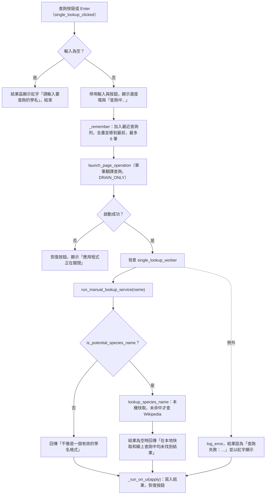
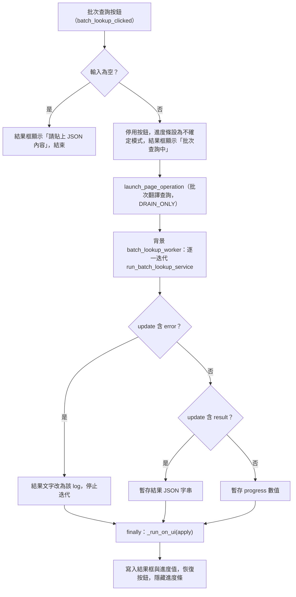

# 學名查詢頁（`lookup`）處理流程

> 入口：`app/views/lookup_view.py` 的 `LookupView`。詳細元件說明見 [`LOOKUP_VIEW_ARCHITECTURE.md`](../LOOKUP_VIEW_ARCHITECTURE.md)。

## 職責

學名查詢頁將生物英文學名對應為學名與繁體中文名稱。頁面分為兩個區塊：

- **單筆查詢**：輸入一個學名，顯示結果，並保留最近查詢的晶片列（最多 6 筆，只存在於本次程式執行期間）。
- **批次查詢**：貼上 JSON 字串陣列，輸出 JSON 物件（學名 → 結果）。

頁面本身不做查詢。查詢邏輯由 `app/services_impl/pipelines/lookup_service.py` 提供（`run_manual_lookup_service`、`run_batch_lookup_service`），實際的物種判斷與查詢由 `translation_tool/utils/species_cache.py` 處理。`LookupView` 只負責畫面狀態與把背景結果套用回 UI。

## 主要流程

### 單筆查詢

最近查詢的晶片點擊時（`_lookup_recent`），若輸入框未停用，會把名稱填回輸入框並直接呼叫 `single_lookup_clicked`。

### 批次查詢

`run_batch_lookup_service` 內部會先 `json.loads`：不是 list 時回報「必須是一個列表」，格式錯誤時回報「不是有效的 JSON 格式」。通過後，逐一對每個名稱判斷：不像學名者記為「格式錯誤」，查無結果者記為「未找到」，其餘記為查詢結果。全部完成後輸出 `--- 批次查詢完成 ---` 與結果 JSON（`ensure_ascii=False`，縮排 2）。

## 背景任務與 UI 更新

- **背景任務**：單筆與批次查詢各自透過 `launch_page_operation` 啟動，owner 皆為 `lookup`，`CancellationPolicy.NON_CANCELLABLE`，`ShutdownPolicy.DRAIN_ONLY`。
- **UI 套用**：背景執行緒不直接碰控制項。`_run_on_ui` 把套用函式包成協程交給 `page.run_task`，在 event loop 上執行。
- **批次進度的實際行為**：`batch_lookup_worker` 只在迭代結束後（`finally`）呼叫一次 `apply`，因此進度條與結果框在查詢過程中不會逐步更新，只在完成時一次更新。查詢期間結果框固定顯示「批次查詢中，請稍候...」。
- **複製結果**：`copy_result_clicked` 以 `ft.Clipboard().set` 寫入剪貼簿，結果為空時不動作。
- **無 debounce**：單筆與批次查詢都只在按下按鈕或 Enter 時觸發，沒有即時搜尋。

## 狀態與資料

- **`_recent`**：最近查詢名稱的清單，只保存在記憶體，程式關閉即清除。上限 `RECENT_LIMIT`（6）。
- **單筆控制項狀態**：`single_input`、`single_button`、`single_progress_ring`、`single_result_text`、`recent_row`。查詢中會停用輸入與按鈕，完成後恢復。
- **批次控制項狀態**：`batch_input`（JSON 字串）、`batch_result_textfield`（唯讀）、`batch_progress_bar`（預設隱藏）、`batch_button`。
- **外部資料來源**：`lookup_species_name` 先查 `species_cache` 的記憶體字典（來源為本機快取檔，寫入時 append 到 tab 分隔檔）；未命中才呼叫 `query_wikipedia_and_update_cache`，成功時更新記憶體與快取檔。
- **負面快取**：查無結果的學名會以空字串寫入記憶體字典，本次執行期間再次查詢會直接回傳「未找到」，不會重新連線；這些空值不會寫入快取檔。
- **語言與速率**：Wikipedia 語言與查詢間隔由設定檔的 `species_cache` 區段決定（預設語言 `zh`，每次線上查詢前等待 `wikipedia_rate_limit_delay`）。

## 錯誤處理

- **輸入錯誤**：空白輸入直接在結果區顯示錯誤，不啟動背景任務。
- **格式錯誤**：單筆格式不符學名規則時回傳提示字串，不呼叫 Wikipedia。批次則為該名稱記錄「格式錯誤」。
- **查詢例外**：單筆在 worker 內捕捉（`log_error` 含 traceback），結果區顯示「查詢失敗：…」並以紅字呈現，按鈕與輸入框仍會恢復。
- **批次例外**：`run_batch_lookup_service` 內部捕捉 JSON 與其他錯誤，轉為 `error` 更新；`batch_lookup_worker` 另外捕捉未預期例外，結果框顯示「批次查詢失敗：…」。
- **Wikipedia 失敗**：`query_wikipedia_and_update_cache` 捕捉 `PageError`、`DisambiguationError`（會改用第一個候選選項重試）與其他網路錯誤，回傳 `None`，頁面顯示「未找到」類結果。
- **應用程式關閉中**：`launch_page_operation` 回傳假值時，單筆與批次都會恢復控制項狀態、顯示 snack 提示「應用程式正在關閉」。
- **注意**：批次結果來自 `GLOBAL_LOG_LIMITER.filter` 過濾後的 update。目前 `LogLimiter` 的 `flush_interval` 設為 `0.0`，正常情況下不會丟棄 `result`，但若日後調整節流設定，最終結果可能不會顯示。
