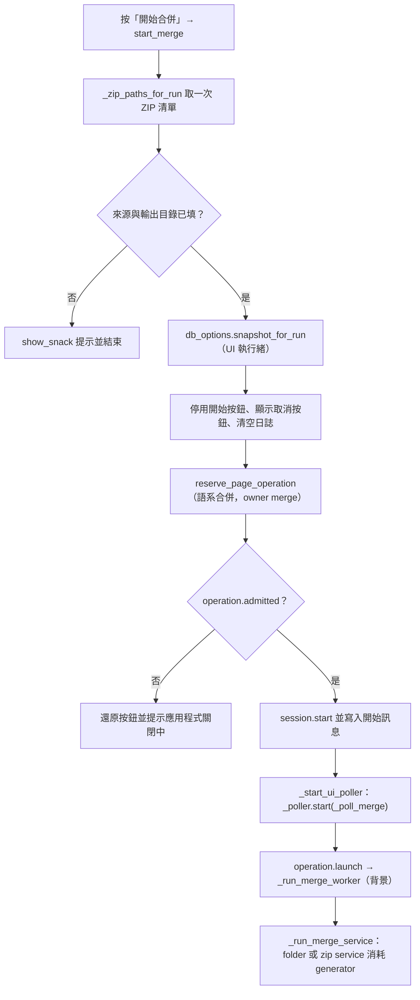
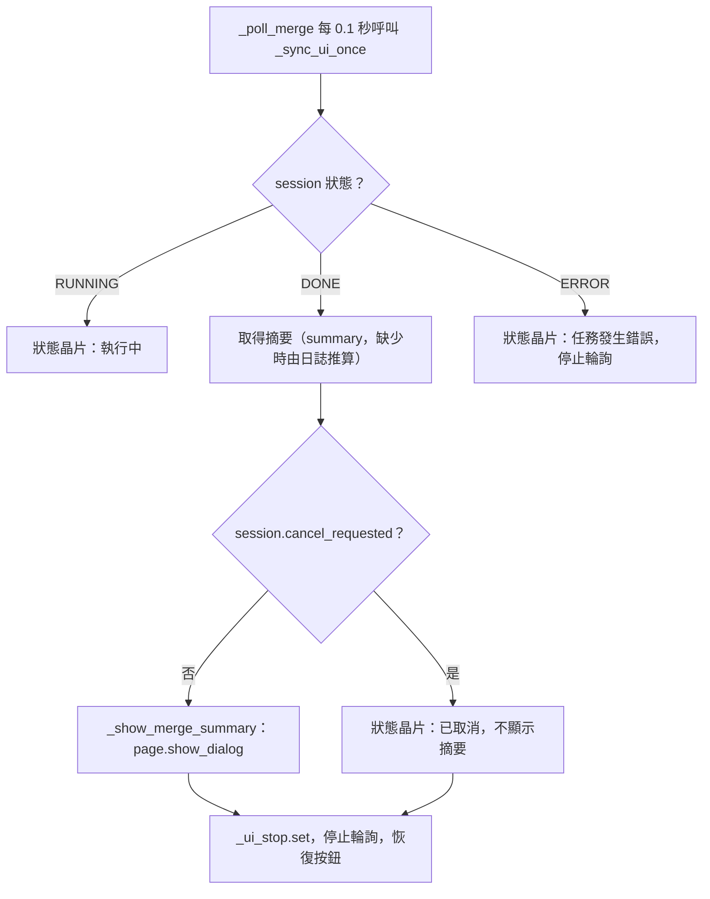

# 語系合併（`merge`）處理流程

> 入口：`app/views/merge_view.py` 的 `MergeView`。詳細元件說明見 [`View 架構文件`](../developer-guide/views/MERGE_VIEW_ARCHITECTURE.md)。

## 職責

- 提供兩種輸入模式：資料夾（`folder`）與 ZIP 清單（可加入手動輸入的單一 ZIP 路徑）；另有輸出資料夾與合併選項（只處理 lang、處理 zh_cn、略過 Patchouli en_us、各項門檻）。
- 啟用 Mod DB 且有目標版本時，語系合併的 lang 條目譯文來源順序為：輸出資料夾既有譯文 → 資料庫（鍵值與英文原文相同）→ jar 的有效 zh_tw → 官方 `key + en_us + zh_cn` 精確對照 → zh_cn 簡轉繁 → 待翻譯。
- Patchouli 手冊的 zh_cn／zh_tw 譯文會先和同書 `en_us` 比對格式（舊版物品 NBT、頁數或欄位不同）；格式不同的視為過時譯文，不寫入輸出，`en_us` 原文改列待翻譯。文字內格式標記數量和 `en_us` 不同的譯文只記警告、仍採用。
- 實際合併交給 `app/services_impl/pipelines/merge_service.py` 的 `run_merge_folder_batch_service` 與 `run_merge_zip_batch_service`，兩者都是 generator，由 `MergeView._run_merge_service` 完整消耗。
- 翻譯記憶庫選項由 `MergeDbOptions`（`app/views/merge/merge_db_options.py`）提供，點擊時產生不可變的 `MergeDbRunSnapshot`。
- 合併選項的變更會即時寫回 `lang_merger` 設定（`config_store.set_value`），並通知已開啟的設定頁重新讀取。
- 進度與日誌透過 `TaskSession` 記錄，由 `LogView.sync_from_session` 與狀態晶片呈現。

## 主要流程

### 開始合併

### 狀態同步與收尾

## 背景任務與 UI 更新

- 啟動時以 `reserve_page_operation(page, name="語系合併", owner="merge", task_session=self.session)` 登記。`operation.admitted` 為 `False` 時會還原 UI 而不啟動。通過後以 `operation.launch(partial(_run_merge_worker, input_mode, zip_paths, db_options_snapshot))` 執行。
- `session` 在 `_init_merge_options` 建立（`TaskSession(max_logs=2000)`，以 `tag_session` 標記為「語系合併」），整個頁面重複使用同一個物件；每次開始時 `session.start()` 會重設。合併服務在預設 `finish_session=True` 時自行呼叫 `finish()`。
- 輪詢由 `PollerHandle`（`self._poller`）持有。`_poll_merge` 每 0.1 秒執行 `_sync_ui_once`，在 event loop 上更新狀態晶片、進度條與日誌（`log_view.sync_from_session`）。收到 DONE 或 ERROR 後設定 `_ui_stop` 結束輪詢。
- 卸載：`will_unmount` 只停止輪詢，合併仍會繼續執行。重新掛載：`did_mount` 先 `db_options.sync_from_config()`，若合併仍在追蹤（`_merge_tracking`）且未停止，就重新啟動輪詢。
- 取消：`cancel_merge` 只在 session 狀態為 `RUNNING` 時呼叫 `session.request_cancel()`，停用取消按鈕並寫入 warning 日誌。worker 以 `cancel_scope` 包住執行，讓核心合併的檢查點讀取同一個取消旗標。
- 摘要視窗（`_show_merge_summary`）以 `page.show_dialog` 顯示。「開啟輸出資料夾」使用合併開始時快照的 `_run_output_dir`；「關閉」呼叫 `page.pop_dialog()`。
- 注意：DB 選項只使用點擊時的快照，但 `_run_merge_service` 在背景執行緒中仍直接讀取 `folder_path_field`（folder 模式）、`output_dir_field`、各合併選項與門檻欄位的目前值；ZIP 模式的路徑則使用開始時的清單。這與該函式註解中「不得在背景讀取可變控制項」的原則不一致，維護時需要留意。

## 狀態與資料

- 頁面狀態：`selected_zips`（清單）、`zip_path_field`、`folder_path_field`、`output_dir_field`、各 switch 與門檻欄位、`_merge_stats`、`_merge_tracking`、`_ui_stop`（`threading.Event`）、`_run_output_dir`。
- `session`：TaskSession；`session.snapshot()` 回傳的 `summary`（`success_zips`、`failed_zips`、`failed_zip_details` 或資料夾版本的 `success_folders` 等）是摘要的主要來源。缺少摘要時，`_sync_ui_once` 會依日誌中的 `[完成]`、`[錯誤]` 字串推算。
- 設定寫入：`_on_merge_field_changed(key, value)` 呼叫 `config_store.set_value(f"lang_merger.{key}", value)`，寫入成功後 `_broadcast_config_change_to_config_view` 會重新讀取已建立的設定頁。
- 設定讀取：`load_config()` 讀取 `lang_merger.pending_folder_name` 與 `lang_merger.pending_organized_folder_name`，用於摘要文字。
- 翻譯記憶庫快照 `MergeDbRunSnapshot`：`use_db`、`version`、`database_settings`。
- 產出：合併結果寫入 `output_dir_field` 指定的目錄。取消時，merge_service 內的 `_cleanup_cancelled_output` 只刪除「本次新建立」的輸出資料夾（以 `existed_before` 判斷），既有資料夾不動。

## 錯誤處理

- 輸入缺漏（來源、ZIP 清單或輸出目錄為空）：以 `show_snack` 提示，不啟動任務。
- 應用程式關閉中無法啟動：還原按鈕與狀態晶片，並顯示提示。
- 合併例外：`_run_merge_worker` 的 `except Exception` 先以 `session_task_scope` 綁定本頁 session，再以 `log_error` 寫入完整堆疊；畫面只顯示「類型: 訊息（完整堆疊已寫入後台 log）」（`add_log_unmirrored`），接著 `set_error()` → `finish()`，狀態晶片顯示「任務發生錯誤」。
- 輸出檔替換被拒（OneDrive／防毒掃描暫時鎖檔的 `WinError 5`）：語言檔與 `.translation-provenance.json` 以 `replace_with_retry`（`translation_tool/utils/file_replace.py`）退避重試最多 5 次；仍失敗時，語言檔寫入失敗會讓該模組失敗（其他模組照常處理，但階段 1 標為失敗、階段 2 略過），來源標記檔寫入失敗只記警告，不影響該模組。
- 取消：`TaskCancelled` 視為正常終止，寫入「[取消] 合併已停止」warning，不作為錯誤處理。
- service 內的致命錯誤（例如 ZIP 無法處理）：service 自行 `set_error()`，並由 `_finish_folder_run` 等函式寫入摘要；`finish` 由 service 負責。
- 狀態同步例外：`_sync_ui_once` 以 `log_warning` 記錄後繼續，不會中斷輪詢。
- 設定寫入失敗：`log_warning(..., exc_info=True)`，UI 不中斷，但設定不會保存。
- 設定頁通知失敗：`log_warning`，不影響合併頁本身。
- 開啟輸出資料夾失敗：以 `show_snack` 提示「無法開啟輸出資料夾」。
