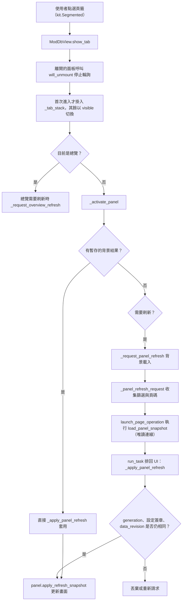
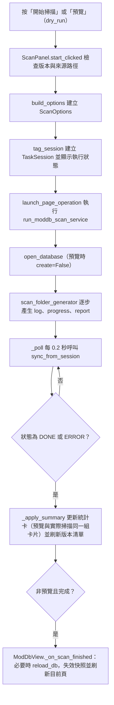
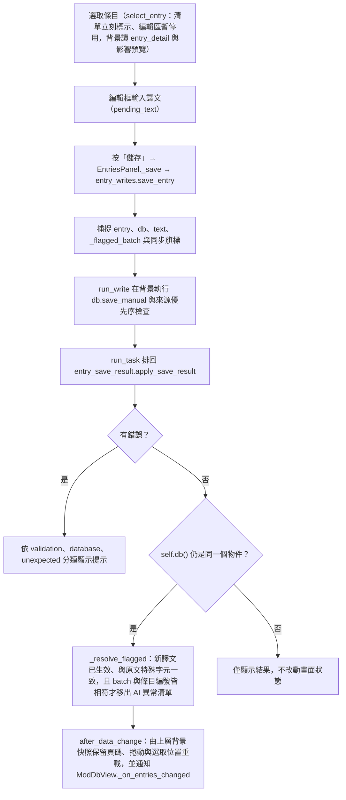
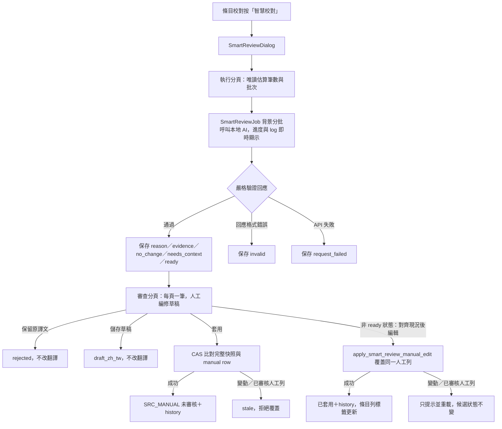
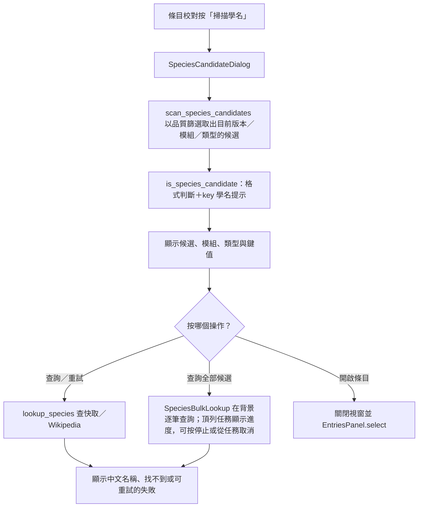
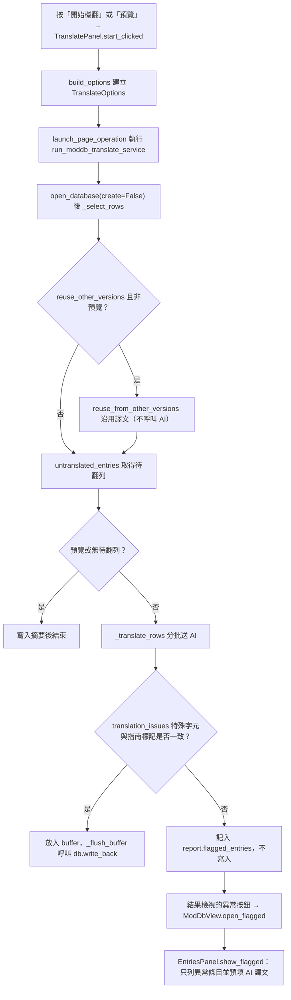
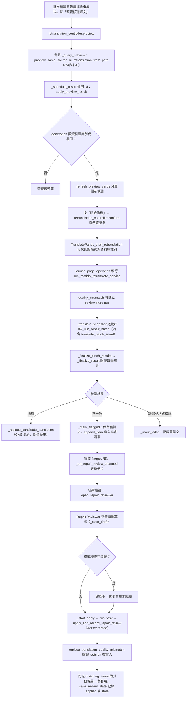
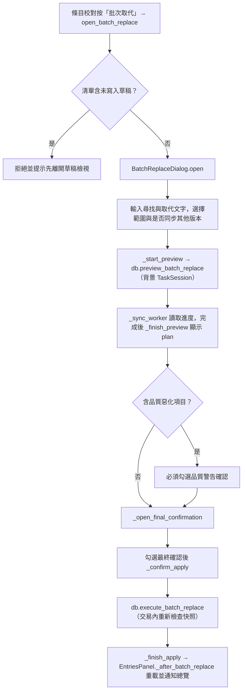

# Mod 資料庫頁（`moddb`）處理流程

> 入口：`app/views/moddb_view.py` 的 `ModDbView`。詳細說明見 [`Mod DB 文件`](../user-guide/mod-translation-db.md)。

## 職責

- `ModDbView`（`app/views/moddb_view.py`）持有唯一的資料庫連線 `_db`、四個頁籤的顯示切換，以及跨頁籤的快照失效與背景刷新。
- 四個頁籤位於 `app/views/moddb/`：`OverviewPanel`（`overview_panel.py`）、`EntriesPanel`（`entries_panel.py`）、`ScanPanel`（`scan_panel.py`）、`TranslatePanel`（`translate_panel.py`）。
- 批次取代對話框 `BatchReplaceDialog`（`batch_replace_dialog.py`）與批量審核對話框 `BulkReviewDialog`（`bulk_review_dialog.py`）由條目校對頁開啟；AI 修復逐筆審查 `RepairReviewer`（`repair_reviewer.py`）由批次機翻的結果檢視開啟。
- 學名候選對話框 `SpeciesCandidateDialog`（`species_dialog.py`）由條目校對頁開啟；它只讀取目前範圍的 `entry.en_us`，逐筆查詢時才使用學名快取／Wikipedia API，不寫入翻譯資料表。
- 實際寫入與掃描邏輯在 `app/services_impl/` 下的 moddb 系列模組（例如 `moddb_service.py`、`moddb_translate_service.py`、`moddb_retranslate_service.py`），資料庫方法在 `translation_tool/translation_db/repository.py`。

## 主要流程

### 頁籤切換與背景資料載入

切換頁籤時，離開的頁籤會先停止輪詢，已掛載的頁籤以 `visible` 切換而不重建控制項。

唯讀背景連線可共用有容量上限的統計與分頁快取；快取依資料世代、資料庫檔案身分及
WAL 狀態隔離，寫入交易中的結果不會發布到共用快取。一般分頁先篩選與排序條目 ID，
只對當頁條目載入譯文、人工來源與歷史資料。品質篩選仍保留精確判斷；可完全用 SQL
判定的未知原文、缺少譯文與前後空白直接分頁，其餘狀態可重用同一資料快照的當頁結果。

頁面快照的 `db_generation` 由 `database_data_generation` 提供，使用包含內部交易世代與外部 SQLite 寫入序號的快取世代。即使資料庫由另一個連線更新，篩選結果與目前清單也會在套用背景結果前失效並重新請求；不可在 view 直接讀取 `_data_gen()` 或把舊快照當成仍有效。

條目校對的換頁、搜尋、狀態／來源／模組／類型／進階篩選與資料庫寫入後的重載，都走這條背景快照：點擊當下只標示目標狀態、清單變暗並顯示載入中提示（讀取先交給 worker，再重畫提示，兩者重疊），結果以請求序號與請求內容比對判斷是否過期；只換頁（`page_only`）的請求不重算版本／模組／來源選項。選項與選值都沒變時篩選列不重畫（它的下拉選單有上千個模組選項）。沒有背景排程的頁面（單元測試）同步查詢。

搜尋、狀態、來源、審核狀態、智慧校對狀態與進階條件變更（版本、模組、類型沒換）分兩段載入（`defer_options`）：第一段只讀清單當頁與總筆數，先顯示清單；模組／來源下拉選項（需要整個版本的掃描、重畫成本也比清單高）由 `FilterOptionsLoader` 在第二段背景補上：條件穩定 0.25 秒（沒有更新的請求）才開始查，輸入中的每個字都不重算；同一時間只跑一個查詢、只保留最新請求，回來時條件已不同就丟棄，選項與選值沒變就不重畫篩選列，有變時只更新有變的下拉選單（`FilterFlush`），進階條件摘要與資料操作按鈕的狀態有變才更新那一列。搜尋框停筆 0.22 秒才查詢；條件又變了時，進行中的舊查詢會被中斷（`QueryInterrupt`，結果本來就不會顯示），新查詢不必等舊的掃完。沒有選模組／來源的搜尋，整個版本的逐列比對只掃一次（切成編號區間、多條唯讀連線同時掃），同一份分面同時回答總筆數與下拉選項。

### 掃描匯入

掃描來源可填 `mods` 資料夾或整個模組包根目錄。jar 之外，選項「包含 KubeJS／FTB
Quests」會透過共用的 pack source scanner 讀取 `kubejs` 與
`config/ftbquests/quests`，並沿用 `scan_ingest.py` 的預覽／實際匯入分類。腳本只做
靜態字串辨識，沒有 JavaScript 執行；每筆來源以相對路徑與 selector 保存於
`entry_origin`，因此同名檔案不會互相覆蓋。動態文字、語言 key 參考與解析失敗會進入
內容處置紀錄，不會產生假條目。`ftb_quests` 與 `kubejs_script` 不會被當作 Resource
Pack lang；回寫分別交給既有 FTB config 與 KubeJS script pipeline。

取消掃描時 `cancel_clicked` 只呼叫 `session.request_cancel()`，等待目前處理中的檔案停止。

預覽也會把每個項目分成新增、補入新來源譯文、已存在略過、原文已變動、補上原文：分類規則在 `scan_ingest.py` 的 `ingest_groups`，實際寫入用 `DbIngestTarget`、預覽用 `PreviewIngestTarget`（`TranslationDB.scan_preview_target` 只讀資料庫；還沒有資料庫時全部算新增）。預覽把這次掃描已「新增」的條目與譯文記在記憶體，後面的 jar 會像實際寫入一樣看到前面 jar 新增的內容，所以預覽與開始掃描的數字相同（jar 平行讀取、完成順序不固定，同一條目分散在多個 jar 且譯文不同時，兩次掃描各自的分類可能不同）。卡片說明在預覽時標示「預覽（未寫入）」（標題不變，避免截斷）；後台記錄的每個 jar 與最後一行摘要都用 `ingest_counts_text` 的同一組欄位。

### 條目校對與儲存

條目校對的畫面執行緒不查詢資料庫：

- **翻頁**（`kit.Pager`）只換頁碼，走 `ModDbView._on_entries_filter_changed(page_only=True)` 的背景快照；Pager 立刻標示目標頁、清單變暗並顯示「正在載入第 N 頁…」，worker 只讀當頁條目、詳情與智慧校對標籤，不重算版本／模組／來源選項。連點頁碼時較舊的結果因請求已改變而被丟棄，只套用最後一次。
- **選取條目**時 `EntriesPanel._select_ticket` 前進：被點的列立刻標示、編輯區停用（載入中不能編輯上一筆的內容，此時輸入事件被忽略，不會把上一筆內容記成新條目草稿），`entry_detail` 與影響預覽在背景讀取；結果到達時 ticket 已過期（又點了別筆，或清單被新快照取代）就丟棄。
- **輸入譯文**只立刻更新儲存／審核按鈕；格式差異、Minecraft 預覽與影響預覽（`compute_impact`）在停筆 `EDIT_DEBOUNCE_SECONDS` 後才重畫，影響預覽由背景查詢，輸入或條目又變了就丟棄。
- 儲存、還原、整批還原與審核都經 `entry_writes.run_write` 在背景寫入，畫面執行緒只套用結果；寫入後的清單重載由上層背景快照完成（`prepare_reload_after_change` 保留頁碼、捲動位置，原條目消失時選同一位置的下一筆）。

背景資料庫快照即使在儲存完成後才抵達，也必須只更新條目清單、篩選選項、審核標籤與統計，不得重設使用者正在編輯的譯文。`EntriesPanel` 以條目 id 保存編輯框相對於資料庫值的 resident 草稿；`apply_refresh_snapshot` 套用新快照前先收集目前差異，`_show_editor` 優先還原該草稿。草稿會在資料庫身分改變時清除，或在儲存回呼確認編輯框仍等於剛寫入的值時清除；儲存後繼續輸入的內容會保留並明確提示尚未儲存。

### 資料庫切換與背景快照失效

`EntriesPanel._sync_database_identity` 是資料庫身分 transition 的共通入口；身分改變時，`reset_editor_for_database_change` 必須一起清除人工草稿、選取／詳情、編輯框、機翻 `entry_ids`、機翻 `drafts`、批次世代與審查預覽。這個清理也適用於從未知身分恢復為實際資料庫，避免相同 entry id 在不同 SQLite 資料庫間重用 resident state。

`ModDbView` 的完整 Entries 快照與 filter-only 快照都帶有資料庫身分和 `db_generation`。在套用邊界由 `_validate_entries_snapshot` 檢查請求身分、快照身分、目前 panel 身分及資料代次；身分不符時清除舊 scope、重新載入資料庫並重新查詢，資料代次不符時丟棄晚到結果並重新查詢。只有通過驗證的快照可以更新清單、選項、source scope、審核標籤與統計；舊快照不得把上一個資料庫的來源範圍或批次條件套用到目前畫面。

資料清理由總覽頁的「資料清理」按鈕開啟 `CleanupDialog`（`cleanup_dialog.py`，服務層 `moddb_cleanup_service.py`）。選擇版本時 `_refresh_overview` 在背景呼叫 `cleanup_overview`，依類型與類別顯示該版本可清理的筆數（只讀，換版本時舊結果作廢）；`_export` 呼叫 `export_cleanup_report` 寫出 JSON 檢查檔，檔名由服務層 `export_cleanup` 取唯一名稱（同一秒匯出兩次、或使用者已編輯過的檔案都不會被覆蓋），內容先寫暫存檔再整個換過去。檢查檔記錄格式 `mod-db-cleanup-v2`、類型（`rule` 或 `protected`）、版本與資料庫身分（`meta.cleanup_db_id`）；格式、類型、版本、身分不符，或 `id` 不是正整數、`id` 重複、`delete` 不是布林值的項目一律拒絕或略過。

**掃描迭代造成的重複鍵**：`CleanupDialog` 的「掃描重複鍵」開啟獨立的 `DuplicateCleanupDialog`。核心只把指南／Patchouli 檔案鍵套用既有語系路徑正規化；同版本、同模組、同類型、同正規化鍵且原文相同的候選才列為可安全合併。翻譯來源內容衝突、原文不同、跨版本或跨模組的項目只列為需人工確認，不會自動合併。掃描匯入時若只有唯一別名且原文相同，也會重用既有條目，避免日後再建立第三筆；已有多個別名時則保持保守，交給清理功能處理。

重複鍵視窗的掃描範圍可明確選擇**遊戲版本、模組與內容類型**（全部、Guide 或 Patchouli）。開啟視窗會先做一次唯讀預覽；切換任一範圍後，舊預覽立即失效，必須按「預覽／重新掃描」才能重新建立可套用計畫。結果以卡片列出狀態、模組／類型、規範化鍵、原文與實際來源路徑；「可安全合併」與「需人工確認」分開標色，人工候選會顯示翻譯衝突或原文不同的原因。預覽 token 同時綁定資料快照與版本／模組／類型範圍，避免把不同範圍誤當成同一份計畫。這樣可以先縮小到單一版本／模組／類型核對，再執行合併，不必從一個扁平清單猜測範圍。

**預覽與刪除的契約**：`_preview` 呼叫 `preview_cleanup`（在 `_read_snapshot` 的一致讀取內重新檢查檔案內標記要刪除的項目），得到的 `CleanupPlan.token` 是檢查檔內容、資料庫身分、版本、類型、可刪條目與各自完整資料狀態的 SHA-256。`_apply` 把這個 token 交給 `apply_cleanup(path, expected_token)`，核心在寫入交易內重新計算同一份計畫，token 不同就丟 `CleanupPlanChanged`、不刪任何東西，要求重新預覽。畫面端在換版本（`_on_version`）、換檢查檔（`_on_report`）、重新整理清單、匯出或刪除後都作廢預覽結果；`_apply` 另外確認預覽時的資料庫、版本（`CleanupPlan.version`）和目前選的檢查檔都沒變。

**每個項目的檢查**（`_item_problem`）：條目存在、版本與類型正確、類型／模組／鍵值與檢查檔一致、原文雜湊相同、目前規則仍判為「不該收」，而且目前類別和檢查檔記錄的類別相同（類別變了要重新匯出）。

一般檢查檔不列入、也不會刪除有譯文、生效譯文或歷史紀錄的條目。這些「符合規則但已有譯文或歷史」的條目（總覽顯示的「另有 N 筆」）由「匯出已有譯文的項目」按鈕另外處理：`_export` 帶 `with_translation` 時呼叫 `export_protected_report`。每筆標記 `has_translation`，列出所有來源的譯文（來源代碼與 `source_catalog` 的名稱、`zh_tw`、`zh_cn`、checker、審核狀態、是否為生效來源、是否被截斷）和最近幾筆歷史，並帶 `_translation_states` 算出的完整狀態指紋（條目、所有來源譯文、生效譯文與歷史每個欄位的 SHA-256）。`apply_cleanup` 對這類項目要求指紋與匯出時一致（否則略過為「譯文或歷史已變動」）；`has_translation` 只在 `protected` 類型的檢查檔有效，一般檢查檔裡標這個旗標的項目會略過。

**預設 `delete`**：類別在 `STRONG_CATEGORIES`（`multiblock`、`meta_key`、`placeholder`、`lang_key`，看結構就能確定）時，只有人工來源的譯文或歷史含中文才預設 `false`；其他類別（包含指南的 `license`、`name_list`、`key_value`、`code`、`data` 與形狀推測的 `not_text`、`code_value`、`no_letters`、`field_name`）只要任何來源的譯文或歷史含中文就預設 `false` 並加上 `review` 說明，由使用者確認後再改成 `true`。`CleanupReport` 區分 `exported_total`（檢查檔列出的筆數）、`default_selected`（預設刪除）與 `review_required`（待人工確認），畫面三者並列顯示。

刪除（`apply_cleanup`）在單一交易內把整批存進 `cleanup_batch`（含譯文、生效譯文、歷史與沒有外鍵的 `src_change` 原文變更紀錄）再刪除。還原（`_revert`）呼叫 `revert_cleanup`，回傳 `RevertResult`：原編號還沒被用掉就沿用，被用掉就改用新編號並重新對應子表的 `entry_id`；譯文的 `revision` 還原成快照當時的值；生效譯文依目前優先序重算；原位置已有同一條目（重新掃描出來）的項目不覆蓋，保留為待還原並列在 `RevertResult.conflicts`，批次要全部還原才設定 `reverted_at`，進度記在 `meta` 的 `cleanup_restored:<批次>`，可以重試。`CleanupDialog._load_batch_info` 用 `cleanup_batches` 列出所有尚未完全還原的批次（新的在前），`batch_dd` 選哪一批就還原哪一批。

重複鍵合併使用獨立的 `duplicate_merge_batch` 快照，不與刪除垃圾條目的批次混用。預覽 token 包含所有候選、條目狀態與翻譯衝突判定；套用時在同一個 SQLite 交易內重新計算，資料在預覽後變動就拒絕。合併前保存條目、翻譯、生效譯文、歷史與原文變更紀錄；復原前會比對合併後 survivor 的狀態，若使用者已修改就只回報衝突、不覆蓋新資料。這個流程的驗收必須同時核對原文、鍵值、翻譯來源、生效文字、歷史與復原後筆數，不能只看合併後的數量。

人工審核走 `ReviewScopeController`（`review_scope_dialog.py`）：`confirm` 以 `run_read`（`background_read.py`）在背景呼叫 `preview_manual_review`，結果回到畫面執行緒後才顯示影響範圍（又按一次或已換條目時丟棄舊結果）；確認視窗內有「同步審核其他版本」開關，預設沿用編輯面板的同步開關，切換時同樣在背景重算範圍、只更新這個視窗；確定後 `execute` 以 `entry_writes.run_write` 呼叫 `review_manual`。批量審核由 `BulkReviewDialog` 負責：選一個版本、模組與一個「目前生效來源」（模組與來源都可選全部），預設只審核格式檢查通過的條目、不同步其他版本；從條目頁開啟時，會把目前版本、模組與目前生效來源預填到對話框，但不會自動產生預覽或執行，仍須使用者按「產生預覽」。`_preview` 呼叫 `preview_bulk_review` 產生預覽（每頁 50 筆，可逐筆排除），`_confirm` 呼叫 `execute_bulk_review`，完成後可用 `_revert`（`revert_review_batch`）整批還原。來源選「全部來源」時，後端以 `source=None` 涵蓋所選版本／模組的所有目前生效來源。選項改變時舊預覽立即失效；確認時資料庫會重算範圍，與預覽不同就拒絕並要求重新預覽。批量審核或還原完成後，對話框若仍開啟會重新查詢「仍有未審核候選」的模組／來源選項，因此剛完成的模組會立即消失、還原後會立即恢復；外層 EntriesPanel 與其他 Mod DB 頁籤則走共通資料變更失效流程。審核只標示審核狀態，不改變生效來源：編輯面板以 `source_chip`（來源）與 `review_chip`（人工已審核）兩個標籤並列，條目列表與來源譯文列表同樣分開顯示；「審核狀態」篩選與「目前生效來源」篩選互相獨立、可組合。

條目編輯器的「解除人工審核」只在目前生效譯文標為「人工已審核」時顯示（包含舊資料相容的 `legacy_unknown`）。它以畫面上的譯文、來源、審核者與狀態執行 CAS；成功後保留譯文與來源、只改成未審核，並新增 `review_unmark` history，所以仍可從歷史還原。寫入在背景執行（`run_write`），按下後按鈕先停用；完成後由 `entry_writes.after_data_change` 保留頁碼與捲動位置重載。若資料庫在操作前已被其他流程更新，CAS 會拒絕並重載條目，不會清除新的審核結果。

#### AI 智慧校對（本地候選）

智慧校對的新批次先以共用 planner 依目前 DB 快照規劃：可選擇讀取**目前遊戲版本**最近兩份可解析 JSON manifest，其他版本不會佔用「最近兩份」額度；只有完整 CAS 快照、local context、provider 與 model 相容的 `applied`／`no_change` 結果才可跳過；缺少 provider/model metadata 的舊歷史在指定模型時保守地不重用；`ready` 保留為待人工審查，不計入「AI 不用修改」。最新批次若只有 `request_failed`、`pending` 或 `cancelled`，最多回看這兩份歷史中的另一份有效結果，不會延伸掃描第三份。執行前預覽與真正執行使用同一套 planner，但為避免大量候選建立 context，預覽只比對 CAS 欄位，結果是可重用數量估算；真正執行仍以完整 local context/CAS 驗證為準。預覽期間會依序顯示目前候選、同版本歷史 JSON 與比對階段，避免大量資料讀取時看起來沒有反應。

歷史卡片上的「繼續未完成校對」會先讀取**該卡片的單一 `run_id`**，以確認視窗顯示版本、範圍、模型、批次大小、原批次／已處理／待續跑筆數與狀態分布；模型和每批筆數都是可編輯輸入，不寫死在 UI。確認後才切換到「執行」分頁並顯示可見提示，再驗證原 provider/model，以原 `run_id` 重新預檢目前有效來源、revision、local context 與人工快照；provider 初始化成功後才會在同一個跨程序寫入鎖內取得批次所有權並改成 `running`，避免初始化失敗或雙重續跑留下錯誤狀態。續跑先快速比對 CAS 欄位；未變更候選沿用 JSON 已保存的 context，只有條目快照真的變動時才重建 local context。已完成且快照仍有效的候選保留，`pending`／取消／請求失敗及人工修改造成的失效候選才重新入列，範圍外候選維持排除並記錄原因。恢復不會把 `applied`／`rejected` 轉回 `ready`，舊結果會留在 `attempt_history`，配額耗盡、授權失敗、未真正送出與實際送出的候選分開記帳。
續跑確認資料套用到執行頁後，版本、模組、類型、來源、搜尋、原上限與模型／每批輸入會與該 `run_id` 的快照一致；初始範圍查詢若晚到會被丟棄，不得把畫面改回舊選擇。執行 log 會先列出確認的批次、模型與輸入，範圍重新驗證完成後再列出實際原批次、既有處理與本次待處理筆數。續跑進度同時顯示累計總進度與本次新增處理量，剩餘時間只依本次新增處理量計算，並從範圍準備完成後開始計時。

批量審核開啟時先顯示預填範圍，再以維護型背景查詢建立有未審核候選的模組清單；目前生效來源清單會隨選定模組更新，只列該模組實際使用的來源。智慧校對執行分頁同樣在背景載入只列有未審核候選的模組與來源，模組切換只重用已載入的映射，不重新查詢整個資料庫。這些都是範圍預填與選單過濾，不會自動產生預覽、掃描或開始執行；切換條件時舊的晚到查詢結果會被丟棄。範圍選單背景工作若因頁面卸載而無法回傳，只結束自己的 loading 標記，不得清掉同一對話框後續已開始的審核 busy 狀態。

Mod DB 的資料清理／還原也是資料庫變更：完成回呼會經 `ModDbView` 的共通失效入口，遞增資料世代、清除待套用快照，刷新目前可見頁籤並把隱藏頁籤標記為待刷新；不能只重繪總覽，否則條目列、分頁、選取詳情或批次範圍可能暫時保留已刪除資料。

條目校對工具列的「智慧校對」開啟 `SmartReviewDialog`，視窗分成「執行」「審查」「歷史批次」三個分頁，以 `Segmented` 切換；「審查」分頁再以 `Segmented` 切換逐筆與批量模式。

審查對話框使用較大的響應式內容區，逐筆與批量工具列都可收合，讓原文、譯文、草稿與 AI 說明保有足夠檢視空間。開啟批次時只先以背景工作載入目前選擇的審查模式；切換到批量模式才以背景工作載入候選分頁，避免隱藏的批量面板重複讀取，也不阻塞分頁切換。

- **執行**（`SmartReviewRunPanel`）：沿用 EntriesPanel 的版本、模組、kind、目前生效來源與搜尋條件，另有校對模型、上限與每批筆數；模型由設定中的第一個啟用選項帶入，但執行頁與續跑確認視窗都可直接輸入，批次大小由設定帶入但可編輯。開啟或變更範圍後在背景以唯讀快速預估顯示「範圍候選、歷史重用後估算送 AI 的筆數與約幾批」；這個預估只比對 CAS 欄位，不建立完整 local context，不能當成實際送出數量。預估文字（候選筆數、歷史規劃）的更新只重畫這兩段文字，不重畫整個視窗；搜尋條件、上限與模型的輸入不觸發 Flet 的自動整窗更新，停筆 0.3 秒後才重新預估。上限與模型不影響候選範圍，變更時只重讀歷史規劃，不重數候選筆數；範圍（版本、模組、類型、來源、搜尋）變更時才重數候選。範圍又變了或視窗隱藏時，進行中的候選計數與歷史規劃查詢會被中斷（結果本來就不會顯示）。視窗的資料庫身分（`SmartReviewContext.db_identity`）在畫面執行緒取得，世代值用 `TranslationDB.cache_generation_nowait`（另用一條唯讀連線讀已提交的值），寫入或長查詢佔著共用連線的鎖時也不會卡住畫面。按「開始智慧校對」後，執行前會以相同 scope、目前版本最近兩份歷史與完整 local context 重新建立 `EXACT_EXECUTION` 計畫，並以精確計畫的數量建立 run record；執行 log 與 run metrics 的精確計畫／實際 API 數量才是權威。每批預設值、API 安全上限與歷史 JSON 分片大小由設定頁「智慧校對」區塊的 `smart_review.default_batch_size`（預設 20）、`smart_review.max_batch_size`（預設 50）與 `smart_review.storage_chunk_size`（預設 200）控制。本次處理上限輸入 `0` 代表不限；每批筆數仍必須大於 `0`。按「開始智慧校對」後設定欄位鎖定，畫面顯示進度條、已處理筆數、預估剩餘時間、有效／無效／請求錯誤統計與逐批執行紀錄（`LogView`，可只看警告與錯誤）；每批紀錄會分開顯示搜尋準備、配額等待、API、解析、驗證、JSON 寫入與 retry backoff 耗時，並即時記錄 batch start、Smart Review 外層 attempt、底層 network attempt、HTTP／timeout／connection 錯誤分類、Retry-After 與恢復事件。結束後再顯示 selection、planning、prompt、API、配額等待、retry backoff、解析、驗證、寫入與 total 的 monotonic timing、結果分類與 validation error 分布，並可「前往審查候選」。
- **背景執行**：校對由頁面層級的 `SmartReviewJob` 持有（`job_for_page`），以 `TaskSession` 登記到任務管理，所以頂列任務膠囊會顯示進度；關閉視窗只停止畫面輪詢，不會中斷校對，重新開啟時 `attach` 會接續顯示進度與 log，完成時若視窗已關閉會以提示訊息通知。同一時間只允許一個校對在執行。停止按鈕只停止後續批次，已送出的 API 回應返回後由核心寫入 `partial` 或 `cancelled`。
- **審查**（`SmartReviewReviewer`）：每頁只顯示一筆候選，「上一筆／下一筆」就是換頁；預設只看「可套用」佇列，沒有可套用候選時改看全部，也可依狀態（已套用、已保留原譯文、需補 context、無效等）篩選，篩選器會顯示各狀態筆數。位置欄可直接輸入 1-based 筆次後按 Enter 跳轉，例如輸入 `20` 顯示第 20 / N 筆。左側是英文原文、目前譯文與來源、AI 建議、理由與可展開的本地證據，右側是可編輯草稿、格式診斷與動作按鈕。不能操作的按鈕會變灰並說明原因；草稿有格式問題時不能儲存或套用，避免 service 把候選鎖成 `invalid_format`。換筆前會自動儲存格式正確且有修改的草稿，套用或保留原譯文後會更新統計並顯示佇列中的下一筆；同一篩選範圍的換筆會重用已取得的總筆數；載入某一筆時，同一次唯讀查詢會一併取回前後各一筆並預載，換筆優先顯示預載的候選而不再開資料庫，套用或保留之後的狀態統計與下一筆也在同一個連線內讀取；背景載入期間鎖定導覽以避免快速連點造成並行查詢，且每次載入都有請求序號，較舊的非同步結果晚到時會被丟棄，不會覆蓋較新的筆次或篩選；套用成功後會重載目前條目頁並保留選取項目，讓左側條目旁的來源／審核標籤同步更新。
- **批量審查**（`SmartReviewBatchReviewer`）：每頁顯示 25 筆候選，`kit.Pager` 切換頁面，勾選狀態以候選 `ordinal` 保存所以可跨頁選取。預設顯示 `ready`，沒有可套用候選時改顯示全部狀態；「全選本頁」保留格式問題候選供批量保留原譯文，「全選全部可套用」則背景載入完整篩選範圍，只選取格式診斷通過的項目；另有「全選全部可覆蓋」載入所有 stale 候選，只選取有草稿且格式通過者。批量套用／保留／覆蓋前都顯示確認視窗，執行時由 `apply_moddb_smart_review_batch_from_path` 逐筆沿用 CAS，顯示即時進度並允許停止後續項目；「批量覆蓋已過期」是獨立且明確的動作，會先以 `realign_smart_review_candidate` 將 JSON 的 `current_zh_tw` 快照更新成資料庫目前譯文，再以人工編輯 CAS 套用草稿／AI 建議，資料庫在對齊後再次變更或已有人工審核的項目會略過。完成後摘要區分已套用、已保留、過期／不適用、格式問題與失敗，成功結果會重載條目頁的來源／審核標籤。

逐筆審查會在原文、目前譯文及人工編輯欄位上方獨立顯示 AI 理由與問題類型，本地證據可展開查看；批量候選卡也會直接顯示理由與問題類型。批量首次載入、重新整理與批量操作後才更新整批狀態統計，單純換頁只讀取當頁候選，以避免反覆顯示候選分頁載入並減少唯讀查詢。

審查導覽的同步邊界：切換到「審查」分頁時，分頁立即顯示，尚未載入的批次資料由背景工作讀取；從「歷史批次」或執行結果開啟審查時，兩個審查面板在共用批次摘要讀取期間顯示「正在載入批次…」（`show_run_loading`），並作廢先前批次未完成的讀取；逐筆審查的上一筆／下一筆、位置跳轉與狀態篩選，以及批量審查的狀態篩選與 `kit.Pager` 換頁，仍在使用者事件內同步讀取當頁。鄰近候選預載、全選完整範圍與真正的批次套用／保留／覆蓋也維持背景執行。審查面板以請求序號丟棄晚到結果，避免快速切換範圍或批次時舊資料覆蓋新畫面。

智慧校對歷史的重新整理與「載入更多」使用背景工作；切換分頁先顯示「正在讀取批次清單」，完成後才更新卡片，讀取失敗會保留在歷史分頁顯示錯誤。背景結果仍受視窗世代、資料庫身分與 request sequence 保護。
- **相同原文去重**：選取候選時，同版本、同模組、同種類、英文原文相同，且目前譯文、生效來源與審核狀態也相同的條目只留第一筆（不看 key），其餘不送模型、不進審查清單，它們的 id 記在代表候選的 `twin_entry_ids`，所以 `smart_review_candidates` 回傳的筆數可能少於範圍內條目數。套用代表條目時（`apply_smart_review_candidate` 與 `apply_smart_review_manual_edit` 的同一個交易內）由 `_apply_smart_review_twins` 只對 `twin_entry_ids` 內、且狀態仍與代表條目套用前相同的條目寫入同一份譯文（所以以搜尋字串等條件限縮的批次不會寫到範圍外的條目），每筆各自新增 `smart_review_apply` history（note 為 `run=<id>; twin_of_ordinal=<n>`，可用條目 history 還原）；已有人工審核列的條目不覆蓋。目前狀態不同的同文條目各自成為候選。
- **人工編輯套用**：除了可套用（`ready`）以外，已套用、已保留原譯文、需補 context、AI 認為不用改、無效、格式不符與已過期的候選都能在審查分頁直接編輯並套用。載入這些候選時先呼叫 `realign_smart_review_candidate` 把快照對齊目前資料庫，畫面顯示的「目前譯文」就是現況；草稿起點依序取已存草稿、AI 建議、目前譯文（已套用則直接取目前資料庫值）。按鈕顯示「重新套用」（已套用）或「套用修改」，走 `apply_smart_review_manual_edit`：只覆蓋同一個來源 6 的未審核人工列並新增 `smart_review_apply` history，成功後候選一律標為已套用，可用條目 history 還原。草稿與目前譯文相同時回報沒有變更；對齊後資料庫又被他處修改（含英文原文）時先回報「已變更」、重新載入這筆且不改候選狀態，格式檢查使用交易內的最新原文；既有人工已審核列不會被覆蓋；格式不合格或空白的草稿不能套用，也不會把候選鎖成 `invalid_format`。譯文已寫入 SQLite 但批次 JSON 狀態回寫失敗（重試 3 次後）時回傳 `state_sync_failed`，畫面提示譯文已寫入、可由條目歷史還原；SQLite 不回滾，下次載入批次時 `reconcile_applied` 依 history 的 `applied_batch` 補回已套用，不會重複套用。這些狀態不提供儲存草稿與保留原譯文，未套用的修改換筆後不保留；舊版 SQLite 批次不支援人工編輯套用。
- **批次與批量結果的標籤**：執行頁結果、歷史頁狀態膠囊與視窗關閉後的提示訊息使用同一份批次狀態標籤（完成 em、部分完成與已取消 gold、意外中斷與失敗 red）；批量審查結果摘要把每筆結果歸入已套用、已保留原譯文、略過、失敗其中一類，「完成 N / M」的 N 等於四類加總，未預期的結果碼也計入略過而不會漏算。
- **條目列狀態標籤**：條目校對的每一列與右側詳情，會以 `smart_review_mark_chip` 顯示該條目在**最近一次批次**的處理結果（已套用、保留原譯文、AI 不用改、需補 context、無效、格式不符、已過期；待審查的 `ready` 不標記），tooltip 帶批次編號與驗證原因。標記由 `TranslationDB.smart_review_marks` 在載入條目頁的背景快照中取得，取得前會先以 SQLite 套用紀錄對帳最近批次（僅在 `history` 最大 id 變動時才執行），所以批次狀態回寫失敗後不必先開智慧校對也能看到已套用；只完整解析最近一份可解析的批次檔（其餘批次只讀檔頭的開始時間，並以修改時間與大小快取），結果每個資料庫目錄只保留一份，換頁只多做檔案 stat；`candidates` 不是清單的損壞批次會記錄警告並略過，改用次新批次；套用後重載條目頁即同步更新。條目校對篩選列另有「智慧校對（最近批次）」下拉（全部、有處理結果、已套用、無效／格式不符、已過期、需補 context、AI 認為不用改、已保留原譯文），選擇後以 `EntryFilter.smart_review` 只列最近一次批次中處於該狀態的條目，可與版本、模組、來源、搜尋等條件疊加；沒有批次或沒有符合的條目時清單為空。
- **歷史批次**（`SmartReviewHistory`）：以卡片列出最近的批次（時間、模型、範圍、處理與有效／無效／錯誤筆數），資料庫標記為執行中但實際沒有在跑的批次顯示「可能已中斷」；「開啟審查」直接載入該批次，也可展開「進階」貼上 `run_id` 開啟。批次清單在切到這個分頁時才讀取與繪製，開啟視窗本身不讀歷史。新批次與候選存放在資料庫旁的 `.smart_review` 目錄，不增加翻譯 SQLite；小批次維持 `<run_id>.json` 單檔，大批次使用 `<run_id>.json` manifest 加上 `<run_id>.chunks/*.json` 分片，更新候選時只原子重寫受影響分片。舊版單檔 JSON 仍可讀取；套用時才把正式翻譯與 audit history 寫入 SQLite。

模型輸出先經嚴格 JSON、具體 `reason`、證據 ID、決策值與 `translation_issues` 驗證，再寫入該批次 JSON。候選含可追溯的 `db:<entry_id>`／`official:<key>` local context；同 key reference 另外要求英文原文相同，Patchouli／Guide／Advancement 會取得同模組 reviewed lang 術語，衝突證據會降為需人工判斷。

「套用」只新增或更新來源 6 的未審核人工譯文，原 AI／其他來源列保留；不會自動標記人工已審核。套用前會再次驗證條目身份、effective 值、revision、既有 manual 快照與格式，成功後可從該筆 `smart_review_apply` history 使用既有還原流程回復。格式診斷只協助人工檢查，術語準確率需使用人工標註 evaluator，不能用格式通過率代替。

#### 學名候選掃描

`SpeciesCandidateDialog` 開啟時先顯示預填的版本／模組／來源，再以維護型背景作業依目前版本、類型與學名候選條件建立模組清單及來源映射；模組切換只重用這份映射，不會同步掃描資料庫。切換範圍只清除舊掃描結果，使用者仍須按「掃描候選」才會執行掃描；關閉視窗後的晚到選項結果會被丟棄。

進階篩選的「品質狀態 → 疑似學名文字」（`QualityFilter` 的 `species_name`）用同一組規則在條目清單列出疑似學名條目，不需開啟對話框。對話框預設只收 key 帶有 `latin`、`scientific` 等提示（或值含 ×、var.、subsp. 記號）且格式像學名的條目；勾選「包含沒有學名 key 的候選」才退回只看格式。候選數量不設上限，對話框以頁碼切換（每頁 50 筆）；掃描時學名快取裡已有確定結果的候選（查到名稱或查無）直接顯示，「查詢全部候選」只查其餘的；查無的列有「再查一次」，以 `refresh` 略過快取重新連線。種以下的名稱查無時，列上附上一層物種的名稱（`parent_name`／`parent_value`），只供參考；上一層查詢限流或失敗時改顯示失敗原因，批次查詢也會依 `SpeciesLookup.rate_limited`／`SpeciesLookup.failed` 停止或累計連續失敗。候選的完成狀態看 `SpeciesLookup.complete`：原名稱確定查無但上一層還沒查過或查詢失敗（`parent_resolved` 為 False，例如重新啟動後快取只有原名稱的查無）時，該列顯示「補查上一層」，「查詢全部候選」也會把它納入，只補查上一層物種，不重查原名稱。

「查詢全部候選」交給頁面共用的 `SpeciesBulkLookup`（`species_bulk_lookup.py`，用 `bulk_lookup_for` 取得）執行：它有自己的 `TaskSession`，頂列任務膠囊顯示進度並可取消。查詢中對話框多一個「背景執行」：收起視窗、只退訂事件，查詢繼續進行；「關閉」會停止查詢再關閉視窗。「開啟條目」與 Esc 等非按鈕關閉都視同背景執行。完成或停止時以提示訊息回報摘要。重新開啟對話框時接回進行中的查詢與它的候選範圍；查詢期間不能重新掃描或逐筆查詢。遇到限流或連續 `MAX_CONSECUTIVE_FAILURES` 筆失敗會自動停止。掃描與單筆查詢的結果在視窗關閉後會被 generation 丟棄。查詢結果只更新學名快取，不會自動改寫翻譯。

條目校對右側建議區有第三個分頁「學名」（`SpeciesSuggestion`）：目前條目原文像學名時，顯示學名快取中的中文名稱與「套用」（只把名稱帶入譯文框，不儲存）；還沒查過就顯示「查詢維基百科」，失敗顯示「重試」。上次查詢是暫時性失敗時（`retry_needs_refresh`），「重試」與對話框的「重試」、「查詢全部候選」都略過快取重新連線，所以「再查一次」逾時後的重試不會被舊的查無紀錄擋下；「補查上一層」仍走快取，不重查已確定查無的原名稱。背景批次查詢每查到一筆，這個分頁就重繪，目前條目的結果會即時出現；分頁自己的查詢結果（包含「再查一次」的失敗）優先；只有快取在那次查詢之後又被更新，且更新後查到名稱，或已完整（查無且上一層物種也有結果）而分頁的結果還是失敗或上一層待查時，才改顯示快取的結果。查無時顯示「再查一次」；有上一層物種的名稱時另顯示「套用參考名稱」，同樣只帶入譯文框；上一層還沒有確定結果時顯示「補查上一層」。從對話框按「開啟條目」會直接切到這個分頁（`EntriesPanel.open_species_entry`）。

查詢結果分為找到、查無（確定結果）與請求過於頻繁、連線失敗（可重試，不寫入快取）。批次查詢遇到限流、連續 3 筆失敗或使用者按「停止查詢」時停止，已完成的結果保留；失敗的候選列顯示「重試」。

還原單筆或整批分別由 `_revert`（`db.revert`）與 `_revert_batch`（`db.revert_batch_replace`）處理。

#### 格式診斷顯示與進階篩選

條目校對、AI 修復審查與批次取代預覽共用同一份格式診斷：`analyze_format_diagnostics` 依條目種類的策略回傳 `FormatDiagnosticsResult`，畫面不自行判斷格式。

- 差異預覽的摘要、檢查表與原文／譯文高亮都讀同一份結果（`format_issue_rendering` 的 `diagnostic_label`、`diagnostic_spans`）。可計數的標記（佔位符、色碼、Patchouli 巨集、指南標記）各有一列，顯示原文數量、譯文數量與缺少／多出的處理建議。
- Patchouli `<link;分類;顯示文字[;start]>` 標籤只比對分類與 `start`，第三欄的顯示文字可翻譯。
- 指南的空行（只算內容之間，文字開頭與結尾的空行不計）、區塊前綴順序、硬換行與獨立成行的元件（整行只有 `<Tag/>` 或 `$(br2)` 這類不含文字的標記）沒有可計數標記，由 `FormatDiagnosticsResult.extra_guide_issues` 提供白話說明（例如元件被移動時說明是哪個元件、該放回哪裡），檢查表以「指南結構」列顯示並標明位置無法可靠判定。已有結構化診斷涵蓋的訊息不會重複出現。
- 進階篩選的起訖日可用日曆選取（`AdvancedFilters._pick_date`，繁體中文語系）；日曆回傳的 UTC 時間以 `picked_date` 換回本地日期，起訖兩個日期都選好才立即套用（只選一個時提示還需要另一個，不顯示錯誤）。「時間依據」為不限時間時，選日期會自動改用條目匯入時間，並在提示訊息說明。日期範圍查無資料時，清單空狀態與彈出提示會說明該時間依據實際有資料的期間（`AdvancedFilters.announce_no_data`，資料來自 `TranslationDB.time_data_range`），不會自動放寬或改動使用者輸入的日期。
- 會影響結果範圍的篩選條件（模組、來源、類型、條目狀態、審核狀態、智慧校對狀態、搜尋與進階時間／品質）啟用時，模組與目前生效來源選單會依相同條件縮減；若目前選值在新條件下沒有交集，仍保留該選值並顯示空結果，不會清除選值後改查其他模組或來源。
- 排序旁的方向按鈕對每種排序依據有效：模組／鍵值預設遞增、日期排序預設遞減，切換後立即重新載入並跳出訊息；換排序依據或重設時回到預設方向。

### 批次機翻與異常清單

翻譯頁的範圍刷新只查詢未翻譯與可沿用筆數，畫面上的批次數是快速估算（標示「粗估」）；不會在每次版本或模組篩選變更時建立完整翻譯項目。同一範圍（版本、模組、上限、是否沿用）按過預覽後，範圍說明改用預覽精確規劃的批數（「預覽規劃 N 批」）；範圍改變、開始執行，或範圍刷新得到的未翻譯／可沿用筆數和預覽時不同（其他操作改了資料）時回到粗估。按「預覽」或「開始機翻」後，服務層才依篩選後的項目、`cache_type`／`_batch_group`、session 與固定提示詞 token 重新執行精確批次規劃。

### AI 修復既有譯文與逐筆審查

修復有兩種模式：`quality_mismatch`（來源譯文特殊字元修復）與 `same_source_ai`（舊 AI 同原文重翻）。先預覽、再確認、最後才送 AI。

修復與「1　選擇要機翻的範圍」共用同一組遊戲版本、模組與單次上限（`TranslatePanel.build_options`），AI 修復的快取寫入也遵循「每次寫入新快取分片」；「先沿用其他版本的相同譯文」只影響一般機翻。修復卡片頂端以 `repair_card.SCOPE_HINT` 說明這點。

套用被拒絕時，`_diagnose_stale_review_item` 依資料庫現值分類原因並隨結果回傳（`stale:changed`、`stale:not_needed`、`stale:missing`；沒有可歸類原因時是 `stale`），畫面逐項說明：`changed` 現值與審查時不同、`not_needed` 現值已沒有格式問題、`missing` 找不到該列或資料庫已不是建立審查的那一個。現值已等於草稿（先前已套用過）時回傳 `already_applied`，狀態記為 `applied`。

「重新讀取」（`RepairReviewer._reload`）呼叫 `rebase_repair_review_item`：以資料庫現值取代審查項目記錄的舊譯文與 revision，狀態回到待審查、草稿保留，之後可再次套用；現值已沒有格式問題時不改審查資料。已套用或保留舊譯文的項目是完成狀態：草稿唯讀、不會降回待審查，按「重新讀取」只會提示要修改請到條目校對編輯。摘要與篩選把被拒絕的項目統稱「未寫入」，原因在項目畫面與提示訊息中說明。

### 批次取代

跳過原因清單由 `_start_skipped_load` 以同樣的背景作業機制載入。

### 預覽與執行結果

同一個操作的預覽與執行結果用同一組欄位與用語，文字集中在 `operation_summaries.py`（純函式）；結果只多出寫入後才知道的數字，後台記錄與畫面訊息用同一段文字。

| 操作 | 預覽 | 執行結果 |
|---|---|---|
| 掃描匯入 | 新增／補入／略過／原文已變動／補上原文（卡片說明標「預覽（未寫入）」） | 同一組卡片與數字 |
| 資料清理 | `cleanup_plan_lines`：檢查檔標記與可刪筆數、各類別筆數、已有譯文或歷史的筆數、逐項略過原因 | 同一組欄位（「已刪除」），提示訊息另附略過總數 |
| 批次取代 | `batch_replace_counts_text`：可替換、含跨版本、略過、品質惡化、品質混合變化（最後確認視窗用相同用語） | `batch_replace_result_text`：已替換＋同一組欄位（跨版本與品質筆數取自送出寫入的預覽計畫），另加被來源優先序遮住的筆數 |
| 批量審核 | 符合、納入、同步其他版本（其中改寫不同譯文） | `bulk_review_result_text`：納入、已審核、同步其他版本（附預覽筆數）、已被其他操作改動而略過 |
| 單筆人工審核 | 審核版本（含本版本，卡片說明「本版本＋同步 N 個」）、略過版本 | `manual_review_result_text`：已審核 N 個版本（本版本＋同步）、略過的版本 |
| 批次機翻 | 卡片標題標「預覽」：可沿用（估算）、將送 AI 翻譯（約幾批）、特殊字元不一致（執行後才檢查）、此範圍仍未翻譯 | 沿用、已寫入、特殊字元不一致、此範圍仍未翻譯（`scope_remaining`，完成的執行結束後重算；取消、中止或資料庫錯誤時不重算，改顯示本次未寫入筆數），說明列出本次未寫入筆數 |
| 譯文修復 | 符合條件的來源項目、本次處理來源項目 | 本次處理來源項目＋更新與各項略過 |

機翻頁四張卡在各模式的標題由 `translation_kpi_titles` 提供。

## 背景任務與 UI 更新

- 資料庫的讀取與寫入主要透過 `launch_page_operation`（`app/tasks/operation_registry.py`）執行；批次取代改由 `launch_batch_replace_job` 啟動。只有缺少 `run_task` 的精簡頁面（例如測試用頁面）才會在當前執行緒直接套用結果。
- 結果一律以 `page.run_task` 排回 UI 執行緒，worker 本身不操作 Flet 控制項。
- 掃描與機翻以 `_poll` 協程每 0.2 秒讀取 `TaskSession.snapshot()`；離開頁籤時 `will_unmount` 停止輪詢，切回來時 `resume` 接續。
- 批次取代對話框以 `_sync_worker` 輪詢，並以 `generation` 判斷結果是否仍有效。
- 更新範圍：`ModDbView`、四個頁籤、條目頁的篩選列／清單／編輯區／記錄都是更新邊界（`app/ui/update_scope.py` 的 `isolate`），頁面層級的 `page.update()`（狀態列、Key 輪詢）不會走進這棵樹；各處以 `update_regions` 只更新實際變動的區塊（頁籤切換更新分頁堆疊與目前頁籤，翻頁更新清單與頁碼，選取更新兩個清單列、編輯區與記錄）。事件處理函式沒有明確更新時，Flet 只會自動更新最近的邊界；確定沒有畫面變更的事件（全域按鍵、搜尋框逐字輸入）呼叫 `suppress_auto_update` 讓 Flet 略過這次自動更新。
- 對話框（批量審核、資料清理、學名、智慧校對、修復審查）本身也是更新邊界：內容只由自己的 `update_regions(dialog)`／`SmartReviewContext.update` 更新，頁面層級的更新（任務事件、Key 輪詢）不會走訪對話框內的數千個控制項；視窗尺寸隨頁面縮放時由 `app/ui/dialogs.py` 逐一更新視窗。
- 條目寫入（儲存、還原、審核、解除審核）完成後只顯示輕量的載入中提示，整個條目面板在背景快照套用後重畫一次；篩選列只在選項或選值改變時才重畫。
- 畫面執行緒連線上的統計快取寫入（`stat_cache`）不等待其他連線的寫入鎖；掃描或批次寫入進行時，畫面執行緒的讀取不會因此凍結。
- 條目清單列由 `EntryTilePool` 一次建好 50 列並原地更新內容（只改文字、顏色與 `visible`），翻頁不新增或移除控制項；連續點選時只重畫選取狀態改變的兩列。
- 寫入後重載套用時只更新內容有變的列（`EntryTilePool.set_rows` 回傳有變的列；超過 `MAX_ROW_UPDATES` 列改更新整個清單）；寫入完成先交出背景重載請求再顯示提示，儲存結果不另外重算影響預覽或重畫編輯區。
- 批次機翻的範圍變更（版本、模組、上限）只更新筆數文字與有變的下拉選單（`TranslatePanel.flush_loading`／`flush_refresh`）；上限欄位逐字輸入只更新 `count_text`；工作結束後的範圍筆數交給背景快照。批次規劃用的 tokenizer 在 App 啟動時由背景預先載入（`warm_token_encoder`），第一次預覽不會讓事件迴圈停住。

## 狀態與資料

- `ModDbView` 狀態：`_db`、`_db_loaded`、`_db_sig`（資料庫路徑與來源優先序簽章）、`_data_revision`（資料變動計數）、`_panel_refresh_generation`、`_panel_refresh_needed`、`_pending_panel_results`。
- 背景載入使用唯讀連線（`open_database(create=False, readonly=True)`），並在套用前比對 generation、簽章與 `data_revision`。
- `EntriesPanel` 的 AI 異常清單狀態：`entry_ids`、`drafts`、`_flagged_batch`。每次 `_set_flagged` 會把 `_flagged_batch` 加一。
- 修復審查草稿存放在資料庫旁的 sidecar 檔（`moddb_repair_review_store.store_path`，後綴 `.repair-review.sqlite3`）。
- 譯文變更的歷史紀錄存於資料庫 `history` 表，還原時依 `history_id`（單筆）或 `batch_id`（整批）查詢（見 `translation_tool/translation_db/repository.py` 的 `revert` 與 `revert_batch_replace`）。

## 錯誤處理

- 開啟資料庫失敗時，服務層回傳 `database_problem()` 的說明並呼叫 `session.set_error()`；總覽則顯示錯誤並保留頁面。
- 手動儲存：`ValueError` 顯示驗證訊息；`sqlite3.Error` 提示資料庫可能被鎖定；其他例外記錄後台 log。
- 機翻：單一批次經 `translation_issues` 判斷不一致的譯文不寫入，只記錄（指南條目另檢查連結目標、標籤與前綴）；寫入失敗最多重試 `DB_FLUSH_RETRIES` 次，仍失敗則停止後續翻譯。連續 `ABORT_AFTER_FAILURES` 筆未成功會中止，通常代表 API 金鑰或模型設定有問題。
- 修復：寫入時以 compare-and-set 比對舊譯文與 revision，資料已變動時記為 `cas_changed` 並跳過；審查套用時若版本已變動，該筆記為 `stale` 且草稿保留。
- 機翻日誌分流：畫面日誌每批只有一行（正常批次「成功 | 總進度」；有回填原文或品質不符時「寫入 N/M」與未寫入數量），後台 `[BatchResult]` 與最終摘要由同一份 `TranslateReport` 計數產生。品質不符的完整清單由 `moddb_translate_report` 寫入 `<logging.log_dir>/<YYYYMMDD>/quality-issues-<task_id>.json`（與 `app.log` 同一個資料夾）（依批次分組、相同項目去重並記錄出現次數、檔頭有中文欄位說明）與同名 `.csv`（Excel 表格版），畫面只顯示數量與檔案路徑；替換規則衝突明細（以翻譯器實際套用的規則計算）每天一份 `replace-rule-conflicts.json`（只偵測，不修改規則）。後台結束摘要為多行中文，完整明細在報告檔。回應契約錯誤（重複 id、id 不符、結構無效）只記後台 `[ResponseContractError]`（類型、批次大小、縮批前後、是否最終成功）。
- 機翻最終狀態：有品質拒絕、來源回填、MAX_TOKENS、契約失敗、未解決的品質 retry 時（範圍內仍未翻譯的筆數只是統計，不單獨觸發警告），摘要狀態為 `DONE_WITH_WARNINGS`；`TaskSession.status` 仍是 `DONE`，後台「任務結束」紀錄會同時標出摘要狀態。單筆超出安全預算的政策（原文回填、不寫快取與資料庫）只套用於帶 `_batch_group` 的 Mod DB 項目。單筆超限只比較項目本身與設定的硬上限（不含提示詞、session 歷史與學到的輸出預算縮放）；JSON 不完整時只有供應商回報 MAX_TOKENS 才記為 MAX_TOKENS，其餘記為回應格式錯誤。
- 取消：掃描、機翻與修復都以 `session.request_cancel()` 請求取消，已提交的批次保留。
- 輪詢或畫面更新失敗時 `_abort_polling` 會恢復按鈕並顯示「畫面更新失敗」，不會永久停在執行中。
