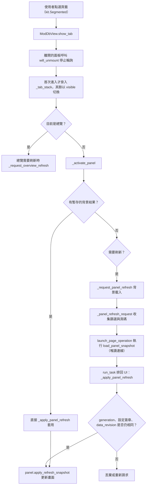
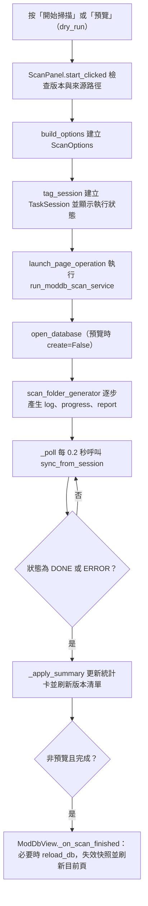
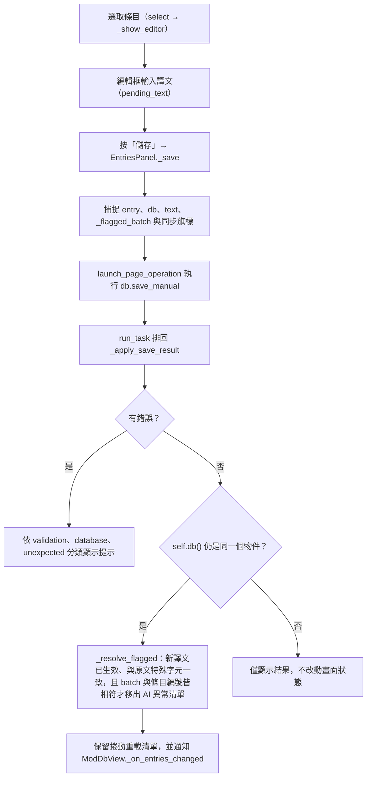
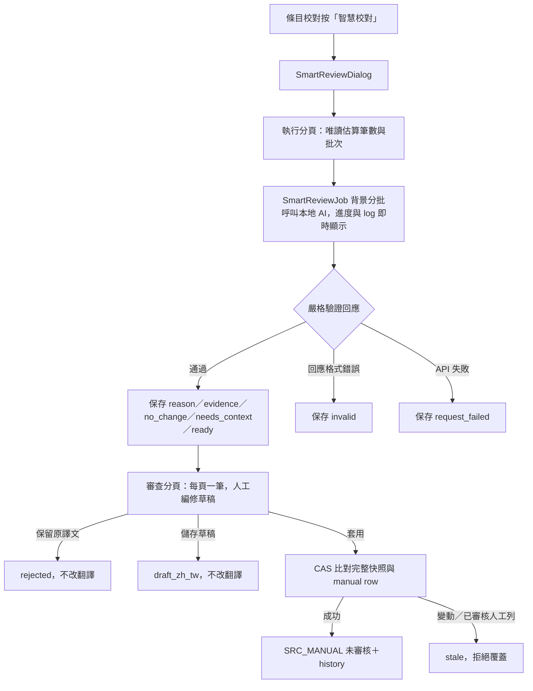
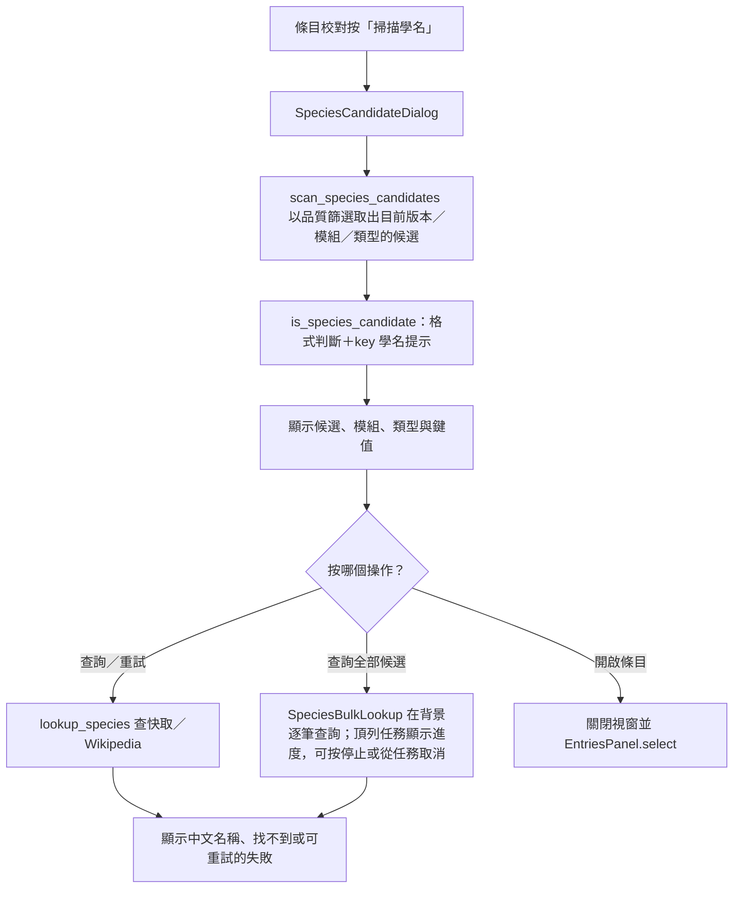
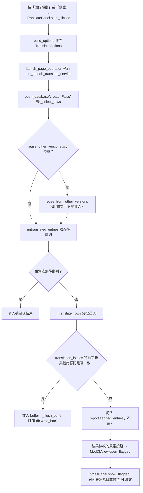
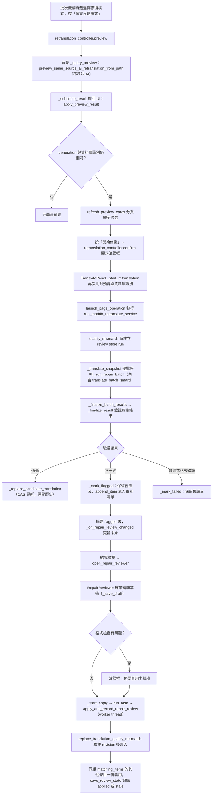
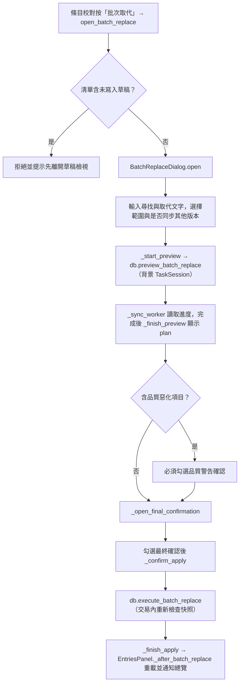

# Mod 資料庫頁（`moddb`）處理流程

> 入口：`app/views/moddb_view.py` 的 `ModDbView`。詳細說明見 [`Mod DB 文件`](../user-guide/mod-translation-db.md)。

## 職責

- `ModDbView`（`app/views/moddb_view.py`）持有唯一的資料庫連線 `_db`、四個頁籤的顯示切換，以及跨頁籤的快照失效與背景刷新。
- 四個頁籤位於 `app/views/moddb/`：`OverviewPanel`（`overview_panel.py`）、`EntriesPanel`（`entries_panel.py`）、`ScanPanel`（`scan_panel.py`）、`TranslatePanel`（`translate_panel.py`）。
- 批次取代對話框 `BatchReplaceDialog`（`batch_replace_dialog.py`）與批量審核對話框 `BulkReviewDialog`（`bulk_review_dialog.py`）由條目校對頁開啟；AI 修復逐筆審查 `RepairReviewer`（`repair_reviewer.py`）由批次機翻的結果檢視開啟。
- 學名候選對話框 `SpeciesCandidateDialog`（`species_dialog.py`）由條目校對頁開啟；它只讀取目前範圍的 `entry.en_us`，逐筆查詢時才使用學名快取／Wikipedia API，不寫入翻譯資料表。
- 實際寫入與掃描邏輯在 `app/services_impl/` 下的 moddb 系列模組（例如 `moddb_service.py`、`moddb_translate_service.py`、`moddb_retranslate_service.py`），資料庫方法在 `translation_tool/translation_db/repository.py`。

## 主要流程

### 頁籤切換與背景資料載入

切換頁籤時，離開的頁籤會先停止輪詢，已掛載的頁籤以 `visible` 切換而不重建控制項。

唯讀背景連線可共用有容量上限的統計與分頁快取；快取依資料世代、資料庫檔案身分及
WAL 狀態隔離，寫入交易中的結果不會發布到共用快取。一般分頁先篩選與排序條目 ID，
只對當頁條目載入譯文、人工來源與歷史資料。品質篩選仍保留精確判斷；可完全用 SQL
判定的未知原文、缺少譯文與前後空白直接分頁，其餘狀態可重用同一資料快照的當頁結果。

### 掃描匯入

取消掃描時 `cancel_clicked` 只呼叫 `session.request_cancel()`，等待目前處理中的檔案停止。

### 條目校對與儲存

資料清理由總覽頁的「資料清理」按鈕開啟 `CleanupDialog`（`cleanup_dialog.py`，服務層 `moddb_cleanup_service.py`）。選擇版本時 `_refresh_overview` 在背景呼叫 `cleanup_overview`，依類型與類別顯示該版本可清理的筆數（只讀，換版本時舊結果作廢）；`_export` 呼叫 `export_cleanup_report` 寫出 JSON 檢查檔，檔名由服務層 `export_cleanup` 取唯一名稱（同一秒匯出兩次、或使用者已編輯過的檔案都不會被覆蓋），內容先寫暫存檔再整個換過去。檢查檔記錄格式 `mod-db-cleanup-v2`、類型（`rule` 或 `protected`）、版本與資料庫身分（`meta.cleanup_db_id`）；格式、類型、版本、身分不符，或 `id` 不是正整數、`id` 重複、`delete` 不是布林值的項目一律拒絕或略過。

**預覽與刪除的契約**：`_preview` 呼叫 `preview_cleanup`（在 `_read_snapshot` 的一致讀取內重新檢查檔案內標記要刪除的項目），得到的 `CleanupPlan.token` 是檢查檔內容、資料庫身分、版本、類型、可刪條目與各自完整資料狀態的 SHA-256。`_apply` 把這個 token 交給 `apply_cleanup(path, expected_token)`，核心在寫入交易內重新計算同一份計畫，token 不同就丟 `CleanupPlanChanged`、不刪任何東西，要求重新預覽。畫面端在換版本（`_on_version`）、換檢查檔（`_on_report`）、重新整理清單、匯出或刪除後都作廢預覽結果；`_apply` 另外確認預覽時的資料庫、版本（`CleanupPlan.version`）和目前選的檢查檔都沒變。

**每個項目的檢查**（`_item_problem`）：條目存在、版本與類型正確、類型／模組／鍵值與檢查檔一致、原文雜湊相同、目前規則仍判為「不該收」，而且目前類別和檢查檔記錄的類別相同（類別變了要重新匯出）。

一般檢查檔不列入、也不會刪除有譯文、生效譯文或歷史紀錄的條目。這些「符合規則但已有譯文或歷史」的條目（總覽顯示的「另有 N 筆」）由「匯出已有譯文的項目」按鈕另外處理：`_export` 帶 `with_translation` 時呼叫 `export_protected_report`。每筆標記 `has_translation`，列出所有來源的譯文（來源代碼與 `source_catalog` 的名稱、`zh_tw`、`zh_cn`、checker、審核狀態、是否為生效來源、是否被截斷）和最近幾筆歷史，並帶 `_translation_states` 算出的完整狀態指紋（條目、所有來源譯文、生效譯文與歷史每個欄位的 SHA-256）。`apply_cleanup` 對這類項目要求指紋與匯出時一致（否則略過為「譯文或歷史已變動」）；`has_translation` 只在 `protected` 類型的檢查檔有效，一般檢查檔裡標這個旗標的項目會略過。

**預設 `delete`**：類別在 `STRONG_CATEGORIES`（`multiblock`、`meta_key`、`placeholder`、`lang_key`，看結構就能確定）時，只有人工來源的譯文或歷史含中文才預設 `false`；其他類別（包含指南的 `license`、`name_list`、`key_value`、`code`、`data` 與形狀推測的 `not_text`、`code_value`、`no_letters`、`field_name`）只要任何來源的譯文或歷史含中文就預設 `false` 並加上 `review` 說明，由使用者確認後再改成 `true`。`CleanupReport` 區分 `exported_total`（檢查檔列出的筆數）、`default_selected`（預設刪除）與 `review_required`（待人工確認），畫面三者並列顯示。

刪除（`apply_cleanup`）在單一交易內把整批存進 `cleanup_batch`（含譯文、生效譯文、歷史與沒有外鍵的 `src_change` 原文變更紀錄）再刪除。還原（`_revert`）呼叫 `revert_cleanup`，回傳 `RevertResult`：原編號還沒被用掉就沿用，被用掉就改用新編號並重新對應子表的 `entry_id`；譯文的 `revision` 還原成快照當時的值；生效譯文依目前優先序重算；原位置已有同一條目（重新掃描出來）的項目不覆蓋，保留為待還原並列在 `RevertResult.conflicts`，批次要全部還原才設定 `reverted_at`，進度記在 `meta` 的 `cleanup_restored:<批次>`，可以重試。`CleanupDialog._load_batch_info` 用 `cleanup_batches` 列出所有尚未完全還原的批次（新的在前），`batch_dd` 選哪一批就還原哪一批。

人工審核走 `ReviewScopeController`（`review_scope_dialog.py`）：`confirm` 先呼叫 `preview_manual_review` 顯示影響範圍；確認視窗內有「同步審核其他版本」開關，預設沿用編輯面板的同步開關，切換時重算範圍；確定後 `execute` 呼叫 `review_manual`。批量審核由 `BulkReviewDialog` 負責：選一個版本與一個「目前生效來源」（皆單選），預設只審核格式檢查通過的條目、不同步其他版本；`_preview` 呼叫 `preview_bulk_review` 產生預覽（每頁 50 筆，可逐筆排除），`_confirm` 呼叫 `execute_bulk_review`，完成後可用 `_revert`（`revert_review_batch`）整批還原。選項改變時舊預覽立即失效；確認時資料庫會重算範圍，與預覽不同就拒絕並要求重新預覽。審核只標示審核狀態，不改變生效來源：編輯面板以 `source_chip`（來源）與 `review_chip`（人工已審核）兩個標籤並列，條目列表與來源譯文列表同樣分開顯示；「審核狀態」篩選與「目前生效來源」篩選互相獨立、可組合。

#### AI 智慧校對（本地候選）

條目校對工具列的「智慧校對」開啟 `SmartReviewDialog`，視窗分成「執行」「審查」「歷史批次」三個分頁，以 `Segmented` 切換。

- **執行**（`SmartReviewRunPanel`）：沿用 EntriesPanel 的版本、模組、kind、目前生效來源與搜尋條件，另有校對模型、上限與每批筆數；選定範圍後在背景以唯讀查詢顯示「符合筆數、本次處理筆數與約幾批」（每批最多 100 筆）。按「開始智慧校對」後設定欄位鎖定，畫面顯示進度條、已處理筆數、預估剩餘時間、有效／無效／請求錯誤統計與逐批執行紀錄（`LogView`，可只看警告與錯誤）；結束後顯示結果摘要與最常見的無效原因，並可「前往審查候選」。
- **背景執行**：校對由頁面層級的 `SmartReviewJob` 持有（`job_for_page`），以 `TaskSession` 登記到任務管理，所以頂列任務膠囊會顯示進度；關閉視窗只停止畫面輪詢，不會中斷校對，重新開啟時 `attach` 會接續顯示進度與 log，完成時若視窗已關閉會以提示訊息通知。同一時間只允許一個校對在執行。停止按鈕只停止後續批次，已送出的 API 回應返回後由核心寫入 `partial` 或 `cancelled`。
- **審查**（`SmartReviewReviewer`）：每頁只顯示一筆候選，「上一筆／下一筆」就是換頁；預設只看「可套用」佇列，沒有可套用候選時改看全部，也可依狀態（已套用、已保留原譯文、需補 context、無效等）篩選，篩選器會顯示各狀態筆數。左側是英文原文、目前譯文與來源、AI 建議、理由與可展開的本地證據，右側是可編輯草稿、格式診斷與動作按鈕。不能操作的按鈕會變灰並說明原因；草稿有格式問題時不能儲存或套用，避免 service 把候選鎖成 `invalid_format`。換筆前會自動儲存格式正確且有修改的草稿，套用或保留原譯文後會更新統計並顯示佇列中的下一筆。
- **歷史批次**（`SmartReviewHistory`）：以卡片列出最近的批次（時間、模型、範圍、處理與有效／無效／錯誤筆數），資料庫標記為執行中但實際沒有在跑的批次顯示「可能已中斷」；「開啟審查」直接載入該批次，也可展開「進階」貼上 `run_id` 開啟。批次與候選存放在翻譯資料庫本身的 `smart_review_run`／`smart_review_candidate`。

模型輸出先經嚴格 JSON、具體 `reason`、證據 ID、決策值與 `translation_issues` 驗證，再寫入 `smart_review_run`／`smart_review_candidate`。候選含可追溯的 `db:<entry_id>`／`official:<key>` local context；同 key reference 另外要求英文原文相同，Patchouli／Guide／Advancement 會取得同模組 reviewed lang 術語，衝突證據會降為需人工判斷。

「套用」只新增或更新來源 6 的未審核人工譯文，原 AI／其他來源列保留；不會自動標記人工已審核。套用前會再次驗證條目身份、effective 值、revision、既有 manual 快照與格式，成功後可從該筆 `smart_review_apply` history 使用既有還原流程回復。格式診斷只協助人工檢查，術語準確率需使用人工標註 evaluator，不能用格式通過率代替。

#### 學名候選掃描

進階篩選的「品質狀態 → 疑似學名文字」（`QualityFilter` 的 `species_name`）用同一組規則在條目清單列出疑似學名條目，不需開啟對話框。對話框預設只收 key 帶有 `latin`、`scientific` 等提示（或值含 ×、var.、subsp. 記號）且格式像學名的條目；勾選「包含沒有學名 key 的候選」才退回只看格式。候選數量不設上限，對話框以頁碼切換（每頁 50 筆）；掃描時學名快取裡已有確定結果的候選（查到名稱或查無）直接顯示，「查詢全部候選」只查其餘的；查無的列有「再查一次」，以 `refresh` 略過快取重新連線。種以下的名稱查無時，列上附上一層物種的名稱（`parent_name`／`parent_value`），只供參考；上一層查詢限流或失敗時改顯示失敗原因，批次查詢也會依 `SpeciesLookup.rate_limited`／`SpeciesLookup.failed` 停止或累計連續失敗。候選的完成狀態看 `SpeciesLookup.complete`：原名稱確定查無但上一層還沒查過或查詢失敗（`parent_resolved` 為 False，例如重新啟動後快取只有原名稱的查無）時，該列顯示「補查上一層」，「查詢全部候選」也會把它納入，只補查上一層物種，不重查原名稱。

「查詢全部候選」交給頁面共用的 `SpeciesBulkLookup`（`species_bulk_lookup.py`，用 `bulk_lookup_for` 取得）執行：它有自己的 `TaskSession`，頂列任務膠囊顯示進度並可取消。查詢中對話框多一個「背景執行」：收起視窗、只退訂事件，查詢繼續進行；「關閉」會停止查詢再關閉視窗。「開啟條目」與 Esc 等非按鈕關閉都視同背景執行。完成或停止時以提示訊息回報摘要。重新開啟對話框時接回進行中的查詢與它的候選範圍；查詢期間不能重新掃描或逐筆查詢。遇到限流或連續 `MAX_CONSECUTIVE_FAILURES` 筆失敗會自動停止。掃描與單筆查詢的結果在視窗關閉後會被 generation 丟棄。查詢結果只更新學名快取，不會自動改寫翻譯。

條目校對右側建議區有第三個分頁「學名」（`SpeciesSuggestion`）：目前條目原文像學名時，顯示學名快取中的中文名稱與「套用」（只把名稱帶入譯文框，不儲存）；還沒查過就顯示「查詢維基百科」，失敗顯示「重試」。上次查詢是暫時性失敗時（`retry_needs_refresh`），「重試」與對話框的「重試」、「查詢全部候選」都略過快取重新連線，所以「再查一次」逾時後的重試不會被舊的查無紀錄擋下；「補查上一層」仍走快取，不重查已確定查無的原名稱。背景批次查詢每查到一筆，這個分頁就重繪，目前條目的結果會即時出現；分頁自己的查詢結果（包含「再查一次」的失敗）優先；只有快取在那次查詢之後又被更新，且更新後查到名稱，或已完整（查無且上一層物種也有結果）而分頁的結果還是失敗或上一層待查時，才改顯示快取的結果。查無時顯示「再查一次」；有上一層物種的名稱時另顯示「套用參考名稱」，同樣只帶入譯文框；上一層還沒有確定結果時顯示「補查上一層」。從對話框按「開啟條目」會直接切到這個分頁（`EntriesPanel.open_species_entry`）。

查詢結果分為找到、查無（確定結果）與請求過於頻繁、連線失敗（可重試，不寫入快取）。批次查詢遇到限流、連續 3 筆失敗或使用者按「停止查詢」時停止，已完成的結果保留；失敗的候選列顯示「重試」。

還原單筆或整批分別由 `_revert`（`db.revert`）與 `_revert_batch`（`db.revert_batch_replace`）處理。

#### 格式診斷顯示與進階篩選

條目校對、AI 修復審查與批次取代預覽共用同一份格式診斷：`analyze_format_diagnostics` 依條目種類的策略回傳 `FormatDiagnosticsResult`，畫面不自行判斷格式。

- 差異預覽的摘要、檢查表與原文／譯文高亮都讀同一份結果（`format_issue_rendering` 的 `diagnostic_label`、`diagnostic_spans`）。可計數的標記（佔位符、色碼、Patchouli 巨集、指南標記）各有一列，顯示原文數量、譯文數量與缺少／多出的處理建議。
- Patchouli `<link;分類;顯示文字[;start]>` 標籤只比對分類與 `start`，第三欄的顯示文字可翻譯。
- 指南的空行（只算內容之間，文字開頭與結尾的空行不計）、區塊前綴順序、硬換行與獨立成行的元件（整行只有 `<Tag/>` 或 `$(br2)` 這類不含文字的標記）沒有可計數標記，由 `FormatDiagnosticsResult.extra_guide_issues` 提供白話說明（例如元件被移動時說明是哪個元件、該放回哪裡），檢查表以「指南結構」列顯示並標明位置無法可靠判定。已有結構化診斷涵蓋的訊息不會重複出現。
- 進階篩選的起訖日可用日曆選取（`AdvancedFilters._pick_date`，繁體中文語系）；日曆回傳的 UTC 時間以 `picked_date` 換回本地日期，起訖兩個日期都選好才立即套用（只選一個時提示還需要另一個，不顯示錯誤）。「時間依據」為不限時間時，選日期會自動改用條目匯入時間，並在提示訊息說明。日期範圍查無資料時，清單空狀態與彈出提示會說明該時間依據實際有資料的期間（`AdvancedFilters.announce_no_data`，資料來自 `TranslationDB.time_data_range`），不會自動放寬或改動使用者輸入的日期。
- 排序旁的方向按鈕對每種排序依據有效：模組／鍵值預設遞增、日期排序預設遞減，切換後立即重新載入並跳出訊息；換排序依據或重設時回到預設方向。

### 批次機翻與異常清單

翻譯頁的範圍刷新只查詢未翻譯與可沿用筆數，畫面上的批次數是快速估算；不會在每次版本或模組篩選變更時建立完整翻譯項目。按「預覽」或「開始機翻」後，服務層才依篩選後的項目、`cache_type`／`_batch_group`、session 與固定提示詞 token 重新執行精確批次規劃。

### AI 修復既有譯文與逐筆審查

修復有兩種模式：`quality_mismatch`（來源譯文特殊字元修復）與 `same_source_ai`（舊 AI 同原文重翻）。先預覽、再確認、最後才送 AI。

修復與「1　選擇要機翻的範圍」共用同一組遊戲版本、模組與單次上限（`TranslatePanel.build_options`），AI 修復的快取寫入也遵循「每次寫入新快取分片」；「先沿用其他版本的相同譯文」只影響一般機翻。修復卡片頂端以 `repair_card.SCOPE_HINT` 說明這點。

套用被拒絕時，`_diagnose_stale_review_item` 依資料庫現值分類原因並隨結果回傳（`stale:changed`、`stale:not_needed`、`stale:missing`；沒有可歸類原因時是 `stale`），畫面逐項說明：`changed` 現值與審查時不同、`not_needed` 現值已沒有格式問題、`missing` 找不到該列或資料庫已不是建立審查的那一個。現值已等於草稿（先前已套用過）時回傳 `already_applied`，狀態記為 `applied`。

「重新讀取」（`RepairReviewer._reload`）呼叫 `rebase_repair_review_item`：以資料庫現值取代審查項目記錄的舊譯文與 revision，狀態回到待審查、草稿保留，之後可再次套用；現值已沒有格式問題時不改審查資料。已套用或保留舊譯文的項目是完成狀態：草稿唯讀、不會降回待審查，按「重新讀取」只會提示要修改請到條目校對編輯。摘要與篩選把被拒絕的項目統稱「未寫入」，原因在項目畫面與提示訊息中說明。

### 批次取代

跳過原因清單由 `_start_skipped_load` 以同樣的背景作業機制載入。

## 背景任務與 UI 更新

- 資料庫的讀取與寫入主要透過 `launch_page_operation`（`app/tasks/operation_registry.py`）執行；批次取代改由 `launch_batch_replace_job` 啟動。只有缺少 `run_task` 的精簡頁面（例如測試用頁面）才會在當前執行緒直接套用結果。
- 結果一律以 `page.run_task` 排回 UI 執行緒，worker 本身不操作 Flet 控制項。
- 掃描與機翻以 `_poll` 協程每 0.2 秒讀取 `TaskSession.snapshot()`；離開頁籤時 `will_unmount` 停止輪詢，切回來時 `resume` 接續。
- 批次取代對話框以 `_sync_worker` 輪詢，並以 `generation` 判斷結果是否仍有效。
- `ModDbView._safe_update` 只更新 `_tab_stack` 子樹，避免每次切換都重送整個頁面。

## 狀態與資料

- `ModDbView` 狀態：`_db`、`_db_loaded`、`_db_sig`（資料庫路徑與來源優先序簽章）、`_data_revision`（資料變動計數）、`_panel_refresh_generation`、`_panel_refresh_needed`、`_pending_panel_results`。
- 背景載入使用唯讀連線（`open_database(create=False, readonly=True)`），並在套用前比對 generation、簽章與 `data_revision`。
- `EntriesPanel` 的 AI 異常清單狀態：`entry_ids`、`drafts`、`_flagged_batch`。每次 `_set_flagged` 會把 `_flagged_batch` 加一。
- 修復審查草稿存放在資料庫旁的 sidecar 檔（`moddb_repair_review_store.store_path`，後綴 `.repair-review.sqlite3`）。
- 譯文變更的歷史紀錄存於資料庫 `history` 表，還原時依 `history_id`（單筆）或 `batch_id`（整批）查詢（見 `translation_tool/translation_db/repository.py` 的 `revert` 與 `revert_batch_replace`）。

## 錯誤處理

- 開啟資料庫失敗時，服務層回傳 `database_problem()` 的說明並呼叫 `session.set_error()`；總覽則顯示錯誤並保留頁面。
- 手動儲存：`ValueError` 顯示驗證訊息；`sqlite3.Error` 提示資料庫可能被鎖定；其他例外記錄後台 log。
- 機翻：單一批次經 `translation_issues` 判斷不一致的譯文不寫入，只記錄（指南條目另檢查連結目標、標籤與前綴）；寫入失敗最多重試 `DB_FLUSH_RETRIES` 次，仍失敗則停止後續翻譯。連續 `ABORT_AFTER_FAILURES` 筆未成功會中止，通常代表 API 金鑰或模型設定有問題。
- 修復：寫入時以 compare-and-set 比對舊譯文與 revision，資料已變動時記為 `cas_changed` 並跳過；審查套用時若版本已變動，該筆記為 `stale` 且草稿保留。
- 機翻日誌分流：畫面日誌每批只有一行（正常批次「成功 | 總進度」；有回填原文或品質不符時「寫入 N/M」與未寫入數量），後台 `[BatchResult]` 與最終摘要由同一份 `TranslateReport` 計數產生。品質不符的完整清單由 `moddb_translate_report` 寫入 `<logging.log_dir>/<YYYYMMDD>/quality-issues-<task_id>.json`（與 `app.log` 同一個資料夾）（依批次分組、相同項目去重並記錄出現次數、檔頭有中文欄位說明）與同名 `.csv`（Excel 表格版），畫面只顯示數量與檔案路徑；替換規則衝突明細（以翻譯器實際套用的規則計算）每天一份 `replace-rule-conflicts.json`（只偵測，不修改規則）。後台結束摘要為多行中文，完整明細在報告檔。回應契約錯誤（重複 id、id 不符、結構無效）只記後台 `[ResponseContractError]`（類型、批次大小、縮批前後、是否最終成功）。
- 機翻最終狀態：有品質拒絕、來源回填、MAX_TOKENS、契約失敗、未解決的品質 retry 時（範圍內仍未翻譯的筆數只是統計，不單獨觸發警告），摘要狀態為 `DONE_WITH_WARNINGS`；`TaskSession.status` 仍是 `DONE`，後台「任務結束」紀錄會同時標出摘要狀態。單筆超出安全預算的政策（原文回填、不寫快取與資料庫）只套用於帶 `_batch_group` 的 Mod DB 項目。單筆超限只比較項目本身與設定的硬上限（不含提示詞、session 歷史與學到的輸出預算縮放）；JSON 不完整時只有供應商回報 MAX_TOKENS 才記為 MAX_TOKENS，其餘記為回應格式錯誤。
- 取消：掃描、機翻與修復都以 `session.request_cancel()` 請求取消，已提交的批次保留。
- 輪詢或畫面更新失敗時 `_abort_polling` 會恢復按鈕並顯示「畫面更新失敗」，不會永久停在執行中。
