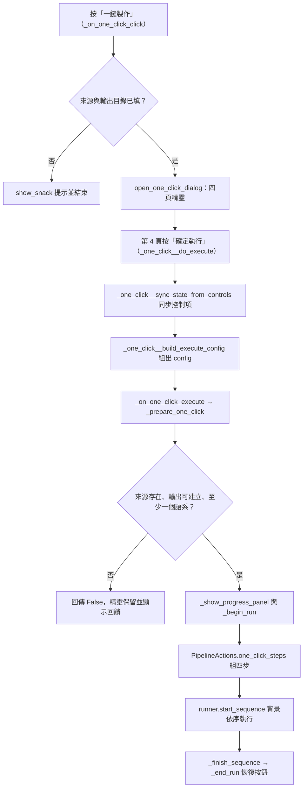
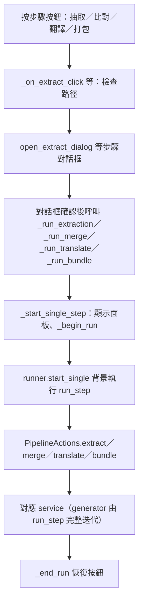

# 一鍵流水線（`pipeline`）處理流程

> 入口：`app/views/pipeline/pipeline_view.py` 的 `PipelineView`。詳細元件說明見 [`PIPELINE_VIEW_ARCHITECTURE.md`](../PIPELINE_VIEW_ARCHITECTURE.md)。

## 職責

- 維護「Mod 來源」與「輸出目錄」兩個路徑欄位，提供四個單一步驟按鈕（抽取、語系比對、啟動翻譯、打包）與一個「一鍵製作」按鈕。
- 單一步驟各自開啟步驟對話框（`pipeline_extract_dialog.py`、`pipeline_merge_dialog.py`、`pipeline_translate_dialog.py`、`pipeline_bundle_dialog.py`），確認後把參數回傳給 `PipelineView`。
- 一鍵製作由 `pipeline_one_click_dialog.py` 的四頁精靈收集設定，`PipelineActions.one_click_steps` 組成四個依序執行的步驟。
- 「步驟怎麼跑」集中在 `PipelineRunner`（`pipeline_session.py`）：worker、session、輪詢與取消。呼叫 service 的動作集中在 `PipelineActions`（`pipeline_actions.py`），不碰 UI。
- 所有子資料夾路徑由 `PipelineConfig`（`pipeline_config.py`）從輸出根目錄推算。

## 主要流程

### 一鍵製作

### 單一步驟

抽取對話框的「預覽」會在背景以 `preview_extraction_generator` 掃描，結果只顯示、不寫檔。語系比對、啟動翻譯、打包三個對話框的「預覽」按鈕目前只顯示「尚未支援」的提示。

## 背景任務與 UI 更新

- `PipelineRunner.start_single`／`start_sequence` 啟動 worker。若外殼已注入 operation registry（`app/shell/app_shell.py` 在建立頁面後呼叫 `set_operation_registry`），先 `reserve` 一個 `OperationDescriptor`（owner `pipeline`、`CancellationPolicy.COOPERATIVE`、`CommitPolicy.PARTIAL_ALLOWED`），再以 `handle.launch(...)` 啟動；否則直接交給 `launch_worker`（預設為 daemon thread）。
- 每個步驟使用獨立的 `TaskSession`（`default_session_factory` 以 `tag_session` 標記為「一鍵流水線」）。
- `run_step` 以 `cancel_scope(cancel_event.is_set)` 包住 service 呼叫。若回傳 generator，會逐項迭代；發現取消時呼叫 `result.close()` 並補 `session.finish()`，因為 generator 被 close 後 yield 之後的 `finish` 不會執行。
- 輪詢：`_watch_loop` 在 event loop 上每 0.2 秒（`POLL_INTERVAL_SEC`）讀取 `session.snapshot()`，依 `seq` 只取新日誌送入 `PipelineProgressPanel.log_view`，並更新進度條與百分比文字。輪詢由 `PollerHandle` 持有。
- worker 不直接改控制項。所有更新都經 `ui_view` → `_deliver`：頁面已卸載（`on_unmount`，由 `will_unmount` 觸發）時暫存到 `_pending`，`on_mount` 時依序套用；掛載中則直接執行。`ui()` 以 `page.run_task` 排回 event loop。
- 步驟結束時 `run_step` 等待 watcher 完成最後一次同步（最多 30 秒，`_FINAL_SYNC_TIMEOUT_SEC`），再以 `_final_sync` 補齊日誌，最後更新步驟晶片（完成、失敗或取消）。
- 取消：`PipelineView._on_cancel` → `runner.request_cancel()`，設定 `cancel_event`，同時呼叫 operation handle 的 `request_cancel` 與 `session.request_cancel()`。重複取消回傳 `False`。目前步驟在下一個檢查點停止；一鍵的後續步驟不再執行。
- 卸載期間 worker 與 session 照常執行；`on_mount` 時若步驟仍在追蹤，會重新啟動 watcher，`last_seq` 避免日誌重複。

## 狀態與資料

- View 狀態：`input_path_text`、`output_path_text`、`_run_buttons`、`_one_click_button`、`_lang_code_checks`（抽取對話框的語系勾選，於同一頁面內保留）。
- Runner 狀態：`cancel_event`、`current_session`、`_watch`（`_Watch`：session、done、last_seq）、`_mounted`、`_pending`、`operation_handle`。
- `PipelineConfig` 由輸入與輸出目錄推算下列路徑：
  - 抽取：`jar_mod_extract/_提取lang_輸出` 與 `jar_mod_extract/_提取book_輸出`。
  - 語系比對：`locale_sort/_整理輸出`；翻譯來源為 `lang_output/<pending_organized_folder_name>` 與 `patchouli_output/<pending_folder_name>`。
  - 翻譯輸出：`lm_translate/<lm_translate_folder_name>`。
  - 打包：暫存目錄 `_打包暫存`，ZIP 輸出為 `output_bundler.output_zip_name` 指定的檔名（未設定時為預設值）。
- 讀取的設定鍵：`lang_merger.pending_folder_name`、`lang_merger.pending_organized_folder_name`、`lm_translator.lm_translate_folder_name`（經 `get_lm_translate_folder_name()`，與機器翻譯頁共用；不是單一資料夾名稱時記錄警告並改用預設 `LM翻譯後`）、`output_bundler.output_zip_name`、`jar_extractor.lang_codes`（精靈預設語系）。
- 打包版本範圍由 `translation_tool/core/resource_pack_version.json` 依所選版本取得 `min_format`／`max_format`。
- 資料庫選項：`merge_db_snapshot` 與 `lm_db_snapshot` 在點擊當下由 `snapshot_for_run()` 取得，之後的 worker 只使用快照。
- 打包步驟會先由 `build_bundle_staging` 把三個來源（既有譯文、Patchouli 譯文、LLM 新譯文，優先序由低到高）整合到暫存目錄，再由 `run_bundling_service` 產生 ZIP。
- 翻譯步驟只處理「存在且含檔案」的來源目錄；若兩個來源都沒有檔案，寫入 `[系統]` 日誌並略過，不視為失敗。

## 錯誤處理

- 路徑與設定驗證失敗：以 `show_snack` 或精靈內的回饋文字提示，不啟動 worker。
- 步驟 service 拋出例外：`run_step` 以 `log_error` 把類型、訊息與完整堆疊寫入後台 log；畫面只顯示「類型: 訊息（完整堆疊已寫入後台 log）」，再 `session.set_error()`、`session.finish()`，步驟晶片標為失敗。
- 步驟的成功判定 `session_failed`：session 已標記錯誤，或摘要中的 `failed_zips`、`failed_folders`、`errored_files` 非零。失敗時會 `_record_operation_error`。
- 一鍵流程：`run_step` 回傳 `False` 即停止後續步驟；`start_sequence` 另外捕捉未預期例外，寫入 `log_error` 與面板的「流程失敗」摘要，最後一定執行 `_finish_sequence` 恢復按鈕。
- 打包：若暫存目錄沒有任何可打包檔案，寫入「沒有可打包的翻譯檔案」錯誤並標記 session 失敗。
- 取消：步驟晶片標為「已取消」（金色），面板顯示「⏹ 已取消」，不計入失敗。
- 日誌同步逾時（30 秒）：寫入 `log_warning`「日誌同步未完成」。
- worker 結束的 `_end_run` 會在 event loop 上恢復按鈕，不論成功、失敗或取消。
