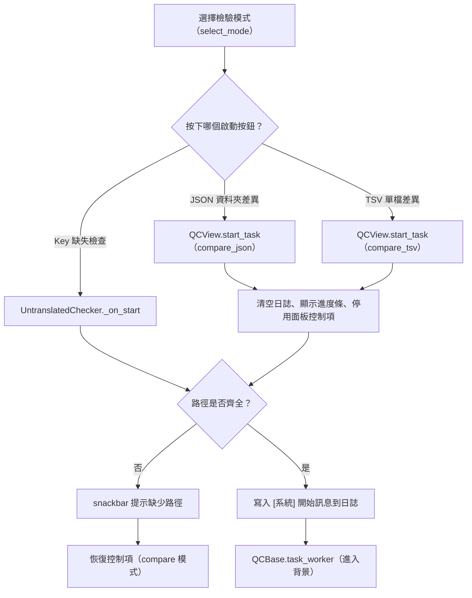
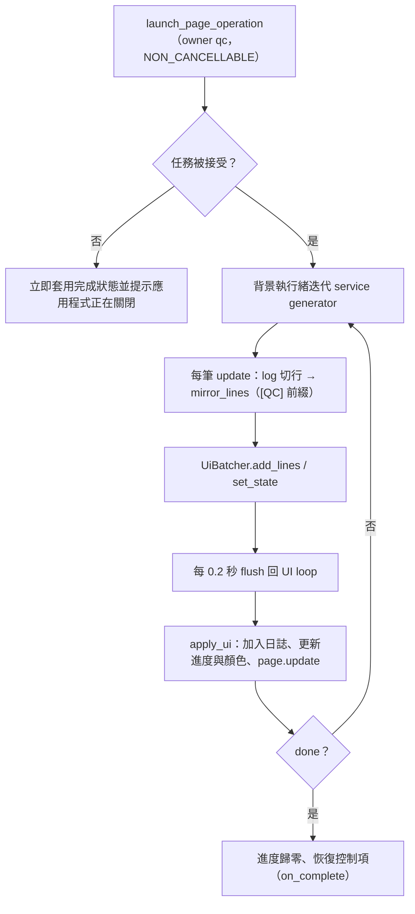

# QC 檢驗（`qc`）處理流程

> 入口：`app/views/qc_view.py` 的 `QCView`。詳細元件說明見 [`View 架構文件`](../developer-guide/views/QC_VIEW_ARCHITECTURE.md)，未翻譯檢查另見 [`未翻譯檢查架構`](../developer-guide/views/UNTRANSLATED_CHECKER_ARCHITECTURE.md)。

## 職責

- 提供三種檢驗模式，由模式卡切換，每種模式有自己的路徑欄位與啟動按鈕：
  - Key 缺失檢查（`untranslated`）：比對 en_us 與 zh_tw 的 key，由 `app/views/untranslated_checker.py` 的 `UntranslatedChecker` 提供 UI。
  - 簡繁差異（JSON 資料夾）（`compare_json`）。
  - 簡繁差異（TSV 單檔）（`compare_tsv`）。
- 透過 `app/services.py` 的服務函式啟動 `translation_tool/checkers/` 下的 generator：
  - `run_untranslated_check_service` → `check_untranslated_generator`（`untranslated_checker.py`）
  - `run_variant_compare_service` → `compare_variants_generator`（`variant_comparator.py`）
  - `run_variant_compare_tsv_service` → `compare_variants_tsv_generator`（`variant_comparator_tsv.py`）
- 背景執行與 UI 更新交給 `app/views/qc_base.py` 的 `QCBase.task_worker`。
- 共用一塊進度條與一個 `LogView`（append 模式，最多 2000 行，固定高度 360）。

## 主要流程

### 啟動與路徑檢查（UI 執行緒）

### 背景執行與回報（`QCBase.task_worker`）

## 背景任務與 UI 更新

- `QCBase.task_worker` 以 `launch_page_operation(..., owner="qc")` 啟動，並設定 `CancellationPolicy.NON_CANCELLABLE` 與 `ShutdownPolicy.DRAIN_ONLY`，因此 QC 任務不提供取消，關閉時只等待完成（`app/tasks/operation_registry.py`）。
- 背景執行緒以 `in_new_task("qc", run)` 包裝（`translation_tool/utils/ui_mirror.py`），確保後台日誌歸屬於 QC 任務。
- 工作函式迭代 service generator：
  - 每筆 `update` 的 `log` 欄位依換行切成多行，等級由 `_guess_level` 依文字推測（含「錯誤」「失敗」「ERROR」「❌」為 error，含「警告」「WARN」「⚠」為 warning）。
  - `mirror_lines` 同步寫入後台 log，前綴為 `[QC] `。
  - `progress` 與 `error` 欄位分別更新進度條與錯誤旗標。
- UI 更新不直接從執行緒進行。`UiBatcher`（`app/ui/ui_batcher.py`）以 0.2 秒為間隔，透過 `page.run_task` 把累積的日誌與狀態交回 event loop 套用（`apply_ui`）。
- `done` 時進度條歸零、顏色復原為 `C.EM`；若有傳入 `controls_to_disable` 則恢復；若有 `on_complete` 則呼叫（compare 模式會恢復面板控制項）。
- 頁面捲動：`start_task` 會以 `run_task(self._scroll_to_log)` 將頁面捲到日誌區。

## 狀態與資料

- 模式狀態：`mode`（預設 `untranslated`）、`mode_cards`、`mode_panels`。`select_mode` 會切換卡片選取與面板可見性。`QCView.start_task` 的 `untranslated` 分支仍存在，但 UI 實際使用的是 `UntranslatedChecker._on_start`。
- 共用控制項：`progress_bar`（預設隱藏，啟動時顯示）、`log_view`、`task_runner`（`QCBase`）。
- 各模式欄位：
  - 未翻譯檢查：`untranslated_checker.en_dir`、`tw_dir`、`out_dir`。
  - JSON 差異：`cn_dir_textfield`、`tw_dir_textfield_2`、`compare_out_dir_textfield`。
  - TSV 差異：`tsv_file_textfield`、`tsv_out_file_textfield`。
- 讀取的設定：`translator.replace_rules_path`（簡繁轉換規則，預設 `replace_rules.json`），由 `variant_comparator.py` 讀取。
- 產出：
  - 未翻譯報告：依相對路徑寫入使用者指定的輸出資料夾（JSON）。
  - JSON 差異報告：依相對路徑寫入輸出資料夾（JSON）。
  - TSV 差異報告：單一 CSV 檔，以 `utf-8-sig` 編碼寫出（`diff_df.to_csv`）。

## 錯誤處理

- 路徑缺漏：`start_task` 與 `UntranslatedChecker._on_start` 以 snackbar 提示，`compare` 模式會恢復控制項，不啟動任務。
- 檔案選擇失敗：`_async_pick_file_or_directory` 捕捉例外並顯示「開啟對話框失敗」；使用者取消則顯示「您已取消選擇」。
- Service 內部例外：`run_*_service` 會捕捉例外，記錄 `logger.error` 並 yield 一筆 `error: True` 的 update，訊息為「[致命錯誤] ...」與完整堆疊。UI 會把該訊息放入日誌，進度條變紅（`C.RED`）。
- 工作執行緒例外：`QCBase` 的 `run()` 捕捉 generator 迭代時的例外，以 `log_error`（含堆疊）記錄後台，並在日誌加入「[錯誤] 任務執行失敗」，設定錯誤旗標。
- 無法啟動（應用程式正在關閉）：立即以 `apply_ui` 套用完成狀態，並顯示 snackbar。
- `finally` 區塊一定會送出 `done`，並強制 flush，確保控制項會被恢復。
- 捲動失敗（`_scroll_to_log`）只記錄 debug，不影響任務。
