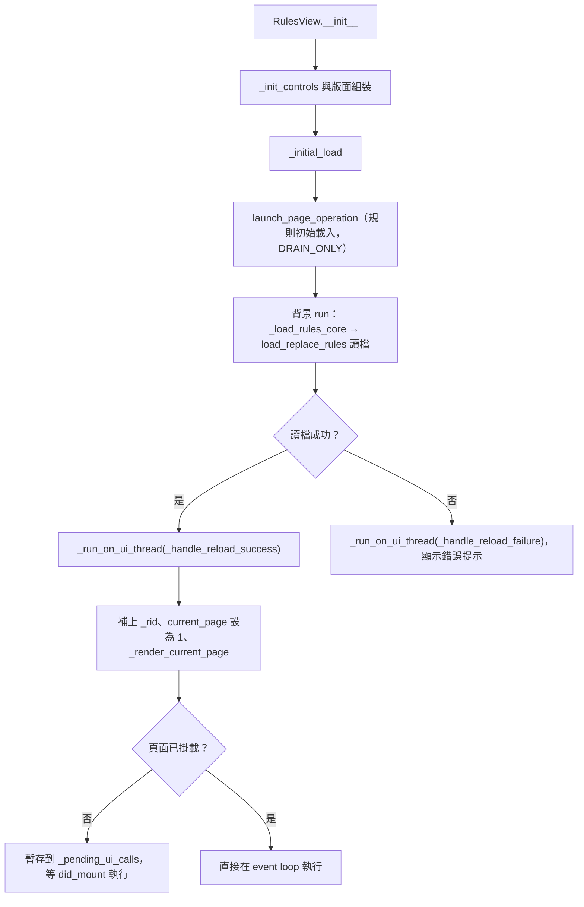
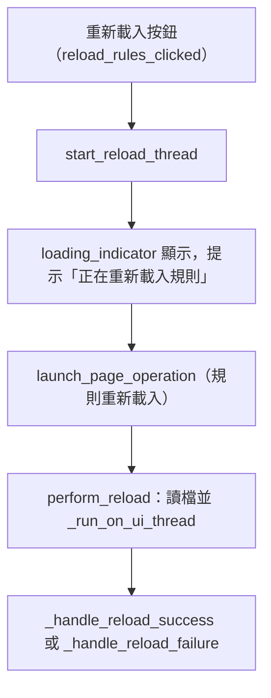
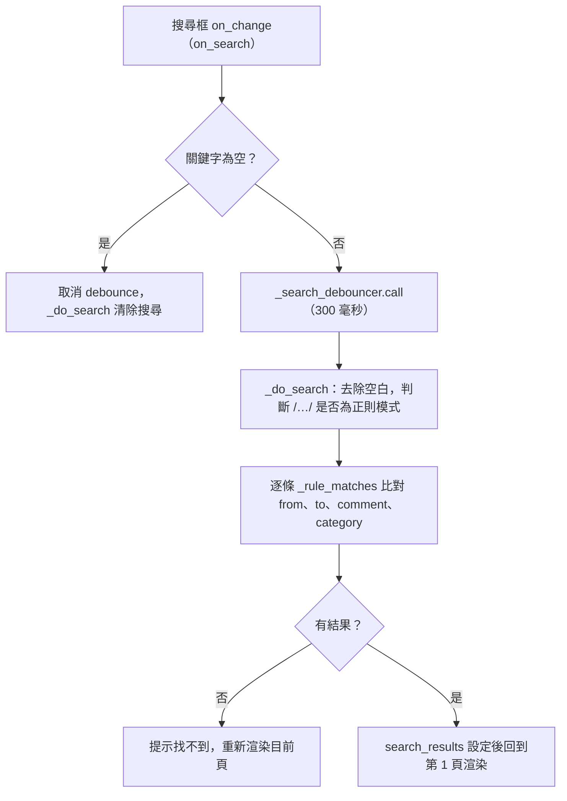
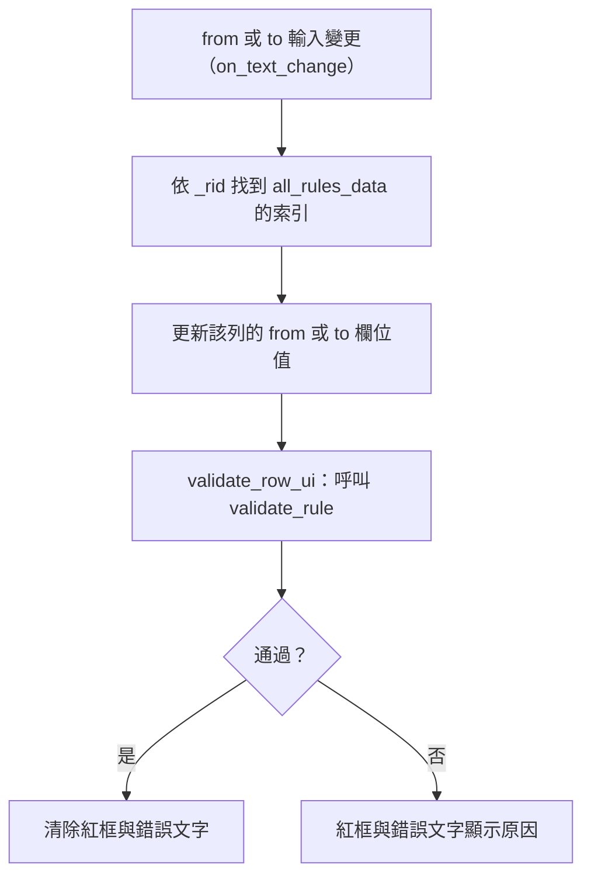
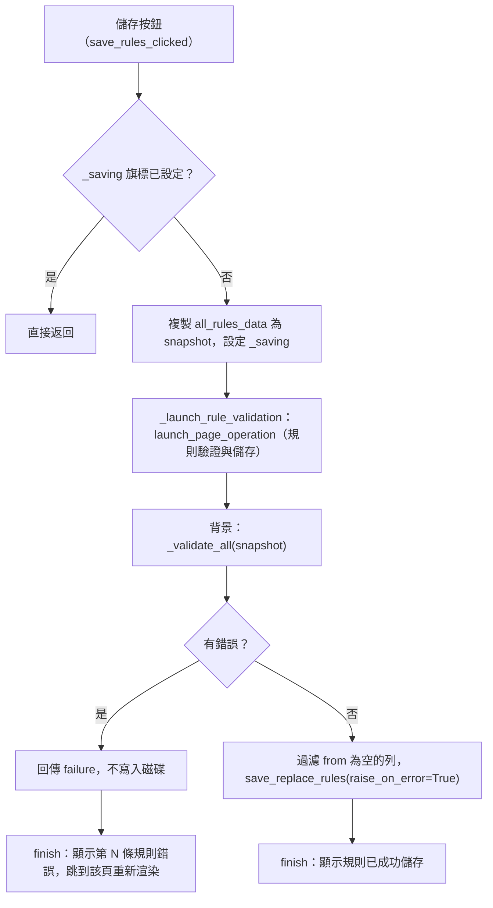

# 替換規則頁（`rules`）處理流程

> 入口：`app/views/rules_view.py` 的 `RulesView`。詳細元件說明見 [`View 架構文件`](../developer-guide/views/RULES_VIEW_ARCHITECTURE.md)。

## 職責

替換規則頁用來編輯 `replace_rules.json`（位於專案根目錄，路徑由 `app/services_impl/config_service.py` 的 `REPLACE_RULES_PATH` 指定）。每條規則包含 `from`（正則表達式）與 `to`（替換內容）。頁面提供：

- 分頁表格（每頁 50 列）的逐列編輯與刪除，以及新增空白列。
- 搜尋（關鍵字或 `/正則/` 模式）與排序（依 From 字典序或長度）。
- 即時測試區：以目前尚未儲存的規則套用到輸入文字。
- 重新載入（從磁碟讀回）與儲存（驗證後寫回磁碟）。

頁面本身不做正則替換，替換邏輯由 `translation_tool/utils/text_processor.py` 的 `apply_replace_rules` 提供，這裡只負責把目前的規則餵給它。

`RulesView` 由 `RulesWidgetsMixin`（`app/views/rules/rules_widgets.py`）負責控制項的建構，列的建立由 `app/views/rules/rules_table.py` 的 `create_rule_row` 負責。

## 主要流程

### 初次載入

`_run_on_ui_thread` 是背景執行緒與 UI 之間的橋接點：頁面尚未掛上時把呼叫放入 `_pending_ui_calls`，`did_mount` 再依序執行。

### 重新載入

重新載入會以磁碟內容覆蓋記憶體中的全部規則，尚未儲存的編輯會遺失。

### 搜尋與排序

`_rule_matches` 比對時一律忽略大小寫（`search_case_sensitive` 目前固定為 `False`）。正則模式下 `re.error` 會退回一般字串比對。排序（`on_sort_change`）直接對 `all_rules_data` 做 in-place 排序並回到第 1 頁，排序結果只存在記憶體中，要儲存才會寫入磁碟。

### 逐列編輯與即時驗證

`validate_rule` 依序檢查：`from` 不可為空、`from` 必須能被 `re.compile` 編譯（錯誤訊息由 `translate_regex_error` 翻譯）、`from` 不可與其他列重複、`to` 中的 `\N` 或 `$N` 群組參照不可超過群組數、`to` 不可含無效跳脫。即時驗證會對每列掃描全部規則做重複檢查。

新增列（`add_row_clicked`）會在清單末端加入 `from` 與 `to` 皆為空字串的列，並跳到最後一頁。刪除列（`delete_row_clicked`）依 `_rid` 找到索引後刪除，必要時回退一頁。

### 即時測試

`on_test_change` 會把 `from` 非空且可編譯的規則組成清單，呼叫 `apply_replace_rules` 處理測試輸入文字，並顯示「已套用 N 條規則，文字有變更」或「沒有符合的規則」。規則使用的是目前記憶體中的內容，不必先儲存。

### 儲存（驗證在背景執行）

`_validate_all` 先以 `_build_from_index` 建立 `{from: [索引...]}` 字典，讓重複檢查達到 O(n)。驗證失敗時 `finish` 會跳到錯誤列所在的頁面並重新渲染。重新渲染時 `_fill_rule_row` 會清除列的錯誤樣式，且 `_render_current_page` 不會重新呼叫 `validate_row_ui`，因此該列不會自動顯示紅框；錯誤只出現在提示訊息中。

若 `run_task` 不存在（沒有 event loop），`finish` 會經由 `_run_on_ui_thread` 回到 UI。

## 背景任務與 UI 更新

- **背景任務**：初次載入、重新載入、儲存（驗證加寫檔）三者都透過 `launch_page_operation` 送進頁面的 operation registry。三者皆使用 `CancellationPolicy.NON_CANCELLABLE`（不可取消）與 `ShutdownPolicy.DRAIN_ONLY`（關閉時排空既有任務）。儲存使用 `CommitPolicy.PARTIAL_ALLOWED` 與 `DurabilityPolicy.USER_ACTION`。
- **UI 更新**：背景執行緒只做讀檔、驗證與寫檔；所有控制項變更都透過 `_run_on_ui_thread` 或 `run_task` 排回 event loop。`worker_done` 事件與 `_wait_for_validation_and_save` 協程負責在 worker 結束後呼叫 `finish`。
- **搜尋 debounce**：`Debouncer` 綁定頁面，`will_unmount` 會取消尚未執行的搜尋。
- **列的重用**：`_render_current_page` 不清空表格，而是重用既有列（`_fill_rule_row`），多出的列以 `visible=False` 隱藏，避免每次翻頁重建 50 列的 `TextField`。
- **防重複提交**：`_saving` 旗標在儲存期間阻擋重複點擊；`finish` 一律把它清回 `False`。

## 狀態與資料

- **`RulesTableState`**（`app/views/rules/rules_state.py`）：`page_size`（50）、`current_page`、`total_pages`、`rid_seq`。`RulesView` 的 `current_page`、`total_pages` 等屬性由它初始化。
- **`all_rules_data`**：記憶體中的完整規則清單，每筆為 `{"from", "to", "_rid"}`。`_rid` 是 UI 用的穩定序號（`_new_rid` 遞增），不寫入磁碟。`_find_index_by_rid` 以它找回資料位置。
- **搜尋狀態**：`search_results`（`None` 表示未搜尋）、`search_keyword`、`search_regex`、`search_current_idx`。
- **儲存內容**：`save_replace_rules` 寫入 `replace_rules.json` 的 `from` 與 `to` 欄位，只保留 `from` 非空的規則。`_rid` 與 `comment`、`category` 等其他欄位不會被寫回（`clean_rules` 只取 `from` 與 `to`）。
- **執行緒共享**：`_ui_lock` 保護 `_page` 與 `_pending_ui_calls`；`_pending_ui_calls` 只在頁面尚未掛載時使用。

## 錯誤處理

- **讀檔失敗**：`_handle_reload_failure` 關閉載入指示器並以 `show_snack` 顯示「載入規則時發生錯誤」；背景端同時以 `log_error` 記錄含 traceback 的訊息。
- **驗證失敗**：不寫入磁碟，跳到第一個錯誤列所在頁面並顯示「第 N 條規則錯誤」。
- **儲存失敗**：`save_replace_rules(raise_on_error=True)` 拋出的例外會被 `validate_and_save` 捕捉並記錄到 `result["error"]`，`finish` 顯示「儲存規則時發生錯誤」，然後重新拋出以讓 operation 記錄錯誤。
- **應用程式關閉中**：`launch_page_operation` 回傳假值時，儲存會顯示「應用程式正在關閉，未開始規則驗證或儲存」並清除 `_saving`。
- **正則錯誤**：即時測試與搜尋都會忽略無法編譯的 `from`（即時測試直接排除，搜尋退回一般字串比對），不會中斷頁面。
- **注意**：`clean_rules` 會過濾 `from` 為空的列，但驗證已先拒絕空的 `from`，因此實際上不會寫入空列。
