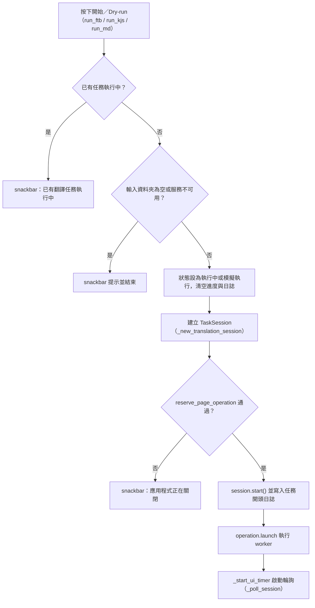
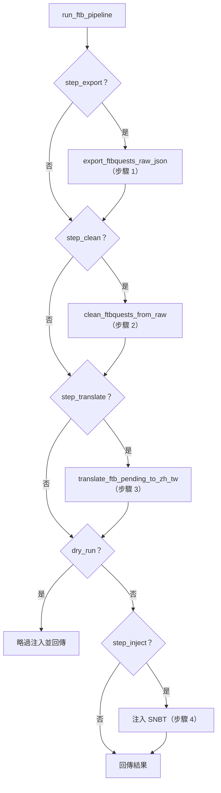
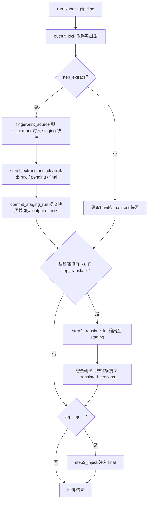
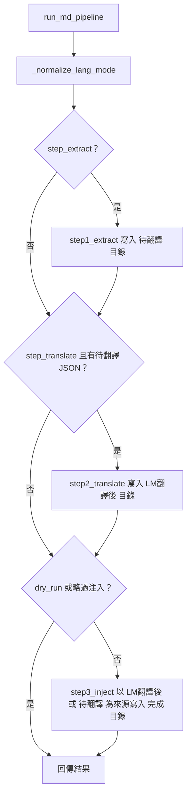

# 任務翻譯（`translation`）處理流程

> 入口：`app/views/translation_view.py` 的 `TranslationView`。詳細元件說明見 [`View 架構文件`](../developer-guide/views/TRANSLATION_VIEW_ARCHITECTURE.md)。

## 職責

- 提供三個流程分頁：FTB Quests、KubeJS Tooltips、Markdown。每個分頁都有路徑欄位、步驟勾選框與「開始翻譯／Dry-run／Reset」按鈕。
- 按下按鈕後，動作層（`app/views/translation/translation_actions.py`）建立 `TaskSession`、登錄頁面任務，並在背景執行緒呼叫對應的服務：
  - `app/services_impl/pipelines/ftb_service.py` 的 `run_ftb_translation_service`
  - `app/services_impl/pipelines/kubejs_service.py` 的 `run_kubejs_tooltip_service`
  - `app/services_impl/pipelines/md_service.py` 的 `run_md_translation_service`
- 服務層以 `resume_task` 包住整個任務（寫續跑標記），再由 `run_callable_task`（`_task_runner.py`）統一處理 session 生命週期與例外。
- 核心流程位於 `translation_tool/core/`：`ftb_translator.py` 的 `run_ftb_pipeline`、`kubejs_translator.py` 的 `run_kubejs_pipeline`、`md_translation_assembly.py` 的 `run_md_pipeline`。
- 支援續跑：`resume_interrupted(task)` 依任務類型切到對應分頁並還原選項。

## 主要流程

### 共通執行流程（三個分頁相同）

### FTB Quests 流水線（`run_ftb_pipeline`）

### KubeJS 流水線（`run_kubejs_pipeline`）

### Markdown 流水線（`run_md_pipeline`）

## 背景任務與 UI 更新

- 每次執行都會建立新的 `TaskSession`（`tag_session(..., "translation", page=...)`），並以 `reserve_page_operation(owner="translation")` 登錄。預設 `CancellationPolicy.COOPERATIVE`。
- `worker` 在背景執行緒中呼叫服務函式。服務層的 `run_callable_task` 會再次呼叫 `session.start()`，這是既有行為（`TaskSession.start()` 會重設狀態，可重入）。`finally` 內一定會呼叫 `session.finish()`。
- 只有在服務函式拋出未預期例外時，動作層的 `worker` 才會再補寫錯誤日誌、`set_error()` 與 `finish()`（`_report_service_failure` 會以 `session_task_scope` 把堆疊寫入後台）。
- UI 同步由 `_poll_session`（`translation_actions.py`）負責：在 Flet event loop 上每 0.2 秒讀取 `session.snapshot()`，更新 `ProgressRing`、`LogView` 與狀態晶片。`DONE` 或 `ERROR` 時停止輪詢、停用取消按鈕。
- 取消：`_on_cancel` 呼叫 `session.request_cancel()`，狀態改為「正在取消…」。翻譯迴圈在批次之間、等待 API 限流時檢查取消。
- 換頁卸載：`will_unmount` 呼叫 `stop_ui_timer`，只停止輪詢；任務仍在背景進行。`did_mount` 呼叫 `resume_ui_timer` 接續輪詢。

## 狀態與資料

- 頁面狀態：`session`、`_ui_timer_running`、`_poller`（`PollerHandle`）、`_step_cards`（步驟卡，reset 後用於刷新外觀）。
- 每個分頁的控制項以前綴區分：
  - FTB：`ftb_in_dir`、`ftb_out_dir`、`ftb_step_export`、`ftb_step_clean`、`ftb_step_translate`、`ftb_step_inject`、`ftb_write_new_cache`。
  - KubeJS：`kjs_in_dir`、`kjs_out_dir`、`kjs_source_mode`（`fresh` 或 `incremental`）、`kjs_step_extract`、`kjs_step_translate`、`kjs_step_inject`、`kjs_write_new_cache`。
  - Markdown：`md_in_dir`、`md_out_dir`、`md_step_extract`、`md_step_translate`、`md_step_inject`、`md_write_new_cache`、`md_lang_mode`（預設 `non_cjk_only`）。
- 續跑類型與分頁：`app/shell/app_shell.py` 的 `_RESUME_VIEW_BY_KIND` 將 `ftbquests`、`kubejs`、`md` 導向本頁。
- 續跑標記：`translation_tool/core/plugin_resume.py` 的 `resume_task` 在任務開始時寫入初始標記，之後由 adapter 逐批更新。只有正常結束、沒有錯誤或取消、且每個翻譯迴圈都 `DONE` 時才會清除。`marker_path(kind)` 決定標記位置。
- 產出資料夾：
  - FTB：`<輸出>/ftbquests/` 下的 `LM翻譯輸出`、`完成`。
  - KubeJS：`<輸出>/kubejs/` 下的 `raw`、`待翻譯`、`LM翻譯後`、`完成`，並保留快照狀態（`pipeline_state_root`）與 `translated-versions`。
  - Markdown：`<輸出>/md/` 下的 `待翻譯`、`LM翻譯後`、`完成`。
  - 未指定輸出時，預設為輸入資料夾下的 `Output`。
- 讀取的設定：翻譯步驟使用的快取與批次大小經由 `lm_translator` 相關設定；UI 日誌行數固定為 250。

## 錯誤處理

- 前置檢查失敗（未選輸入、服務模組載入失敗、`TaskSession` 不可用、應用程式關閉中）以 snackbar 提示，不啟動任務。
- 服務模組載入失敗（匯入時）會在 `log_error` 記錄完整堆疊，該分頁的功能保持不可用，頁面仍可開啟。
- FTB 步驟 3 需要步驟 2 產出 `en_pending_dir`，否則拋出 `RuntimeError`；步驟 4 找不到 zh_tw JSON 時拋出 `FileNotFoundError`。
- KubeJS 翻譯輸出不完整時拋出 `RuntimeError`，不提交翻譯快照。
- MD 的 `run_md_pipeline` 在輸入資料夾不存在時拋出 `FileNotFoundError`。
- 服務內的 `run_callable_task` 捕捉例外：`TaskCancelled` 記錄「任務已取消」並回傳 `None`；其他例外寫入任務日誌（FTB、MD）或後台 log（KubeJS），並呼叫 `set_error()`。
- 取消時，`session.cancel_requested` 為真，續跑標記保留，畫面顯示「已取消」。
- 錯誤摘要顯示在任務日誌中，完整堆疊寫入後台 log（`translation_tool/utils/log_unit.py`）。
