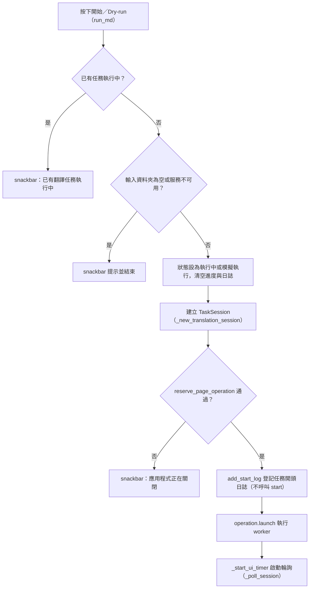
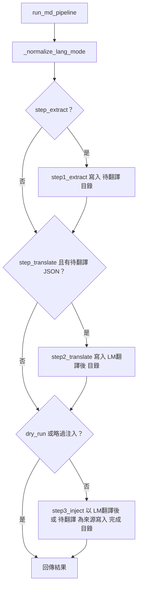

# 任務翻譯（`translation`）處理流程

> 入口：`app/views/translation_view.py` 的 `TranslationView`。詳細元件說明見 [`View 架構文件`](../developer-guide/views/TRANSLATION_VIEW_ARCHITECTURE.md)。

## 職責

- 本頁只處理 Markdown 文件翻譯。頁面有路徑欄位、步驟勾選框與「開始翻譯／Dry-run／Reset」按鈕。
- FTB Quests 與 KubeJS 翻譯已移到 [`KubeJS / FTB 流水線`](kubejs_ftb_pipeline.md) 頁，該頁提供與一鍵製作相同的「預覽 → 確認 → 發布」流程。
- 按下按鈕後，動作層（`app/views/translation/translation_actions.py`）建立 `TaskSession`、登錄頁面任務，並在背景執行緒呼叫 `app/services_impl/pipelines/md_service.py` 的 `run_md_translation_service`。
- 服務層以 `resume_task` 包住整個任務（寫續跑標記），再由 `run_callable_task`（`_task_runner.py`）統一處理 session 生命週期與例外。
- 核心流程位於 `translation_tool/core/md_translation_assembly.py` 的 `run_md_pipeline`。
- 支援續跑：`resume_interrupted(task)` 還原上次的 Markdown 輸入與選項後開始。

## 主要流程

### 共通執行流程

### Markdown 流水線（`run_md_pipeline`）

Markdown 抽取階段已把色碼與物品 ID 換成佔位符並記在待翻譯 JSON 的 `_shields`；翻譯輸出的逐檔 JSON 必須原樣帶回 `_shields`（`PendingItem.shields`），注入階段才能還原。`translation_map_md.json` 是翻譯記錄，注入不會把它當成待注入檔。

Markdown 只有 `DONE` 才能把翻譯結果寫入完成目錄；`PARTIAL`、`FAILED`、`CANCELLED` 不使用 pending JSON 當作完成輸出，也不執行最終注入。

## 背景任務與 UI 更新

- 每次執行都會建立新的 `TaskSession`（`tag_session(..., "translation", page=...)`），並以 `reserve_page_operation(owner="translation")` 登錄。預設 `CancellationPolicy.COOPERATIVE`。
- `worker` 在背景執行緒中呼叫服務函式。`session.start()` 只由服務層的 `run_callable_task` 呼叫一次（單一 owner，一次執行只有一個 task ID 與一組開始／結束紀錄）；動作層用 `add_start_log` 預先登記開頭日誌，`start()` 清空日誌後會放回。`finally` 內一定會呼叫 `session.finish()`。
- 只有在服務函式拋出未預期例外時，動作層的 `worker` 才會再補寫錯誤日誌、`set_error()` 與 `finish()`（`_report_service_failure` 會以 `session_task_scope` 把堆疊寫入後台）。
- UI 同步由 `_poll_session`（`translation_actions.py`）負責：在 Flet event loop 上每 0.2 秒讀取 `session.snapshot()`，更新 `ProgressRing`、`LogView` 與狀態晶片。`DONE` 或 `ERROR` 時停止輪詢、停用取消按鈕；模擬執行（`run_md` 記在 `view._run_dry_run`）結束時狀態為「模擬完成（未翻譯）」，正式執行為「任務完成」。
- 取消：`_on_cancel` 呼叫 `session.request_cancel()`，狀態改為「正在取消…」。翻譯迴圈在批次之間、等待 API 限流時檢查取消。
- 換頁卸載：`will_unmount` 呼叫 `stop_ui_timer`，只停止輪詢；任務仍在背景進行。`did_mount` 呼叫 `resume_ui_timer` 接續輪詢。

## 狀態與資料

- 頁面狀態：`session`、`_ui_timer_running`、`_poller`（`PollerHandle`）、`_step_cards`（步驟卡，reset 後用於刷新外觀）。
- Markdown 控制項：`md_in_dir`、`md_out_dir`、`md_step_extract`、`md_step_translate`、`md_step_inject`、`md_write_new_cache`、`md_lang_mode`（預設 `non_cjk_only`）。
- 續跑類型與分頁：`app/shell/app_shell.py` 的 `_RESUME_VIEW_BY_KIND` 將 `md` 導向本頁。FTB Quests 與 KubeJS 的續跑標記已不再被提示。
- 續跑標記：`translation_tool/core/plugin_resume.py` 的 `resume_task` 在任務開始時寫入初始標記，之後由 adapter 逐批更新。只有正常結束、沒有錯誤或取消、且每個翻譯迴圈都 `DONE` 時才會清除。`marker_path(kind)` 決定標記位置。
- 產出資料夾：`<輸出>/md/` 下的 `待翻譯`、`LM翻譯後`、`完成`。未指定輸出時，預設為輸入資料夾下的 `Output`。
- 讀取的設定：翻譯步驟使用的快取與批次大小經由 `lm_translator` 相關設定；UI 日誌行數固定為 250。

## 錯誤處理

- 前置檢查失敗（未選輸入、服務模組載入失敗、`TaskSession` 不可用、應用程式關閉中）以 snackbar 提示，不啟動任務。
- 服務模組載入失敗（匯入時）會在 `log_error` 記錄完整堆疊，Markdown 功能保持不可用，頁面仍可開啟。
- MD 的 `run_md_pipeline` 在輸入資料夾不存在時拋出 `FileNotFoundError`。
- 服務內的 `run_callable_task` 捕捉例外：`TaskCancelled` 記錄「任務已取消」並回傳 `None`；其他例外寫入任務日誌並呼叫 `set_error()`。
- 取消時，`session.cancel_requested` 為真，續跑標記保留，畫面顯示「已取消」。
- 錯誤摘要顯示在任務日誌中，完整堆疊寫入後台 log（`translation_tool/utils/log_unit.py`）。
