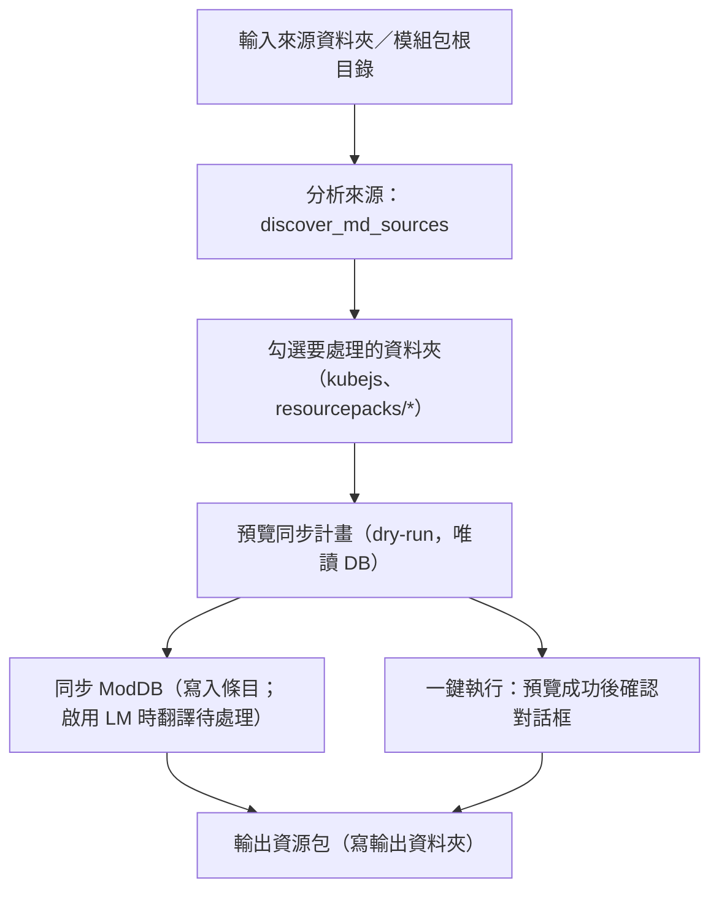

# 任務翻譯（`translation`）處理流程

> 入口：`app/views/translation_view.py` 的 `TranslationView`。詳細元件說明見 [`View 架構文件`](../developer-guide/views/TRANSLATION_VIEW_ARCHITECTURE.md)。

## 職責

- 頁面有三個翻譯來源分頁：**FTB Quests**、**KubeJS Tooltips**、**Markdown**，三者都是同一種流水線工作台（來源分析 → ModDB 同步 → LM 翻譯 → 輸出）。
- FTB Quests 與 KubeJS 分頁直接使用 [`KUBEJS / FTB 流水線`](kubejs_ftb_pipeline.md) 的同一個元件（`KubejsFtbPipelineView`，`embedded=True`），不在本頁另外維護。
- Markdown 分頁是 `MarkdownPipelineView`（`app/views/md_pipeline_view.py`），後端為 `translation_tool/translation_db/md_pipeline.py`，說明見 [Markdown ModDB 流水線](../developer-guide/md-moddb-pipeline.md)。
- 本頁沒有自己的背景任務：各分頁各自建立 `TaskSession`、向 `OperationRegistry` 登錄並輪詢；換頁卸載只停止輪詢，任務照常進行。
- 舊版 Markdown 三步驟任務的續跑資料：`resume_interrupted(task)` 只切到 Markdown 分頁並提示重新執行流水線（已翻譯的內容在 ModDB 或翻譯快取內，會沿用）。

## Markdown 分頁流程

- 來源探索：選到模組包根目錄時列出 `kubejs` 與 `resourcepacks/<包>`（底下要有 `assets`）；其他資料夾直接掃描。每個勾選的資料夾各跑一次，摘要合併。
- 條目、輸出路徑與人工修改保護的規則見 [Markdown ModDB 流水線](../developer-guide/md-moddb-pipeline.md)。
- Oracle Index 書（`assets/oracle_index/books/<書>/`）的 `.mdx` 頁面與 `_meta.json` 選單名稱也在掃描範圍；譯文輸出到 `<書>/translated/zh_tw/`，路徑與配對規則見 [Oracle Index 書籍的路徑契約](../developer-guide/oracle-index-books.md)。
- 「讀取 zh_cn 檔」勾選的初始值取自設定 `translator.md_use_zh_cn_base`（預設開）；每次執行以畫面勾選為準。
- 「LM 翻譯待處理」只翻本次來源涉及模組的指南條目；Mod 資料庫設定關閉時略過 LM 翻譯，只輸出 DB 既有譯文。

## 背景任務與 UI 更新

- 每次執行建立新的 `TaskSession`，以 `launch_page_operation` 啟動；應用程式關閉中時不啟動並提示。
- 服務層 `run_md_pipeline_service` 是 `session.start()` 的 owner，`finally` 一定呼叫 `session.finish()`；例外寫入任務日誌並 `set_error()`。
- 畫面定時讀 `session.snapshot()` 更新進度、日誌與狀態晶片；`DONE`／`ERROR` 時停止輪詢。
- 取消：`session.request_cancel()`，服務在階段之間、掃描迴圈與輸出迴圈（每 50 檔）檢查取消；輸出階段取消時，已寫出的檔案會保留，但不會補寫 `pack.mcmeta`。

## 狀態與資料

- 讀取的設定：`translator.md_use_zh_cn_base`（勾選初始值）、Mod 資料庫設定（`load_db_settings`）。
- 輸出：`<輸出資料夾>/<來源相對路徑，語言資料夾換成 zh_tw>`，資源包結構時附 `pack.mcmeta`，另有 `.md_output_hashes.json` 記錄寫入內容雜湊。

## 錯誤處理

- 前置檢查失敗（已有流水線執行中、沒有來源、沒勾選資料夾、沒有版本、發布缺輸出資料夾）以 snackbar 提示，不啟動任務。
- 段落數對不上的譯文檔、多個來源會寫到同一個輸出等情況記為掃描提醒，狀態顯示「完成但有警告」。
- 輸出資料夾位於來源資料夾內時拋出 `MdPipelineError`。
- 例外由服務層捕捉：`TaskCancelled` 記錄「流水線已取消」；其他例外寫任務日誌並呼叫 `set_error()`，完整堆疊寫入後台 log。
